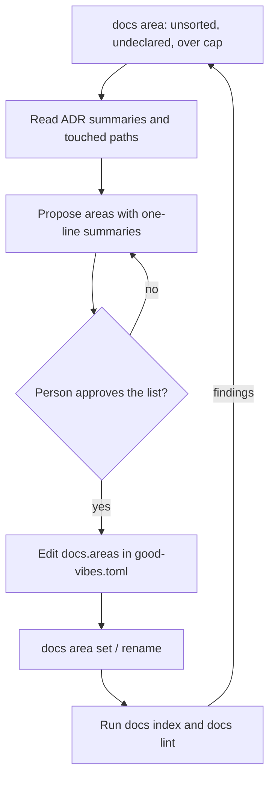

# Reorganize ADR areas

Give every decision doc a home in a small, stable area list. The binary reports and applies; you propose the list, and a
person approves it before anything changes.



## When to run it

Run it when `good-vibes docs area` shows work to do:

- **Unsorted ADRs.** They carry no `area` and land in `areas/unsorted.txt` until they get one.
- **Undeclared areas.** An ADR names an area that `docs.areas` no longer declares, usually after a rename.
- **Oversize areas.** Lint's `area-size` warning says a declared area holds more live ADRs than
  `docs.lint.area_max_live` (25 by default).
- **A changed project shape.** New subsystems arrive, or old ones merge, and the current names no longer tell a reader
  where to look.

A repo that declares no areas is not behind. Declaring the first area turns on the rule: from then on every ADR needs a
declared area, every `replaces` id must resolve, and the map splits into the top map plus one map per area.

## 1. Read the status

```sh
good-vibes docs area
good-vibes docs area --json
```

The text view lists each declared area with live and replaced counts and an `over` flag, then the unsorted ids, then
each undeclared area with its ids. `--json` prints the same as `areas`, `unsorted`, and `undeclared`, with `over_cap` on
each area, for a script or a quick read.

## 2. Read the decisions

For each ADR that needs a home, read its `summary` and its `touched` paths. Group by the subject a reader would look
for, not by the folder a file happens to live in.

```sh
good-vibes docs list --type decision
good-vibes docs for <path>
```

Aim for a handful to a dozen areas. Too few rebuilds one flat bucket; too many scatter the map. Prefer a name a person
would say out loud, and check that each area's live count stays under the cap.

## 3. Propose the list

Write the proposal as a short table with one line per area:

| Area | Summary | ADRs |
|---|---|---|
| `herdr` | The herdr app, its panes, and how runs appear in it. | `adr-herdr-panel`, `adr-herdr-board` |

Say which ADRs move from where, and why an oversize area splits. Ask a person to approve the list and its summaries
before editing config.

## 4. Declare the areas

Edit `good-vibes.toml`:

```toml
[docs.areas.herdr]
summary = "The herdr app, its panes, and how runs appear in it."
```

`summary` is one plain sentence that becomes the area's line in the top map, under `docs.lint.summary_max`. Each table
name is the slug an ADR carries in `area`: lowercase letters, digits, and hyphens. Declare the new area before moving
ADRs into it.

## 5. Apply the moves

Move named ADRs into a declared area:

```sh
good-vibes docs area set herdr adr-herdr-panel adr-herdr-board
```

Move every ADR from one area to another:

```sh
good-vibes docs area rename old-name herdr
```

Both commands check the area and every id before writing, so a bad argument writes nothing. Both rewrite only the `area`
line; every other key and the body stay byte for byte. Renaming onto an area that already holds ADRs merges the two. To
split an area, declare the new one and use `set` with the ids that move. After a rename, drop the old table from config:
nothing else reads it.

## 6. Mark replaced ADRs

An ADR is live while no other ADR lists it in `replaces`. When a newer ADR's prose says it supersedes an older one, set
the key by hand on the newer ADR:

```yaml
replaces: [adr-herdr-panel]
```

Use the ADR id, the same form `related` uses. Lint fails an unknown id, a non-decision id, and an ADR that names itself.
Never edit the older ADR to mark it replaced; the map computes that.

## 7. Clean up

```sh
good-vibes docs index
good-vibes docs lint
```

`docs index` rewrites the top map and each area map, and deletes an `areas/<name>.txt` left behind by a removed area.
`docs lint` reports any remaining `area`, `replaces`, or `area-size` finding. Close with no findings.

## Rules

- Touch only the `area` and `replaces` front matter lines. Leave the body, title, summary, and other keys alone.
- Let a person approve the area list and its summaries before you write config or move ADRs.
- Keep `good-vibes.toml`'s unrelated tables and comments. Add or remove the `[docs.areas.<name>]` tables the plan needs.
- Work inside a change so the person reviews the config edit and every moved ADR.
