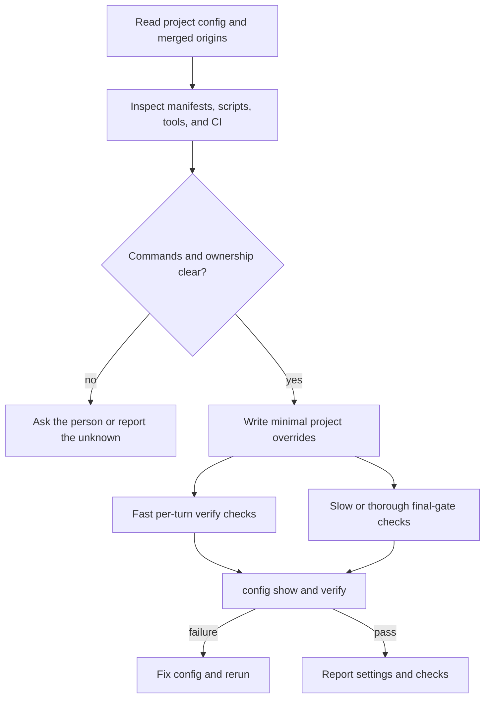

# Configure good-vibes

Write only the project configuration this repository needs. The full key reference is `docs/reference/config.md` in the
good-vibes repository.

## Steps

1. Read `good-vibes.toml` and run `good-vibes config show --origin`. The origin view says which layer supplied each
   value. Preserve unrelated settings and comments, and edit only the project config. Do not copy user, local,
   environment, or profile values into it, and do not flatten those layers.
2. Inspect the repository before choosing commands. Read manifests, lockfiles, package scripts, tool configuration, and
   CI workflows. Find the commands the project already uses for lint, format, test, type-check, and build. Do not assume
   a language, and do not copy a starter or reference example until you have checked it against the repository. Every
   active `run` must be a command this project can execute, never a placeholder such as `./path/to`.
3. Write only intentional overrides. Keep the per-turn `[implement.verify]` gate fast and deterministic: commands that
   finish quickly, need no network, and give stable results. Put broad suites, race detectors, expensive builds, and
   other slow or thorough commands in `[implement.final.verify]`. Do not turn on an empty gate or add a check that
   repeats another.
4. Give every check a unique `name` and a full `run`. Add `quick` only when a useful fast form exists for the worker. It
   is guidance, so it may contain a location the worker narrows, but it must otherwise be a real command. Add `paths`
   only when they state the real dependency boundary, including every input, output, config file, and fixture. Omitted
   or empty `paths` mean always run; that is safer than a guessed filter.
5. Set `fix = true` on every check that may write. Keep fixing checks before reading checks, because fixers run first in
   config order. A fixing check's `paths` must cover every file it reads and every file it may add, change, or delete.
   Do not mark a read-only check as a fixer.
6. Validate the result:
   - `good-vibes config show` must load the merged config.
   - Run the per-turn checks with `good-vibes verify`. Use `good-vibes verify --exec -- <command>` when you need a
     final-only command in the run environment.
   - Exercise a final-only command directly when no run owns the worktree.
   - Never report a command as tested when you did not run it.

Report the settings you wrote and which checks run per turn versus at the final gate. Leave a real project failure
visible instead of weakening or deleting a check to make it pass.
