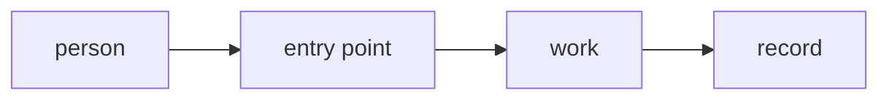
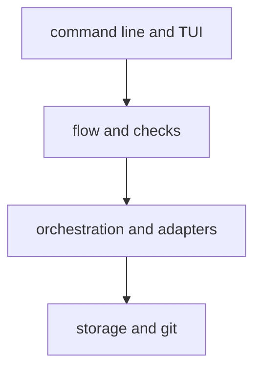
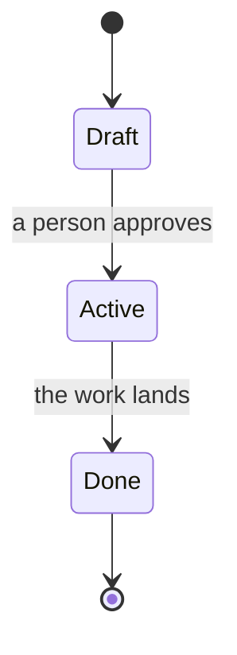
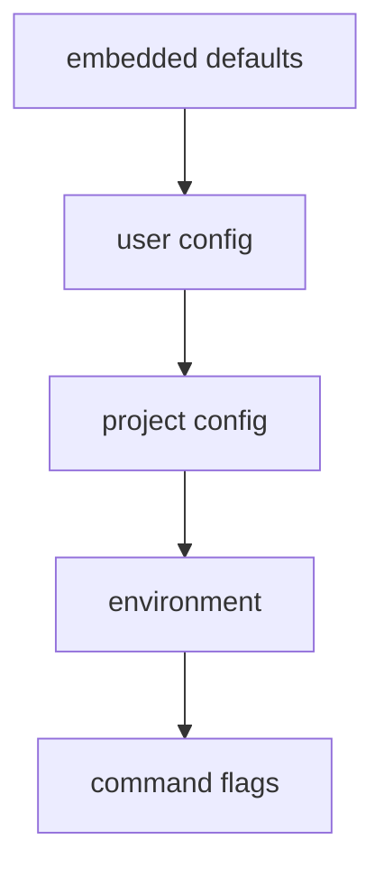
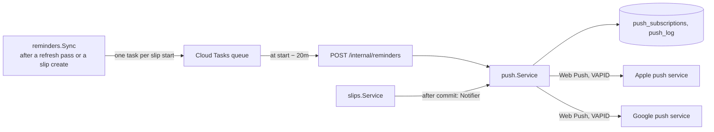

# Architecture

<!--
  The whole system on one page, as diagrams. Keep each diagram to one idea and label nodes with modules, not files or
  functions, so a rename inside a package does not break the doc. Each section opens with a diagram. Prose only adds
  what a diagram cannot carry: the reason behind a boundary, or a link down to a concept doc.
-->

## Overview

<!-- Caption: the main flow end to end, as a person and an agent move through it. -->

## Code map

<!--
  Caption: packages by layer. Split the map when one diagram would carry more than one idea. Arrows show who calls
  whom; a dashed arrow or note says what a layer must never do.
-->

## Invariants

<!-- Caption: the lifecycles and ownership rules. Each "never" or "always" is an edge label or a note. -->

## Cross-cutting concerns

<!--
  Caption: one small diagram per concern: config layers, harness adapters, git and worktree safety, and the like. Add
  an H3 with its own diagram for each concern this project has.
-->

### Outbound push and timed reminders

<!--
  Caption: every way a phone hears from the server. Slip events leave after the commit, inside the request that caused
  them. Reminders wait in Cloud Tasks and recheck SQLite when they fire.
-->

Two paths reach the same sender. Slip events (`legs_added`, `slip_locked`, `slip_graded`) go out after the commit,
inside the request that caused them, because Cloud Run throttles CPU once the response is written. Reminders cannot wait
on a request: `reminders.Sync` gives every open slip one Cloud Tasks task at its fixed first kickoff minus 20 minutes,
so the instance can scale to zero between page loads and nothing polls.

When a task fires, the endpoint rechecks the slip, its start, the fire window, and each member's next step from SQLite.
A stale task is harmless, so `Sync` never deletes one. `push_log` reserves each send before it happens, which keeps a
Cloud Tasks retry from doubling a nudge. `LocalTimers` stands in for the queue on a dev server, and sandbox mode wires
no scheduler at all because its clock is frozen. See [Notifications](docs/concepts/notifications.md).

