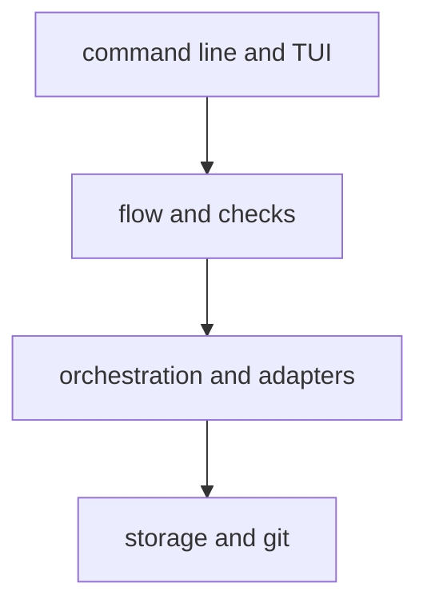
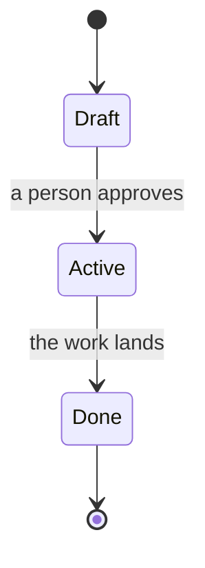
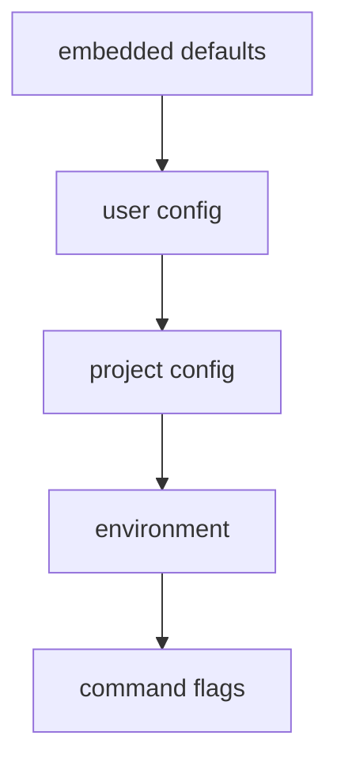

# Architecture

<!--
  The whole system on one page, as diagrams. Keep each diagram to one idea and label nodes with modules, not files or
  functions, so a rename inside a package does not break the doc. Each section opens with a diagram. Prose only adds
  what a diagram cannot carry: the reason behind a boundary, or a link down to a concept doc.
-->

## Overview

<!-- Caption: the main flow end to end, as a person and an agent move through it. -->

## Code map

<!--
  Caption: packages by layer. Split the map when one diagram would carry more than one idea. Arrows show who calls
  whom; a dashed arrow or note says what a layer must never do.
-->

## Invariants

<!-- Caption: the lifecycles and ownership rules. Each "never" or "always" is an edge label or a note. -->

## Cross-cutting concerns

<!--
  Caption: one small diagram per concern: config layers, harness adapters, git and worktree safety, and the like. Add
  an H3 with its own diagram for each concern this project has.
-->

