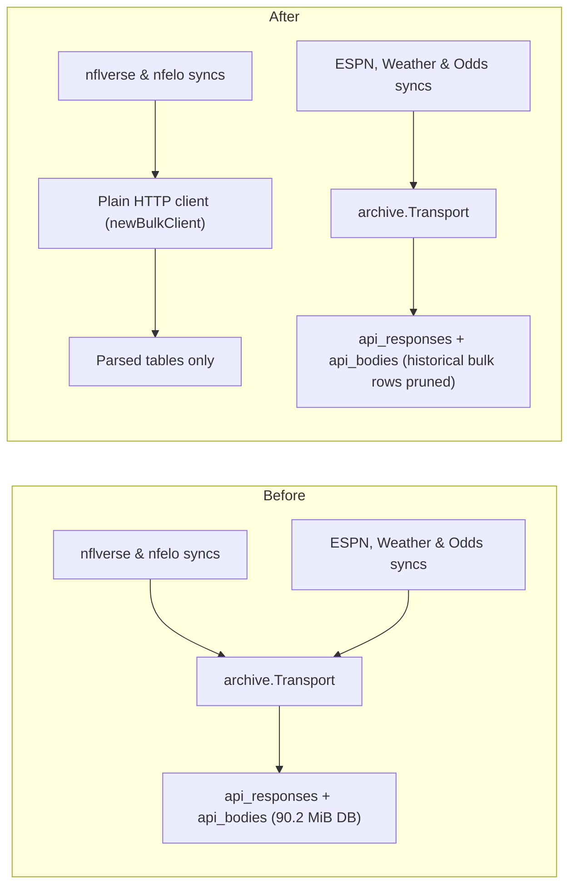

# Close-out

## Overview

## Consequences

- **Easier:** Cloud Run cold starts and Litestream GCS restores handle a much smaller SQLite database instead of a 90+ MiB file, keeping memory usage well below the 512 MiB limit.
- **Easier:** Client construction in `cmd/server/main.go` controls which sources skip raw archiving without coupling `archive.Transport` to source-name policy.
- **Harder:** Raw HTTP responses for `nflverse` and `nfelo` can no longer be inspected or replayed from `api_bodies`; only the latest parsed rows remain in their tables.
- **Revisit:** Revisit if offline evals ever need raw `nflverse` or `nfelo` byte replay, or if another high-churn bulk source is added and needs `newBulkClient`.

## Alternatives considered

- **Raise Cloud Run memory or add a scheduled pruning job:** Rejected because both add ongoing cost and operational complexity to store raw CSV snapshots that nothing in production or evals reads.
- **Keep only the latest `nflverse` and `nfelo` body in `api_bodies`:** Rejected because even a single copy of the bulk CSVs adds unnecessary megabytes to the in-memory SQLite database when parsed tables already hold every field the app uses.
- **Filter excluded sources inside `archive.Transport`:** Rejected because `archive.Transport` would still buffer multi-MB responses before discarding them and would bake source-name policy into a generic HTTP wrapper.

## Implementation notes

- The design used `0024_prune_bulk_archive.sql` as an example name; the migration shipped as `0022_prune_bulk_archive.sql`.
- Deleting rows in SQLite marks pages as reusable without shrinking the file on disk, and `VACUUM` cannot run inside a migration transaction. The database file and Litestream snapshots will not shrink until a manual `VACUUM` runs.

## Follow-ups

- Run `sqlite3 "$DB_PATH" "VACUUM;"` in production during a quiet maintenance window after deploying migration `0022_prune_bulk_archive.sql` to reclaim freed SQLite pages and shrink Litestream snapshots.
