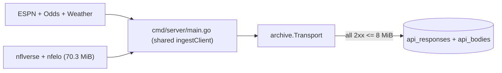
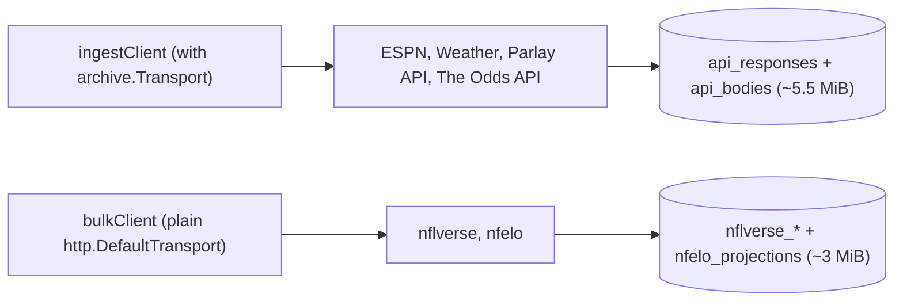

# Design: Trim raw archive bloat from nflverse and nfelo

## Context

In `cmd/server/main.go`, a single `ingestClient` wraps `http.DefaultTransport` with
`archive.NewTransport(http.DefaultTransport, store, nil)` and is shared by every ingest client: ESPN, Open-Meteo, Parlay
API, The Odds API, `nfelo.NewClient`, and `nflverse.NewClient`. `archive.Transport.RoundTrip` reads every 2xx response
up to `MaxBodySize` (8 MiB), computes its SHA-256, gzips it, and writes it to `api_bodies` and `api_responses` via
`db.Store.SaveAPIResponse`.

Meanwhile:

- `internal/refresh` already parses `nflverse` and `nfelo` responses and upserts them in place into
  `nflverse_player_weeks`, `nflverse_team_weeks`, `nflverse_player_ids`, and `nfelo_projections` (~3 MiB total).
- Offline eval replay (`internal/eval/replay.go`) only reads ESPN (`espn:summary:*`, `espn:roster:*`, `espn:gamelog:*`)
  and Odds (`odds:lines`, `odds:props:*`) from `api_responses`/`api_bodies`. It reads nflverse directly from the parsed
  week-keyed tables and never reads `nfelo` from the archive.
- `cmd/server/main_test.go` (`TestRefreshArchivesEveryIngestCall`) asserts which sources land in `api_responses`.

## Approach

### 1. Skip raw archiving for `nflverse` and `nfelo` at the transport seam

Add an explicit `Source` exclusion check in `internal/ingest/archive` (for example, `WithExcludedSources(...)` or a
default skip list / dedicated unarchived `*http.Client` for bulk datasets). Putting the skip check in
`archive.Transport` (keyed by `sourceForKey(key, host)`) OR wiring `nfelo.NewClient` and `nflverse.NewClient` in
`cmd/server/main.go` with a plain `*http.Client` (no `archive.Transport`) both work;
**giving `nfelo` and `nflverse` a dedicated plain `*http.Client` in `cmd/server/main.go`** is simpler, avoids reading up
to 8 MiB into memory in `Transport.RoundTrip` just to discard it, and keeps `archive.Transport` pure and generic.

Trade-off: Keeping `archive.Transport` untouched avoids baking source-name policy into a generic HTTP wrapper, while
`cmd/server/main.go` makes the boundary explicit where clients are constructed.

### 2. Prune existing `nflverse` and `nfelo` rows via a one-time migration and runbook update

Add a forward SQLite migration (for example, `0024_prune_bulk_archive.sql`) that deletes historical `nflverse` and
`nfelo` rows from `api_responses` and then deletes orphaned rows from `api_bodies`
(`WHERE sha256 NOT IN (SELECT body_sha256 FROM api_responses)`). Because SQLite `VACUUM` cannot run inside a migration
transaction, document the post-deploy `VACUUM` (or run `PRAGMA incremental_vacuum` / maintenance-window `VACUUM` per
`docs/runbooks/archive-size.md`) so the freed pages are returned to the OS and Litestream snapshots drop from ~90 MiB to
~15–20 MiB.

Update `docs/concepts/archive.md`, `docs/reference/data-sources.md`, and `docs/runbooks/archive-size.md` to state that
bulk season datasets (`nflverse` and `nfelo`) upsert directly into their parsed tables and are excluded from the raw
HTTP archive.

## Verification

- `go test -short ./... && golangci-lint run ./...`
- Verify in `cmd/server/main_test.go` that a full refresh pass archives ESPN, Weather, and Odds responses while leaving
  zero `nflverse` or `nfelo` rows in `api_responses` and `api_bodies`, and still populates `nflverse_*` and
  `nfelo_projections`.
- Verify in `internal/db/migrate_test.go` that the new migration removes `nflverse` and `nfelo` rows from
  `api_responses` and orphaned `api_bodies` while preserving `espn`, `odds`, and `weather` archive rows.
- Verify offline eval replay (`go test ./internal/eval/...`) continues to pass without `nflverse` or `nfelo` in
  `api_bodies`.

## Risks

- **Accidental exclusion of ESPN or Odds:** If `ingestClient` wiring were changed broadly, eval replay would lose
  pre-kickoff snapshots. Mitigated by keeping `ingestClient` unchanged for ESPN, Weather, and Odds and asserting their
  presence in `TestRefreshArchivesEveryIngestCall`.
- **Freed pages not shrinking file size immediately:** Deleting rows frees SQLite pages for reuse without shrinking the
  file on disk until `VACUUM` runs. Mitigated by documenting the one-time `VACUUM` step in the archive-size runbook and
  running it during a quiet window after deploy.

## TODO

### Phase 1: Exclude nflverse and nfelo from raw archiving and prune existing bloat

Complexity: low (localized to `cmd/server/main.go` client wiring, one SQL migration, and existing archive/migration
tests).

Risk: low (no production route reads `api_bodies`, and automated server and eval tests verify ESPN and Odds archiving
remains intact).

- [x] Wire `nfelo.NewClient` and `nflverse.NewClient` in `cmd/server/main.go` with a non-archiving `*http.Client`
      (preserving timeout and `User-Agent`), and update `cmd/server/main_test.go` (`TestRefreshArchivesEveryIngestCall`)
      to assert that `espn`, `weather`, and `odds` are archived while `nflverse` and `nfelo` are not.
- [x] Add a SQLite migration in `internal/db/migrations/` to delete `source IN ('nflverse', 'nfelo')` from
      `api_responses` and orphaned rows from `api_bodies`, with a migration test in `internal/db/migrate_test.go`
      confirming ESPN and Odds archive rows survive intact.
- [x] Docs: update `docs/concepts/archive.md`, `docs/reference/data-sources.md`, and `docs/runbooks/archive-size.md` to
  document the bulk-source exclusion and post-deploy `VACUUM` step.

## Reviews

- [x] Final review: agy@gemini-4-neon-low
