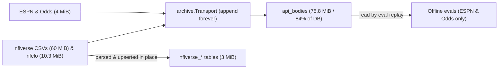
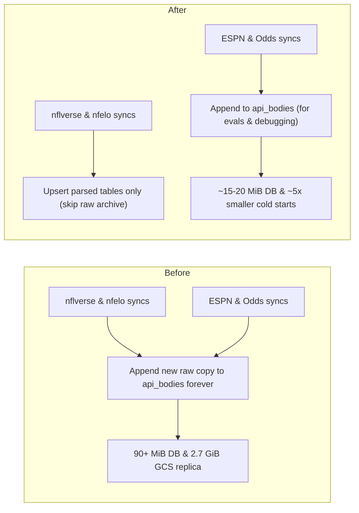

# Trim raw archive bloat from nflverse and nfelo

## Context

The production SQLite database (`backups/parlay-2026-11-27.db`) has grown to 90.2 MiB, and Litestream's GCS replica
directory is 2.7 GiB because every Cloud Run cold start restores and re-uploads a full ~90 MiB snapshot.

84% of the database (75.8 MiB) sits in `api_bodies`, the append-only raw HTTP response archive. Every ingest client
shares `archive.Transport`, which gzips and permanently appends every 2xx response up to 8 MiB keyed by SHA-256. Each
time nflverse updates its season CSVs or nfelo updates projections, the bytes change and a brand-new multi-MB copy is
appended forever:

- `nflverse:season:2026`: **60.0 MiB** gzipped (217.6 MB raw across 32 unique bodies) — 67% of the entire database.
- `nfelo:projections`: **10.3 MiB** gzipped (46.0 MB raw across 20 unique bodies) — 11% of the entire database.
- All parsed app tables combined (`odds`, `nflverse_player_weeks`, `games`, `slips`, `legs`, `roster_players`) take only
  ~14 MiB.

Neither `nflverse` nor `nfelo` raw bodies are read anywhere in production or offline evals. Production routes never read
`api_bodies`, and offline eval replay only reads ESPN (`summary`, `roster`, `gamelog`) and Odds (`lines`, `props`) from
the archive while reading nflverse directly from its week-keyed parsed tables. Because Cloud Run runs with 512 MiB of
RAM and holds `/data/parlay.db` in memory, letting unused raw archives grow risks hitting the memory ceiling and slows
down every cold start.

## Goals and non-goals

**Goals:**

- Stop archiving raw HTTP bodies for sources that are already parsed into week-keyed tables and never replayed from raw
  bytes (`nflverse` and `nfelo`), or retain at most the single latest body if debugging needs it.
- Prune existing orphaned/historical `nflverse` and `nfelo` rows from `api_responses` and `api_bodies` and reclaim space
  (bringing the production database from ~90 MiB down to ~15–20 MiB).
- Preserve full append-only archiving for ESPN (`scoreboard`, `summary`, `roster`, `gamelog`) and Odds (`lines`,
  `props`, `theoddsapi`) so offline eval replay and link debugging keep working unchanged.

**Non-goals:**

- Removing the raw response archive for ESPN or Odds API responses.
- Moving the archive to a separate database or adding a background cron job.
- Changing how `nflverse_*` or `nfelo` parsed tables are structured or queried.

## Decision

Exclude bulk static/season datasets (`nflverse` and `nfelo`) from `api_bodies` archiving (keeping their parsed tables
updated in place) and run a one-time cleanup/vacuum of historical `nflverse` and `nfelo` archive rows.

This beats raising Cloud Run memory or adding a scheduled pruning job, which both pay ongoing complexity and cost to
store raw CSV snapshots that nothing in the app or eval suite ever reads. It also beats replacing `nflverse` in-place in
`api_bodies`, because even a single latest copy of all five nflverse files still adds unnecessary megabytes to the
in-memory SQLite file when the parsed tables already hold every field the app uses.

- **Complexity: low** — Localized to archive transport wiring/filtering and a straightforward cleanup path, with clear
  existing invariants for which sources eval replay reads.
- **Risk: low** — No production feature reads `api_bodies`, offline evals are covered by automated replay tests, and
  excluding only `nflverse` and `nfelo` leaves ESPN and Odds archives untouched.
