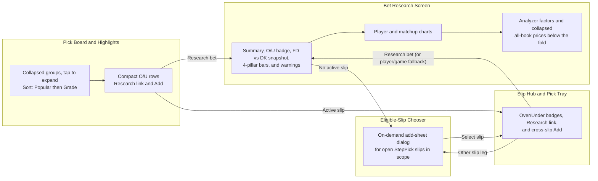

# Close-out

## Overview

## Consequences

- **Easier:** Scanning pick-board categories on a phone, since groups start collapsed and star players surface first under popularity sorting.
- **Easier:** Spotting Over/Under lean across the pick board, pick tray, slip hub, and bet research header via hoisted lines and semantic `OVER`/`UNDER` badges.
- **Easier:** Jumping from any bet surface (pick board, highlights, slip legs, research cards, related bets) to `/research/bet` or adding a leg to any eligible open slip.
- **Easier:** Reading FanDuel and DraftKings prices, visual pillar bars, and analyzer warnings before scrolling into full-market tables.
- **Harder:** Modifying pick-board row templates, because `Research` links and `
` grade popovers must stay outside `<form>` and `<button>` elements while preserving `closest .pick-line-group` HTMX swaps.
- **Revisit:** Popularity scoring weights if early-season or backup-player props rank poorly when cached usage data is sparse.

## Alternatives considered

- **Pagination or infinite scroll vs. collapsed `
` groups:** Rejected pagination and infinite scroll because collapsed `
` keeps every group and count visible in one viewport with zero extra requests, while a small JS hook preserves `[data-keep-open]` sections across same-game HTMX swaps.
- **Server-toggled collapse vs. native `
`:** Rejected server-driven collapse to avoid a network round trip on every group tap.
- **Smaller text on two-button O/U cards vs. hoisted compact O/U rows:** Rejected shrinking fonts because hoisting the shared market and line out of both buttons cuts duplicate text without squeezing phone tap targets.
- **Alphabetical default or click-tracking popularity vs. deterministic cached-signal popularity:** Rejected alphabetical sorting because bench players appeared before stars, and rejected click tracking to avoid new database state and keep ranking deterministic with zero extra API calls.
- **Removing non-FD/DK books vs. collapsing them below the fold:** Rejected removing other books so sharp-book and full-market prices stay one tap away below the primary FD/DK and visual summary.
- **Pre-rendering eligible slips on every card vs. on-demand `GET /bets/add-sheet`:** Rejected computing per-game slip eligibility for every Research Explorer card up front to keep card HTML small and share one server eligibility check.

## Implementation notes

- Query parsing and sort chips in the pick handler already derived from `board.DetailSorts` and `board.Detail`, so adding `SortPopular` required no routing or query-parser changes.
- The design named the pick-tray leg struct `PickTrayLegView`, whereas the codebase uses `TrayLegView`; the O/U badge fields were added to `TrayLegView` directly.
- Server-rendered HTML and handler tests verified markup, sorting, HTMX targets, and slip-eligibility filtering, but live 390px phone-width layout and touch ergonomics across light and dark themes were not verified in a browser.

## Follow-ups

- Run a manual 390px phone-width browser check across light and dark themes covering collapsed groups, same-game SSE/HTMX open-state preservation, compact O/U tap targets, bet research fold order, and the `#bet-add-dialog` chooser.
