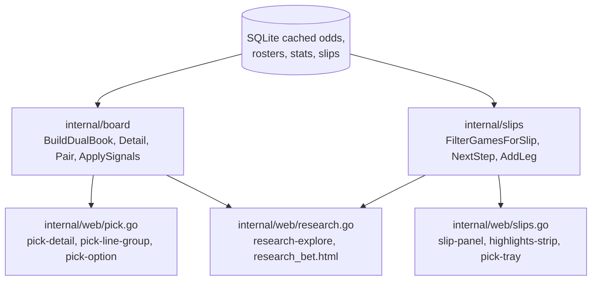
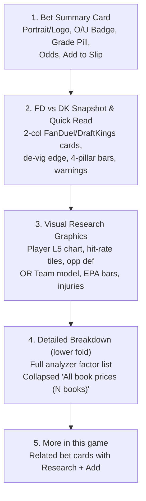
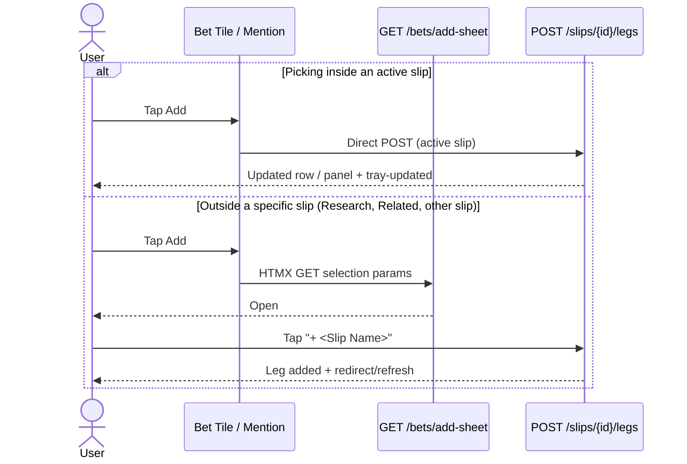

# Design: Bet browsing, slip O/U clarity, and research UX

## Context

Bet browsing, slip viewing, and bet research share one server-rendered Go + HTMX + Tailwind stack (`internal/board`,
`internal/web`, `web/templates`, `web/static`) backed exclusively by cached SQLite rows. Paid odds syncs stay strictly
outside browsing, sorting, and research requests.

Current seams and constraints:

- **Board shaping (`internal/board`):** `board.Detail` builds `DetailSection` slices from dual-book (`DK` + `FD`) `Row`
  values via `categorySections`, `playerSections`, and `gradeSections`. `detailSort` defaults to `SortPlayer`
  (alphabetical) and lists `DetailSorts = []Sort{SortGrade, SortPlayer, SortOdds, SortLine, SortMatchup}`.
  `BoardSignals` already loads `TeamEPA`, `PlayerUsage` (`OffensePct`, `TargetShare`, `CarriesPerGame`, `WOPR`),
  `Injuries`, and `SlipLegs` from SQLite with zero API calls.
- **Pick board (`internal/web/pick.go`, `web/templates/partials.html`):** `pick-detail` renders each section as an
  always-open `<section>`. Each `LineGroup` renders `pick-line-group` with a 2-column grid of `pick-option` blocks;
  every option repeats the full text (`Over 245.5`), `"tap to add/switch/remove"`, and a sibling `
` grade
  popover. Single-row add/switch/remove swaps `closest .pick-line-group`, while Grade mode swaps `#pick-detail`.
- **Slips (`internal/web/slips.go`, `web/templates/partials.html`):** `LegView` renders `Selection` as plain text, so
  `Over` and `Under` have no visual badge. `legResearchURL` links legs to `/research?player_id=...` or
  `/research?game_id=...` rather than `/research/bet`.
- **Bet research (`internal/web/research.go`, `web/templates/research_bet.html`):** `buildBetResearch` resolves a bet by
  `db.SelectionKey` (`db.SameSelection`), builds `BetAddSlipView` via `betAddSlips` (open slips in `StepPick` whose
  slate scope includes the game), and renders: Summary -> Book prices -> Grade & analyzer -> Player research -> Team
  context -> Related bets.
- **Dialogs & theme tokens (`web/templates/layout.html`, `web/static/app.js`, `web/tailwind/`):** Modal sheets use
  native `<dialog class="leg-sheet">` opened by HTMX `afterSwap` listeners in `app.js`. Styling uses semantic CSS
  custom-property tokens (`--color-*` / Tailwind semantic utilities) so every site theme stays legible.

## Approach

### 1. Popularity/visibility sorting and collapsible pick-board groups

Add `SortPopular Sort = "popular"` to `internal/board/board.go` as the default `detailSort` value and reorder
`DetailSorts` to `[SortPopular, SortGrade, SortPlayer, SortOdds, SortLine, SortMatchup]` so Popular is first and Grade
is second.

Compute a deterministic popularity score from cached data already present during `board.Detail`:

- **Game lines (`SPREAD`, `TOTAL`, `ML`, `TEAM_TOTAL`):** Fixed visibility tier (`SPREAD` = 400, `TOTAL` = 300, `ML` =
  200, `TEAM_TOTAL` = 100), keeping headline game markets at the top of Lines.
- **Players and player props:** Combine cached prominence signals into one integer score:
  - Usage signal from `BoardSignals.PlayerUsage[playerID]`: weighted sum of `OffensePct`, `TargetShare`, `WOPR`, and
    normalized `CarriesPerGame` (0–60 points).
  - Market breadth: number of distinct prop markets quoted for the player in that game (up to 25 points), favoring
    featured skill players quoted across yards, receptions/attempts, and TDs.
  - Market line / price prominence: within a market, higher primary line (e.g., 265.5 Pass Yds > 195.5) or shorter
    implied probability on `ANYTIME_TD` adds up to 15 points.
  - Tie-breakers: highest grade score descending, then alphabetical player name / `lineGroupLess`.

In `web/templates/partials.html`, replace each `<section data-section="{{.Key}}">` in `pick-detail` with a native
`
` whose `
` holds the
badge, label, count, and a rotating chevron.

- **Default state:** Omit `open` on `
` when `q == ""` (groups start collapsed). Set `open` automatically when
  `q != ""` so search matches are immediately visible without extra taps.
- **HTMX state preservation:** Add a small listener in `web/static/app.js` that snapshots open `[data-keep-open]` keys
  inside `#pick-detail` before an HTMX swap (`htmx:beforeSwap`) and restores their `open` attribute after
  (`htmx:afterSwap`), clearing the snapshot when the active game changes.

### 2. Compact O/U pick rows and clear O/U slip badges

Add O/U structure to the view models in `internal/web/pick.go` and `internal/web/slips.go`:

- **Pick board (`PickLineGroupView`):** Set `IsOU bool` when a line group has paired `OVER`/`UNDER` options, along with
  `SharedLine string` (e.g., `245.5`) and `SplitLine string` (hoisted once at the line-group header when DK and FD lines
  differ, rather than duplicated inside both buttons).
  - Render a single compact header row (`Pass Yds · 245.5` + optional split-line chip) above a tight 2-column grid of
    `Over` and `Under` controls.
  - Each side button shows a clear directional label (`Over` / `Under` with `▲`/`▼` glyph), odds + implied chance, and
    optional suggestion badge—dropping repetitive `"tap to add"` / `"tap to switch"` / `"tap to remove"` copy and using
    concise state styling (accent/positive border + checkmark when picked).
  - Keep the grade popover trigger and the new compact Research link as siblings in a slim footer/action bar beneath or
    beside the button (never nested inside `<button>` or `<form>`).
  - Preserve `closest .pick-line-group` HTMX swap targets so row-level add/switch/remove stays instant.
- **Slip hub and pick tray (`LegView`, `PickTrayLegView`, `BetResearchView`):**
  - Add `SideBadge` (`"OVER"` or `"UNDER"`) and `SideClass` (semantic token styling—positive-tinted pill with `▲` for
    Over, distinct cool/warning-tinted pill with `▼` for Under) plus `DisplaySelection` so Over/Under stands out at a
    glance on every slip leg row, pick tray item, and research header.

### 3. Visual-first bet research hierarchy with FD/DK focus

Reorder and refine `web/templates/research_bet.html` and `BetResearchView` in `internal/web/research.go` so the page
progresses from visual, high-signal summaries to granular detail:

- **FD/DK Snapshot (`BetResearchPricing`):** Extract explicit `FanDuel` and `DraftKings` book rows (ordered with the
  viewer's `homeBook` first) into a compact 2-column card at the top, showing each book's line, price, implied %, and
  `"Your book"` badge. Keep the de-vig edge callout concise below it.
- **Visual Grade Summary:** Render compact horizontal bars for the grade's four pillars (when present) and surface any
  analyzer warnings directly under the snapshot so sharp-friend heads-ups are never buried.
- **Demoted All-Book List:** Move the full multi-book list and consensus/best summary into a collapsed `
`
  (`"Compare all N books"`) in the lower breakdown section so full market data remains one tap away without dominating
  the first screen.

### 4. Universal Research + Add actions and eligible-slip chooser

Introduce two shared helpers in `internal/web` so every bet surface behaves identically:

- **`betResearchHref(sel db.SelectionKey, from string, slipID int64) string`:** Shared builder used by pick-board
  options, A-grade highlights (single legs and parlay legs), slip legs, research explorer cards, and related bets.
  - Passes `game_id`, `market`, `side`, `team`, `player_id`, `player_name`, `from`, and optional `slip_id`.
  - For slip legs (`legResearchURL`), link to `/research/bet` when the leg is non-`OTHER` and its game has not kicked
    off; otherwise fall back to the player or game research sheet so past or custom legs still open useful context.
- **Shared Eligible-Slip Chooser (`GET /bets/add-sheet` + `<dialog id="bet-add-dialog">`):**
  - Mount `<dialog id="bet-add-dialog" class="leg-sheet">` once in `web/templates/layout.html` with
    `#bet-add-dialog-body` and wire `app.js` to open it on `htmx:afterSwap` (matching `#pick-swap`).
  - `GET /bets/add-sheet` accepts the bet's selection parameters (`game_id`, `market`, `side`, `team`, `player_id`,
    `player_name`, `line`, `odds`, `return`), loads the game from SQLite, and reuses `betAddSlips(ctx, game)` to list
    every eligible open slip in the active group (open status, game in slate scope, viewer in `StepPick` with open
    slots).
  - Each eligible slip renders a one-tap form posting to `POST /slips/{id}/legs` with `quick=1&from=research`. If no
    eligible slip exists, the sheet explains why and links to `/slips/new?week={weekID}`.
  - When a user is already picking inside a specific slip (pick board, slip highlights), `+ Add` posts directly to that
    slip as today. On Research Explorer cards, Related Bets, and cross-slip leg rows, `+ Add` opens `#bet-add-dialog`.

### Trade-offs and rejected options

- **Native `
` vs. server-toggled collapse:** Native `
` expands with zero network latency and works
  without JS, while a tiny `app.js` hook preserves open keys across HTMX refreshes. Server-driven collapse would add a
  round trip on every tap.
- **On-demand `GET /bets/add-sheet` vs. embedding slip lists on every card:** Research Explorer can render dozens of
  cards across multiple games. Loading eligible slips on demand via HTMX keeps card HTML small and avoids computing
  per-game slip eligibility for every card on initial render.
- **Deterministic popularity from cached signals vs. click/bet tracking:** Using cached `PlayerUsage`, market breadth,
  and line prominence requires no new DB tables or analytics writes and stays 100% deterministic in tests and sandbox.

## Verification

- **Unit, handler, and lint suite:** `go generate ./... && golangci-lint run ./... && go test ./...` and
  `go test -short -race ./...`
- **Popularity sort & collapsed groups:**
  - Verify `board.Detail` defaults to `SortPopular`, puts `SortGrade` second, ranks high-usage/multi-market stars above
    low-usage depth players, and keeps `SPREAD -> TOTAL -> ML -> TEAM_TOTAL` ordering in Lines.
  - Verify `pick-detail` renders `
` without `open` when `q == ""`, and with `open` when
    `q != ""`.
- **Compact O/U & slip badges:**
  - Verify paired O/U `LineGroup`s render a single shared line header, distinct Over/Under buttons, no nested
    interactive elements (`<a>` or `
` outside `<button>`/`<form>`), and working HTMX add/switch/remove swaps.
  - Verify `slip-panel` and `pick-tray` render explicit `OVER`/`UNDER` badges for O/U legs and omit them for `SPREAD`,
    `ML`, `ANYTIME_TD`, and `OTHER`.
- **Bet research hierarchy:**
  - Verify `research_bet.html` renders the FD/DK snapshot and visual player/team sections above the collapsed full book
    list, orders the viewer's `homeBook` first, and keeps zero paid API calls.
- **Universal Research + Add & eligible-slip chooser:**
  - Verify pick-board options, highlight legs, research cards, related bets, and active slip legs all link to
    `/research/bet` with matching `SelectionKey` params (and kicked-off/`OTHER` slip legs fall back to player or game
    sheets).
  - Verify `GET /bets/add-sheet` lists only `OPEN` slips in `StepPick` whose slate scope includes the game, returns the
    empty-state link when none qualify, and posts cleanly to `POST /slips/{id}/legs`.
- **Phone-width manual check:** Run the local sandbox at 390px width to confirm collapsed groups, compact O/U tap
  targets, slip O/U badges, bet research fold order, and the `#bet-add-dialog` sheet across light and dark themes.

## Risks

- **HTMX swap target breakage in compact O/U rows:** Moving the Research link or grade popover around `pick-option`
  could accidentally break `closest .pick-line-group` or nest interactive elements inside `<button>`. Mitigated by
  keeping `.pick-line-group` as the outer wrapper and adding handler tests asserting exact HTMX attributes and sibling
  structure.
- **Collapsed sections snapping shut on live updates:** `board-updated` SSE events replace `#pick-detail`, which would
  reset native `
` state if not restored. Mitigated by `data-keep-open` snapshotting in `app.js` keyed by
  `data-section`.
- **Stale or missing usage stats for popularity sort:** Early-season or backup players may lack `PlayerUsage` rows.
  Mitigated by combining market breadth and line prominence with deterministic grade + name tie-breakers so sorting
  never produces unstable order.
- **Slip-scope mismatch in `GET /bets/add-sheet`:** Offering a slip whose scope excludes the game would fail with
  `ErrGameOutsideScope` on submit. Mitigated by reusing `betAddSlips` (`slips.FilterGamesForSlip` + `slips.NextStep`).

## TODO

### Phase 1: Popularity sorting and collapsible pick-board groups

Complexity: medium (coordinates deterministic popularity scoring across all three grouping modes in `internal/board`
with native collapsible sections and HTMX open-state preservation in `app.js`)

Risk: medium (changes default pick-board sort order and section DOM structure; open-state restoration across SSE swaps
is only partially covered by Go HTML tests)

- [x] Add `SortPopular` as the default pick-board detail sort (with `SortGrade` second) in `internal/board/board.go`
  using cached `PlayerUsage`, market breadth, and line prominence signals, and update `internal/web/pick.go` and
  `internal/board/board_test.go` + `internal/web/pick_test.go`.
- [x] Convert `pick-detail` sections in `web/templates/partials.html` to collapsed-by-default `
` headers
  (auto-opened when searching) and preserve expanded section keys across `#pick-detail` HTMX swaps in
  `web/static/app.js`, with template tests in `internal/web/pick_test.go`.

### Phase 2: Compact O/U pick rows and clear O/U slip badges

Complexity: medium (reshapes O/U line groups across add, switch, remove, drift, and at-limit states while keeping
sibling grade popovers and HTMX row swaps intact across pick board, slip hub, and tray)

Risk: medium (modifies high-traffic picking controls and slip leg markup across all site themes; mobile tap-target
ergonomics and theme contrast need careful verification beyond HTML assertions)

- [x] Add `IsOU`, `SharedLine`, and hoisted `SplitLine` fields to `PickLineGroupView` in `internal/web/pick.go` and
  render compact side-by-side Over/Under controls in `web/templates/partials.html`, verifying add/switch/remove/swap
  markup in `internal/web/pick_test.go`.
- [x] Add structured `SideBadge` and `SideClass` fields to `LegView` and `PickTrayLegView` in `internal/web/slips.go`
  and `internal/web/pick.go` and render prominent `OVER`/`UNDER` visual badges on `#slip-panel` and `#pick-tray` in
  `web/templates/partials.html` (with semantic theme styles in `web/tailwind/` and `go generate ./...`), covered by
  tests in `internal/web/slips_test.go` and `internal/web/pick_test.go`.

### Phase 3: Visual-first bet research hierarchy with FD/DK focus

Complexity: low (reorders existing `BetResearchView` sections, extracts an upfront FD/DK comparison card and visual
pillar bars from already-computed data, and collapses the full book list)

Risk: low (read-only `/research/bet` presentation change with no mutations, no external API calls, and direct handler
HTML coverage)

- [x] Extract explicit FanDuel and DraftKings quotes (ordered with `homeBook` first) and visual pillar summary data on
  `BetResearchView` in `internal/web/research.go`, and reorder `web/templates/research_bet.html` to lead with the
  FD/DK snapshot, visual grade/warnings, and player/team graphics while moving all-book prices into a collapsed
  `
` below the fold, with tests in `internal/web/research_test.go`.

### Phase 4: Universal Research + Add actions and eligible-slip chooser

Complexity: medium (unifies bet-research link generation across five surfaces, adds the `GET /bets/add-sheet` HTMX
chooser dialog, and preserves fallback behavior for kicked-off or `OTHER` legs)

Risk: medium (adds new add-leg entry points across research and slip views that must enforce slip scope, open status,
and remaining leg slots consistently with `slips.Service`)

- [x] Share one `betResearchHref` helper across pick-board options, highlights legs/parlays, slip legs (with fallback
  for kicked-off or `OTHER` legs), research cards, and related bets in `internal/web/` and `web/templates/`, adding
  compact Research links to every bet tile with handler tests.
- [x] Add `GET /bets/add-sheet` in `internal/web/research.go`, mount `<dialog id="bet-add-dialog">` in
  `web/templates/layout.html` and `web/static/app.js`, and wire `+ Add` buttons on research cards, related bets, and
  cross-slip leg mentions to open the chooser (or add directly when picking for an active slip), with tests in
  `internal/web/research_test.go` and `internal/web/slips_test.go`.
- [x] Docs: update `docs/concepts/slips.md` and `docs/reference/routes.md` for collapsed groups, popularity-first
  sorting, compact O/U controls and slip badges, visual-first bet research, and `GET /bets/add-sheet`, then run
  `good-vibes docs lint`.

## Reviews

- [x] Final review: agy@gemini-4-neon-medium
