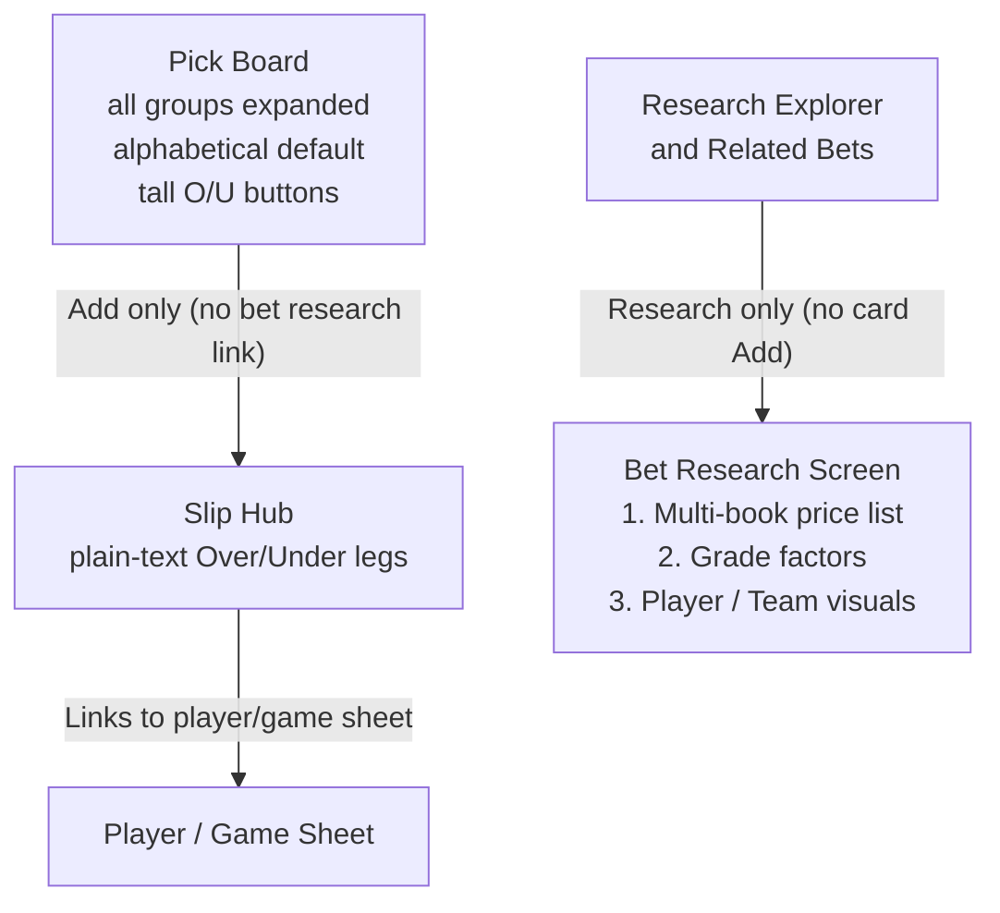
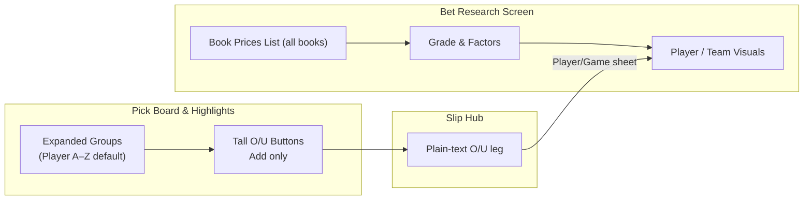
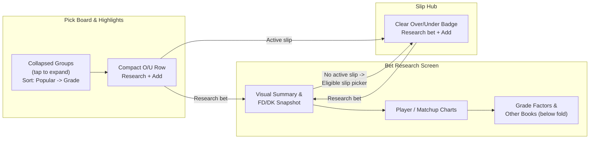

# Bet browsing, slip O/U clarity, and research UX

## Context

Browsing props and reviewing slips on a phone takes too much scrolling and leaves common actions out of reach. Five
related friction points slow down picking and research today:

1. **Expanded groups flood the screen.** Every category, player, or grade group on the pick board opens expanded by
   default. Getting from Passing to Rushing or TDs means scrolling past dozens of player cards.
2. **Over/Under bets waste vertical space and blur together on slips.** Most props and totals are Over/Under pairs. On
   the pick board, each side renders a full multi-line button with repeated text, grade popovers, and status lines. On
   the slip hub, Over and Under are buried inside plain text like `Josh Allen Over 245.5 Pass Yds`, so scanning a slip's
   lean takes effort.
3. **Category sorting defaults to alphabetical player name.** Opening a category shows bench players and low-volume
   depth options ahead of stars and featured lines. Grade is available, but there is no popularity or visibility sort
   that puts headline players and active markets first.
4. **The bet research screen leads with a wall of book prices.** The first major card below the header is a multi-book
   "Book prices" table covering books the club does not use. Because the club places bets on FanDuel and DraftKings,
   visual summaries, grade breakdown, and player or matchup context get pushed below the fold.
5. **Research and Add actions are inconsistent across bet surfaces.** Slip legs link to general player or game sheets
   instead of the specific bet research view. Pick-board tiles and A-grade highlights let you add a bet, but have no
   direct link to research that exact bet. Research explorer cards and related bets link to research, but offer no way
   to add the bet from the card—and when browsing outside a specific slip, there is no unified picker to choose which
   eligible slip should receive the leg.

## Goals and non-goals

### Goals

- **Collapse pick-board groups by default.** Tapping a group header expands or collapses it so a phone viewport shows
  every group at a glance and stays fast to navigate.
- **Make Over/Under bets compact to browse and unmistakable on slips.** Show the shared market and line once on the pick
  board with tight side-by-side Over and Under tap targets, and give Over/Under picks clear visual badges on the slip
  hub and pick tray.
- **Sort categories by popularity/visibility first, then grade.** Default category ordering to a deterministic
  popularity/visibility rank built from cached stats, market breadth, and role signals, with Grade as the second sort
  option.
- **Lead bet research with digestible visuals and FD/DK context.** Reorder the bet research screen from highest-signal
  graphics and summaries at the top (grade, hit-rate visuals, matchup context, and a compact FD/DK comparison) down to
  detailed factor lists and collapsed or lower-priority multi-book prices at the bottom.
- **Put Research and Add on every bet tile and mention.** Every bet card, option, highlight, slip leg, and related bet
  offers a link to that exact bet's research view and an Add action—adding straight to the active slip when picking for
  one, or prompting to choose among eligible open slips when browsing outside a slip context.

### Non-goals

- Fetching new external APIs or spending additional Odds API or Parlay API credits. All popularity sorting, visuals, and
  summaries use cached SQLite data only.
- Changing analyzer grading formulas, warning rules, or dual-book (FD + DK) pick eligibility.
- Changing slip locking, voting, live progress, auto-grading, or sportsbook export rules.
- Supporting sportsbooks beyond FanDuel and DraftKings for primary price highlights.

## Decision

Unify bet presentation and navigation around five coordinated UX changes: collapsible pick-board groups, compact O/U
controls with clear slip badges, popularity-first category sorting, a visual-first bet research hierarchy, and a shared
Research + Add action pair with an eligible-slip chooser.

### Before

### After

### Why this approach

- **Collapsed groups by default** beat infinite scroll or pagination because users still see every category and count in
  one viewport without extra server round trips, and tapping opens only what they care about.
- **Shared compact O/U rows and explicit O/U badges** beat shrinking fonts on the existing two-card layout because
  hoisting the shared market/line out of both buttons cuts duplicate text in half while keeping phone tap targets
  comfortable.
- **Deterministic popularity/visibility default sort (with Grade second)** beats alphabetical player sorting because
  headline starters and high-volume props surface first without requiring manual filtering, while Grade stays one tap
  away. Computing popularity from cached volume, role, and market signals keeps the app deterministic and costs zero API
  credits.
- **Visual-first bet research with FD/DK upfront** beats removing multi-book prices outright because users get the
  headline visual read and their actual books immediately, while sharp-book or full-market detail stays available lower
  down for anyone who scrolls.
- **Universal Research + Add with an eligible-slip chooser** beats silently guessing a target slip or hiding Add on
  research surfaces because every bet mention becomes actionable while respecting each slip's slate scope, open status,
  and remaining leg slots.

### Complexity and risk

- **Complexity (`medium`):** Coordinating shared bet-tile controls, HTMX swap targets, collapsible group state,
  popularity ranking, and eligible-slip selection spans the board, slips, and research layers and requires keeping
  selection identity and phone-width ergonomics consistent across every bet surface.
- **Risk (`medium`):** Changes touch core picking, slip reading, and research screens where visual hierarchy, mobile tap
  targets, and HTMX interactions are only partially exercised by server-rendered HTML tests, though no persistent schema
  or external API contracts change.
