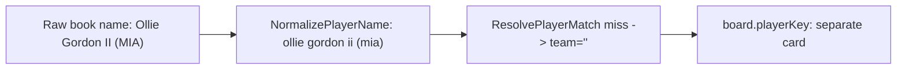
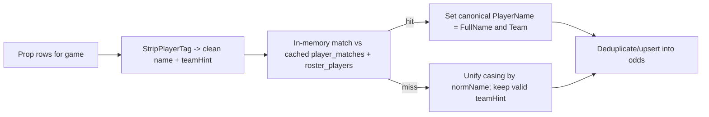

# Design: Unify player identity across sportsbooks

## Context

In `internal/ingest/odds/props.go`, `parseProps` and `mapPropOutcome` copy `item.Player` / `outcome.Description`
directly into `Prop.PlayerName`. Sportsbooks vary on the same player:

- DraftKings / FanDuel / BetMGM / PrizePicks: `"Ollie Gordon II"`
- Sleeper / Underdog: `"Ollie Gordon"`
- Bovada: `"Ollie Gordon II (MIA)"`

In `internal/refresh/research.go`, `mapPropsToOdds` calls
`s.store.ResolvePlayerMatch(ctx, prop.PlayerName, game.HomeTeam, game.AwayTeam)` per row (hundreds of sequential SQL
queries per game) and leaves `row.PlayerName = prop.PlayerName`. Because `db.NormalizePlayerName`
(`internal/db/players.go`) does not strip trailing `(TEAM)` tags or fold accents, `"Ollie Gordon II (MIA)"` normalizes
to `"ollie gordon ii (mia)"`, misses `roster_players`, and stores `team = ""` in `odds`.

In `internal/board/board.go`, `playerKey` keys matched rows by `"id:" + row.PlayerID` and unmatched rows by
`"name:" + normalize(row.PlayerName) + "|" + row.Team`, splitting unmatched `"Ollie Gordon II (MIA)"` (and casing
variants like `"DeMario"` vs `"Demario"`) into separate cards.

## Approach

### 1. Unified name normalization and `(TEAM)` stripping

In `internal/db/players.go`, add `StripPlayerTag(name string) (cleaned, teamHint string)` and fold accents inside
`NormalizePlayerName`:

- Detect a trailing parenthetical tag such as `" (MIA)"` or `" (LAR)"`: trim it from `cleaned`, and if the inner token
  is a 2–4 letter uppercase team code, return it as `teamHint`.
- Fold common Latin accents (sharing the mapping currently in `internal/board/board.go`) inside `NormalizePlayerName`
  before stripping punctuation (`.`, `'`, `-`, `,`) and trailing suffixes (`jr`, `sr`, `ii`, `iii`, `iv`, `v`).
- `internal/board.normalize` delegates directly to `db.NormalizePlayerName` so ingest and board matching share one
  canonical normalizer.

### 2. Batch canonical resolution during prop ingest

In `internal/refresh/research.go` (`mapPropsToOdds`) and `internal/db/players.go`:

- Preload `RosterForTeams([]string{game.HomeTeam, game.AwayTeam})` and `PlayerMatchesForTeams(...)` once per
  `mapPropsToOdds` call instead of querying SQLite per prop row.
- For each prop row:
  1. Strip any trailing `(TEAM)` tag via `StripPlayerTag(prop.PlayerName)`.
  2. Check `player_matches` (`manual = 1` wins first, then non-manual) and `roster_players` using
     `NormalizePlayerName(cleaned)`. If `teamHint` matches `game.HomeTeam` or `game.AwayTeam`, prefer that team when
     disambiguating.
  3. On a roster hit, set `row.Team = roster.Team` and canonicalize `row.PlayerName = roster.FullName` (e.g.
     `"Ollie Gordon II"` across DraftKings, Sleeper, Underdog, and Bovada).
  4. On a miss (e.g. player absent from ESPN roster), set `row.Team = teamHint` if it matches home/away, and unify
     `row.PlayerName` across books in the same game batch by `NormalizePlayerName(cleaned)` so casing variants
     (`"DeMario"` vs `"Demario"`) collapse to one spelling.
- Batch-upsert any newly discovered `player_matches` rows in one transaction.

### 3. Clean up existing stored rows and board grouping

- Add migration `0013_canonical_players.sql` (or a one-time idempotent backfill on migrate/startup using
  `NormalizePlayerName` in Go) that deduplicates and canonicalizes existing `odds` rows (`DELETE` colliding
  un-canonicalized rows before updating remaining ones to canonical `player_name` and `team`) and backfills
  `legs.player_id` / `legs.team` where missing.
- In `internal/board/board.go`, keep `playerKey` grouping by `"id:" + row.PlayerID` when matched and
  `"name:" + normalize(row.PlayerName) + "|" + row.Team` when unmatched, ensuring one card per player even for
  unrostered players.

**Trade-off:** Deduplicating only inside `board.go` at render time was rejected because `odds.team` would stay empty in
SQLite, `legs` would keep un-canonical names, and `export` / `research` lookups would stay fragmented. Canonicalizing at
ingest keeps all tables and downstream readers consistent.

## Verification

- Unit tests in `internal/db/players_test.go` for `StripPlayerTag`, accented names, suffixes (`II`, `Jr.`), and batch
  resolution against `manual = 1` overrides.
- Ingest tests in `internal/refresh/research_test.go` using the real prod Ollie Gordon variants (`"Ollie Gordon II"`,
  `"Ollie Gordon"`, `"Ollie Gordon II (MIA)"`) confirming all three resolve to one `athlete_id`, `team = "MIA"`, and one
  canonical `PlayerName`, and that `board.Detail` produces exactly one player card.
- Migration/backfill test verifying an existing DB with colliding `"Ollie Gordon"` / `"Ollie Gordon II (MIA)"` rows
  migrates cleanly without primary-key errors.
- Standard check: `go test -race ./...` and `golangci-lint run`.

## Risks

- **Two different players with the same normalized name on opposing teams:** Preserving `teamHint` (e.g. `(MIA)`) when
  present and refusing auto-match when `len(rosterMatches) > 1` prevents false merges; manual overrides in
  `player_matches` remain authoritative.
- **Duplicate primary keys on `UpsertOdds` after canonicalizing two rows for the same book:** If one book (e.g. Bovada)
  emits both `"Ollie Gordon II"` and `"Ollie Gordon II (MIA)"` in the same payload, prefer the richer/linked row when
  deduplicating in `mapPropsToOdds` before calling `UpsertOdds`.

## TODO

Effort: medium (coordinates normalization, batched roster/match lookup in prop ingest, board grouping, and safe
deduplication of existing stored rows)

### Phase 1: Unify name normalization and `(TEAM)` stripping

- [x] Add `StripPlayerTag` and accent folding to `NormalizePlayerName` in `internal/db/players.go`, and delegate
      `internal/board.normalize` to it, with unit tests in `internal/db/players_test.go` and
      `internal/board/board_test.go`.

### Phase 2: Canonicalize prop ingest and backfill stored rows

- [x] Batch-load `roster_players` and `player_matches` once per game in `internal/refresh/research.go`
      (`mapPropsToOdds`), rewrite each row's `PlayerName` and `Team` to the canonical player (unifying unmatched casing
      per game and preferring linked rows on same-book collisions), and test with `"Ollie Gordon"` / `"Ollie Gordon II"`
      / `"Ollie Gordon II (MIA)"` fixtures.
- [ ] Add a schema/data backfill (migration `0013` + Go helper) to deduplicate existing `odds` and backfill
      `legs.player_id`/`team`, with a migration test on colliding prod-shaped rows.
- [ ] Docs: update `docs/reference/data-sources.md` and `docs/reference/schema.md` to document canonical player
      normalization and `(TEAM)` tag stripping.
