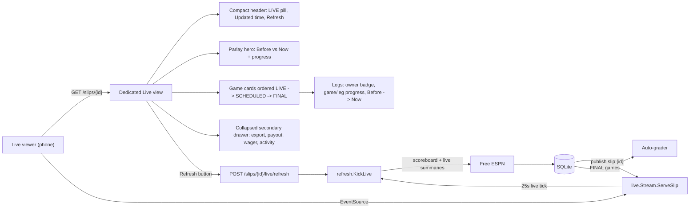

# Close-out

## Overview

A locked slip now leaves the export hub as soon as any leg's game starts. `/slips/{id}` renders the parlay hero first,
groups legs by game in live urgency order, and tucks export, payout, wager, and activity into one collapsed drawer.
While a live stream is open, its SSE tick runs a free-ESPN-only refresh every 25 seconds; leaving the page stops the
tick.

## Consequences

- Easier: Friends following games see the parlay chance and the current game first on a phone instead of scrolling past
  the export card and other people's picks.
- Easier: Live scores, box scores, and auto-grading update in about 20 seconds while anyone watches, with no paid odds
  credits and no background poller keeping Cloud Run warm.
- Easier: Every leg now shows its game-elapsed progress and a before/current hit chance, so a scheduled leg explains why
  its chance has not moved yet.
- Harder: The slip page now has two layouts and a mode-flip reload path. Template changes must keep `slip-wager` outside
  `#slip-panel` and keep `data-live-mode` on both the page section and the panel.
- Revisit: The live tick starts only inside the 30-minute pre-kickoff `liveLead` window. A viewer who opens the slip
  earlier sits in the export layout until a reload or another event refreshes the panel.

## Alternatives considered

- **SSE-attached ticks instead of a background loop:** A cron or global ticker would keep the instance warm and spend
  CPU while nobody watches. Ticks tied to active `ServeSlip` connections reuse the existing visibility, idle, deadline,
  and shutdown cleanup.
- **Automatic Live mode on `/slips/{id}` instead of a `/live` URL:** Keeping the canonical URL means old links, push
  notifications, and open tabs arrive in the right mode without redirects or split bookmarks.
- **Free ESPN model instead of paid live odds:** Live sportsbook odds would burn monthly credits and still leave
  suspended markets; the deterministic ESPN model covers every leg without paid calls.
- **Game-time ordering instead of member grouping:** During play friends watch games chronologically, so the live window
  groups every leg in the game on TV; owner badges keep player attribution.
- **Dedicated Live layout instead of adding progress to the export hub:** Collapsing export and wager tools keeps the
  live action above the fold while the secondary controls stay one tap away.

## Implementation notes

- `StepLive` is decided from the slip's own leg games, not the whole slate, so a Sunday Main slip with only late games
  stays in `export` while an early slate game runs.
- `SyncLive` touches only `espn:scoreboard` and live `espn:summary` keys. The 20-second `sync_state` gate and
  `singleflight` mean concurrent viewers share one fetch, and `failureBackoff` still applies. `ForceLiveRefresh` has a
  10-second per-slip cooldown. Sandbox mode omits `WithLiveTick` entirely.
- The live tick uses the existing stream timers: it fires on connect and every 25 seconds, and stops on disconnect,
  `bye`, or `Shutdown`. Nothing keeps running after the last viewer leaves.
- A manual refresh reloads the slip before rendering, so a refresh that auto-grades the slip flips `data-live-mode` to
  false and the browser reloads into the graded view. `app.js` does the same whenever an HTMX panel swap changes the
  mode.
- The 375px phone check showed no horizontal overflow, the parlay hero at 192px, and the first live game card at 349px,
  both above the fold. The export drawer stays collapsed and below the panel.
- The final review removed a stray compiled `server` binary from the branch and is recorded as a manual final review.

## Follow-ups

- Add a client-side reload at the first leg's kickoff, or start the SSE tick for locked slips outside the 30-minute
  window, so a page opened early still enters Live mode without a manual reload.
- Add a browser viewport test at 375px for the Live layout so no-overflow and above-the-fold placement stay covered in
  CI.
- Consider sharing the `espn:scoreboard` source key from one package so the `internal/web` freshness stamp and
  `internal/refresh` gating cannot drift.
