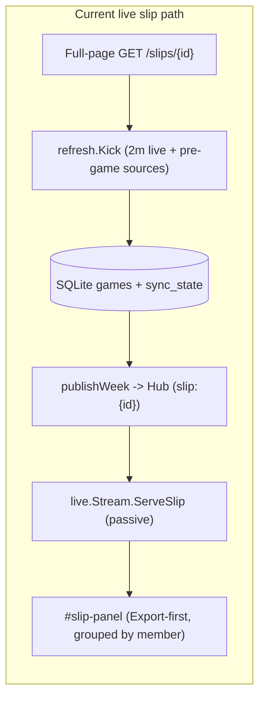
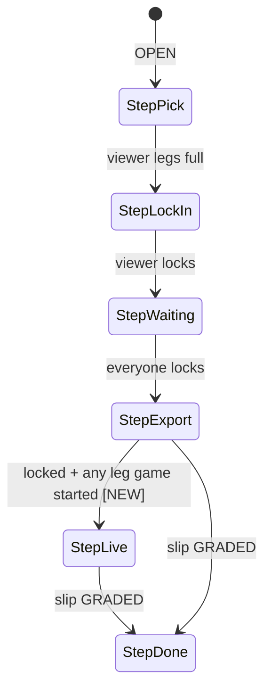
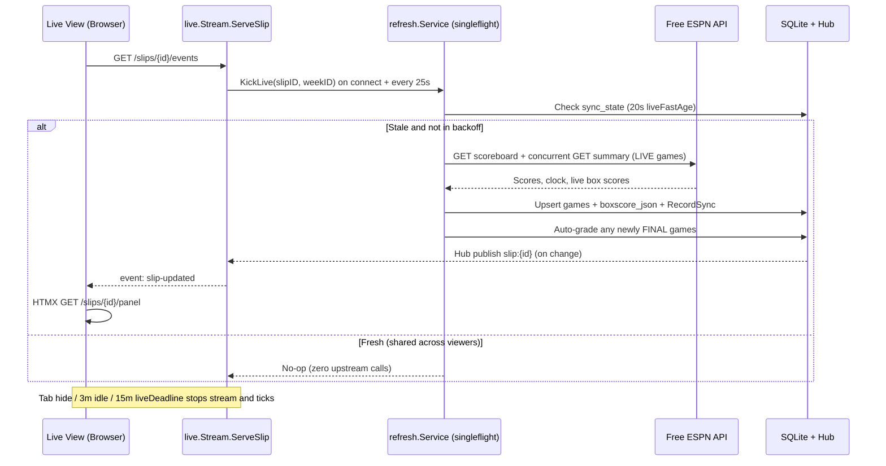
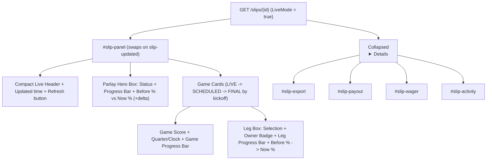

# Design: Dedicated Live view for locked parlays

## Context

Locked slips currently stay in `slips.StepExport` ("Ready to place") from the moment every member locks in until the
slip reaches `db.SlipGraded` (`slips.StepDone`). On `GET /slips/{id}`, `web/templates/slip.html` always renders
`slip-export` above `slip-panel`, followed by `slip-payout`, `slip-wager`, and `slip-activity`. Inside `slip-panel`,
legs are grouped by `SlipMemberView` (the member who picked them).

Live game data flows through two existing seams:

- **Refresh (`internal/refresh`):** `Kick()` runs only on authenticated full-page `GET` requests (never on HTMX partials
  or SSE streams). In a live window, `espn:scoreboard` and `espn:summary:{gameID}` use 2-minute staleness windows
  (`scoreboardLiveAge`, `summaryLiveAge`) and run alongside slower pre-game sources (`weather`, `espn:roster`,
  `espn:gamelog`, `nfelo`, `nflverse`).
- **SSE (`internal/live` + `web/static/app.js`):** `live.Stream.ServeSlip` subscribes to `slip:{id}` and
  `week:{weekID}`, sends `: ping` every 25 seconds, and closes on `liveDeadline` (15 minutes), `idleDeadline` (3
  minutes), client tab hide, client 3-minute inactivity, or `Stream.Shutdown()`. While a user watches an open slip page
  without reloading, nothing triggers `refresh` to poll ESPN.
- **Progress (`internal/progress`):** `EvaluateLeg` and `EvaluateSlip` already compute deterministic `PreGameProb`,
  `LiveProb`, `ProgressPct`, `StatLabel`, `ClockLabel`, and `Tone` over cached `db.Game` rows and `games.boxscore_json`
  with zero paid API calls. `legLiveView` currently returns `nil` when `HasLive` is false (so scheduled legs hide
  progress and before/current percentages), and neither `LegProgress` nor `SlipProgress` exposes game-elapsed progress
  or probability delta.



## Approach

### 1. Slip lifecycle transition (`internal/slips`)

Add `StepLive Step = "live"` to `internal/slips/next.go`, with `Next.Label()` returning `"Live"`.

Inside `NextStep`, when the slip is not `db.SlipGraded` and is locked
(`everyoneLocked(members) || slip.Status == db.SlipLocked`), check `legGamesStarted(legs, games, now)`:

- Build a lookup of `games` by `ID`.
- Return `true` if any leg references a game whose `Status` is `db.GameLive` or `db.GameFinal`, or where
  `!now.Before(game.Kickoff)`.
- If no leg references a stored game (for example, all custom `OTHER` legs), return `false` so `StepExport` remains
  active.

Checking the games actually referenced by the slip's legs (rather than all games in the slate scope) prevents a Sunday
Main slip whose legs are all in late-afternoon games from switching out of `StepExport` at 1:00 PM ET.



### 2. Expanded progress model (`internal/progress`)

Extend `LegProgress` and `SlipProgress` with pure deterministic fields so every leg card and the parlay hero can render
game-state progress and before-vs-current hit probabilities consistently:

```go
type LegProgress struct {
    // existing fields...
    GameProgressPct float64 // 0 (SCHEDULED), (1-remFrac)*100 (LIVE), 100 (FINAL)
    ProbDelta       float64 // LiveProb - PreGameProb (0 for PUSH/VOID)
    ProbTrend       string  // "up", "down", "flat"
}

type SlipProgress struct {
    // existing fields...
    ScheduledCount int     // counting legs still SCHEDULED
    ProbDelta      float64 // LiveProb - PreGameProb
    ProbTrend      string  // "up", "down", "flat"
}
```

- `GameProgressPct` is computed directly from `RemainingFraction(game.Status, game.Period, game.Clock)`: `0` when
  `game == nil || game.Status == db.GameScheduled`, `100` when `game.Status == db.GameFinal`, and `(1 - remFrac) * 100`
  when `game.Status == db.GameLive`.
- `ProbDelta` and `ProbTrend` use a small deadband (`0.005`, half a percentage point) so tiny rounding noise reads as
  `"flat"`.
- `EvaluateLeg` keeps `PreGameProb` and `LiveProb` populated for every counting state (`SCHEDULED`, `LIVE`, `CASHED`,
  `BUSTED`, `UNAVAILABLE`): scheduled legs report `LiveProb == PreGameProb` (`ProbDelta == 0`, `ProbTrend == "flat"`),
  cashed legs report `LiveProb == 1.0`, and busted legs report `LiveProb == 0.0`.
- `EvaluateSlip` counts `ScheduledCount` for counting legs that are neither cashed, busted, nor live, and formats
  `Summary` to include upcoming legs when present (for example, `"1/4 hit · 2 live · 1 upcoming"`).

### 3. Viewer-driven fast free-API live refresh (`internal/refresh`, `internal/live`, `cmd/server`, `internal/web`)

Keep live updates fast (~25 seconds) while honoring Cloud Run scale-to-zero and spending zero paid odds credits by tying
a live-only refresh path directly to active SSE viewers.

- **Fast live refresh (`internal/refresh`):**
  - Add `liveFastAge = 20 * time.Second`, `liveRefreshCooldown = 10 * time.Second`,
    `liveSyncTimeout = 10 * time.Second`, and `liveSummaryConcurrency = 4`.
  - Add `SyncLive(ctx context.Context, slipID, weekID int64) error` and its non-blocking counterpart
    `KickLive(slipID, weekID int64)` (detaches request cancellation, cancels on `s.shutdownCtx`, tracks in `s.wg`, and
    runs with `liveSyncTimeout`).
  - `SyncLive` runs **only** free live ESPN sources:
    1. Sync `espn:scoreboard` via `singleflight` when older than `liveFastAge` (and not in `failureBackoff`).
    2. Load the week's games and the slip's legs (falling back to all `LIVE` games with active slip legs in `weekID`).
    3. Sync `espn:summary:{gameID}` concurrently (bounded to `liveSummaryConcurrency`) for each `LIVE` game on the slip
       whose summary is older than `liveFastAge` (and not in `failureBackoff`).
    4. If any game on the slip is `FINAL` and has `PENDING` legs, run `syncGrade` immediately so auto-grading settles
       legs without waiting for a full `Kick()`.
  - Because `singleflight` keys on `ScoreboardSource` and `SummarySource(gameID)` and re-checks `sync_state.fetched_at`
    inside the flight, concurrent Live viewers watching the same slip share one ESPN fetch per 20-second window.
  - Whenever `syncScoreboard` or `syncSummary` commits changed rows, existing `publishWeek` publishes `slip:{id}` over
    the hub, pushing `slip-updated` to every connected viewer.
  - Add `ForceLiveRefresh(ctx context.Context, slipID, weekID int64) error` for the manual `"Refresh"` button, bypassing
    `liveFastAge` subject to an in-memory `liveRefreshCooldown` (10 seconds) keyed per slip.

- **SSE tick hook (`internal/live` + `cmd/server`):**
  - Add `LiveTick func(slipID, weekID int64)` and `WithLiveTick(interval time.Duration, fn LiveTick) StreamOption` to
    `live.Stream`.
  - Inside `ServeSlip`, when `live == true` and `s.liveTick != nil`:
    - Start a tick timer via `s.clock.NewTimer(s.liveTickEvery)` (25 seconds in production) alongside `ping` and
      `deadline`, and stop it on `defer`.
    - Call `s.liveTick(slipID, weekID)` once on stream start and on every tick firing, resetting the timer.
  - When all viewers close their tab, switch away (`visibilitychange`), hit the 3-minute client idle pause, or reach the
    15-minute `liveDeadline`, `ServeSlip` returns, its timer stops, and zero background refresh runs.
  - In `cmd/server/main.go`, wire `live.WithLiveTick(25*time.Second, refresher.KickLive)` in production/dev, and omit it
    in sandbox mode (`cfg.Sandbox == true`) so the frozen sandbox clock never polls live ESPN.



- **Manual live refresh route (`internal/web`):**
  - Add `POST /slips/{id}/live/refresh` in `slipHandlers.Routes`. It loads the slip, calls
    `h.deps.Refresh.ForceLiveRefresh(ctx, slip.ID, slip.WeekID)` (no-op if `Refresh` is nil), and re-renders
    `slip-panel` so the user gets immediate feedback and updated timestamps.

### 4. Dedicated phone-first Live view & game-time ordering (`internal/web`, `web/templates`, `web/static`)

- **Live mode activation (`internal/web/slips.go`):**
  - `SlipPage.LiveMode` and `SlipView.LiveMode` are `true` when `next.Step == slips.StepLive`.
  - Add `LiveUpdatedISO` / `LiveUpdatedLabel` (from `sync_state` max `fetched_at` across `espn:scoreboard` and active
    leg `espn:summary:{gameID}` keys) so the Live header shows freshness (`Updated <time>`).
  - Keep `SlipLiveView` enriched with `PreGameChance`, `LiveChance`, `ProbDelta` (for example, `"+14%"`, `"-8%"`, or
    `""`), `ProbTrend` (`"up"`, `"down"`, `"flat"`), and `ScheduledCount`.
  - Build `LegLiveView` for **every** leg in Live mode (including `SCHEDULED` and `UNAVAILABLE` legs), carrying
    `PreGameChance`, `LiveChance`, `ProbDelta`, `ProbTrend`, `GameProgressPct`, `State`, `ProgressPct`, `StatLabel`,
    `ClockLabel`, and `Tone`.

- **Game-time ordering (`LiveGameGroup` in `internal/web/slips.go`):**
  - Add `LiveGames []LiveGameGroup` on `SlipView` (populated when `LiveMode` is true):

```go
type LiveGameGroup struct {
    GameID          string // "" for unlinked OTHER legs
    Matchup         string // e.g. "BUF @ MIA" or "Other legs"
    AwayTeam        string
    HomeTeam        string
    AwayLogo        string
    HomeLogo        string
    ScoreLabel      string // e.g. "21 - 17" (empty when SCHEDULED)
    Status          string // "LIVE", "SCHEDULED", "FINAL", "UNLINKED"
    ClockLabel      string // "Q3 8:42", "Halftime", "Final", or ""
    KickoffISO      string // RFC3339 for <time> formatting when SCHEDULED
    KickoffLabel    string
    GameProgressPct int    // 0..100
    Legs            []LegView
}
```

- Sort `LiveGames` deterministically by game time and urgency:
  1. `LIVE` games first, ordered by earliest `Kickoff`, then `GameID`.
  2. `SCHEDULED` games next, ordered by earliest `Kickoff`, then `GameID`.
  3. `FINAL` games next, ordered by earliest `Kickoff`, then `GameID`.
  4. Unlinked (`OTHER` / missing game) group last.
- Within each `LiveGameGroup`, sort legs deterministically by live urgency (`LIVE`, `SCHEDULED`, `CASHED`, `BUSTED`,
  `PUSH`/`VOID`) then leg ID, and display each leg's owner via a compact member badge (`OwnerName` + avatar/initials)
  instead of grouping the whole screen by member.
- **Phone-first template layout (`web/templates/slip.html`, `web/templates/partials.html`):**
  - In `slip.html`:
    - When `.Slip.LiveMode` is `true`: render `slip-panel` **first** at the top of the page, followed by a collapsed
      `<details data-live-secondary>` card ("Bet details, export & wager") containing `slip-export`, `slip-payout`,
      `slip-wager`, and `slip-activity`. `slip-wager` remains outside `#slip-panel` so SSE swaps never overwrite
      in-progress wager edits.
    - When `.Slip.LiveMode` is `false`: keep the existing hub order (`slip-export`, `slip-panel`, `slip-payout`,
      `slip-wager`, `slip-activity`) unchanged.
  - Inside `slip-panel` when `.Slip.LiveMode` is `true`:
    1. **Compact Live header:** slip title, scope badge, sibling switcher (if multiple slips), `LIVE` indicator pill,
       `<time>` freshness stamp, and a compact `"Refresh"` button (`hx-post="/slips/{{.Slip.ID}}/live/refresh"`). Omit
       the pre-game `Next` banner (`"Ready to place"`), highlights strip, and pre-game analyzer warning stack.
    2. **Parlay Live Hero card:** status badge + hit/live/upcoming/lost summary, a prominent 2-column stat box pairing
       **Before %** (`PreGameChance`) and **Now %** (`LiveChance` + delta badge + `?` help bubble to `#sys-live`), and
       the parlay progress bar (`role="progressbar"`).
    3. **Chronological `LiveGames` cards:** each game card shows team logos, matchup, live score (or kickoff `<time>`),
       clock/quarter badge, and a game-elapsed progress bar (`role="progressbar"`). Inside the game card, each leg box
       shows selection, odds, compact owner pill, result/grade override menu, leg progress bar (`role="progressbar"`),
       live stat/margin label, and a clear **Before % → Now %** comparison row on every leg.
  - **Live mode transition on open pages (`web/static/app.js`):**
    - Stamp `data-live-mode="{{.Slip.LiveMode}}"` on `#slip-panel` and on the outer `<section>` in `slip.html`.
    - In `app.js` `htmx:afterSwap`, when `#slip-panel` swaps and its `data-live-mode` differs from the outer
      `<section>`'s `data-live-mode`, reload the page (`window.location.reload()`) so a viewer sitting on the Export hub
      at kickoff automatically transitions into the Live layout (and vice versa if unlocked or graded).
  - **Group overview spotlight (`internal/web/home.go`):**
    - Include `slips.StepLive` in `isSpotlightSlip` and give `StepLive` top `stepPriority` (priority `5`), displaying a
      `"Live"` status pill and `"Watch live"` CTA on the group overview card.



### Trade-offs and rejected options

- **SSE-attached live ticks vs. a background goroutine/cron:** Rejected a global background ticker because Cloud Run
  bills idle CPU and must scale to zero when nobody is watching. Driving ticks from active `ServeSlip` connections
  reuses existing visibility close, 3-minute idle pause, 15-minute `liveDeadline`, and shutdown drain.
- **Dedicated `/slips/{id}/live` URL vs. automatic Live mode on `/slips/{id}`:** Keeping `/slips/{id}` as the canonical
  URL means existing links, push notifications, group overview cards, and open browser tabs automatically land in Live
  mode when kickoff arrives without redirects or split bookmark URLs.
- **Polling live sportsbook odds vs. deterministic ESPN model:** Rejected paid live odds feeds to protect monthly free
  credits and keep every player prop and game market covered without suspended-line gaps.

## Verification

- Standard verification: `go generate ./...`, `golangci-lint run ./...`, `go test ./...`, and
  `go test -short -race ./...`.
- **Lifecycle transitions (`internal/slips`):** `NextStep` returns `StepExport` when locked and all leg games are
  `SCHEDULED` ahead of `now`; switches to `StepLive` as soon as any leg's game is `LIVE`, `FINAL`, or at/past kickoff;
  stays `StepExport` when a locked slip's legs are all in later kickoff windows even if an earlier slate game started;
  stays `StepExport` when locked with only unlinked `OTHER` legs; returns `StepDone` once `GRADED`.
- **Progress math (`internal/progress`):** Verify `GameProgressPct` across `SCHEDULED` (`0`), `LIVE` (`Q1`–`Q4`,
  `Halftime`, `OT`), and `FINAL` (`100`); verify `ProbDelta` and `ProbTrend` (`up`/`down`/`flat` within 0.5% deadband);
  verify `SCHEDULED` legs expose `PreGameProb == LiveProb`, `CASHED` exposes `100%`, `BUSTED` exposes `0%`, and
  `SlipProgress.ScheduledCount` and summary strings reflect mixed live/hit/upcoming/lost slips.
- **Fast live refresh & SSE ticks (`internal/refresh`, `internal/live`):**
  - Unit test `SyncLive` fetches only `espn:scoreboard` and `espn:summary:{gameID}` for `LIVE` games on the slip, never
    calls odds/weather/roster/nfelo/nflverse, honors `liveFastAge` (20s) and `failureBackoff`, deduplicates concurrent
    callers via `singleflight`, runs `syncGrade` when a game becomes `FINAL`, and publishes `slip:{id}` only when rows
    change.
  - Unit test `ForceLiveRefresh` enforces the 10-second per-slip cooldown.
  - Unit test `live.Stream.ServeSlip` with a fake `Clock`: fires `liveTick` on connect and every interval while
    `live == true`, never fires when `live == false`, and stops firing immediately on client disconnect, `liveDeadline`
    (`bye`), or `Shutdown()`.
- **Live view HTML & ordering (`internal/web`):**
  - Render `GET /slips/{id}` and `GET /slips/{id}/panel` for a locked slip with live, upcoming, and final games across
    multiple players: assert `data-live-mode="true"`, parlay hero shows both Before % and Now % + progress bar, legs
    appear inside `LiveGames` ordered `LIVE` → `SCHEDULED` → `FINAL` by kickoff time (not grouped by member), every leg
    shows owner badge + Before % + Now % + progress bar, and export/wager sit inside the collapsed secondary `<details>`
    below `#slip-panel`.
  - Render a locked pre-kickoff slip (`StepExport`): assert `data-live-mode="false"` and existing export-first layout is
    preserved.
  - Verify `POST /slips/{id}/live/refresh` returns 200 with updated `slip-panel`, and `GET /groups/{id}/week` spotlights
    a `StepLive` slip with `"Watch live"` ahead of non-live slips.
  - Verify phone-width layout (375px) has no horizontal overflow and places the parlay hero and first live game card
    above the fold.

## Risks

- **ESPN rate limiting under fast cadence:** Shortening live fetches from 2 minutes to ~20–25 seconds increases ESPN
  request volume during live games. Mitigated by `singleflight` + 20-second `sync_state` gating (so N viewers = 1 fetch
  per game per 20s), scoping summaries strictly to `LIVE` games with legs on the slip, and honoring the existing
  5-minute `failureBackoff` on errors. Visible via `refresh` error logs.
- **Cloud Run idle billing if SSE ticks leak:** A forgotten timer or tick goroutine would keep the instance warm after
  viewers leave. Mitigated by stopping the tick timer in `ServeSlip`'s `defer`, binding `KickLive` to `s.shutdownCtx`
  and `s.wg` with a 10-second timeout, and keeping existing client visibility-close, 3-minute inactivity pause, and
  15-minute `liveDeadline`. Verified by race-enabled stream lifecycle tests.
- **HTMX swap wiping open secondary drawer or wager inputs:** Putting `slip-wager` and the secondary `<details>` outside
  `#slip-panel` prevents SSE swaps from resetting wager form state or collapsing an expanded drawer while scores update.
- **Sandbox replay drift:** Calling live ESPN ticks in sandbox mode would fail against the fail-closed replay transport.
  Mitigated by omitting `WithLiveTick` when `cfg.Sandbox` is true and verifying sandbox boot/stage tests pass.

## TODO

### Phase 1: Slip live step and expanded progress model

Complexity: low (pure deterministic state and math additions in `internal/slips` and `internal/progress` following
existing patterns)

Risk: low (small blast radius with full unit-test coverage and no external I/O or UI layout changes)

- [ ] Add `StepLive` (`"live"`, label `"Live"`) to `internal/slips/next.go` when a locked, non-graded slip has at least
  one leg whose game is `LIVE`, `FINAL`, or at/past kickoff, keeping `StepExport` for pre-kickoff and unlinked-only
  slips, with unit tests in `internal/slips/next_test.go`.
- [ ] Extend `internal/progress` (`LegProgress` and `SlipProgress`) with `GameProgressPct`, `ProbDelta`, `ProbTrend`,
  and `ScheduledCount`, updating `EvaluateLeg` and `EvaluateSlip` so every leg state carries game progress and
  before-vs-current probability delta, with unit tests in `internal/progress/progress_test.go`.
- [ ] Docs: update `docs/reference/odds-math.md` and `docs/concepts/slips.md` for `StepLive` and the new progress
  fields.

### Phase 2: Fast viewer-driven free-API live refresh and SSE ticks

Complexity: medium (coordinates across `internal/refresh`, `internal/live`, `cmd/server`, and `internal/web` while
preserving `singleflight`, shutdown drain, and sandbox isolation)

Risk: medium (touches live ESPN cadence and SSE stream timers where cleanup or backoff bugs could increase upstream
traffic or keep Cloud Run warm)

- [ ] Add `SyncLive`, `KickLive`, and cooldown-guarded `ForceLiveRefresh` to `internal/refresh` (fetching only
  `espn:scoreboard`, concurrent `espn:summary:{gameID}` for `LIVE` slip games at a 20-second `liveFastAge`, and
  immediate `syncGrade` on `FINAL` games, with zero paid odds calls), plus unit tests in
  `internal/refresh/live_test.go`.
- [ ] Add `WithLiveTick` to `internal/live/stream.go` so active `live` SSE connections trigger `KickLive` on connect and
  every 25 seconds (stopping cleanly on disconnect, `bye` deadline, or `Shutdown`), wire it in `cmd/server/main.go`
  (disabled in sandbox mode), and expose `POST /slips/{id}/live/refresh` in `internal/web/slips.go`, with tests in
  `internal/live/stream_test.go` and `internal/web/slips_test.go`.
- [ ] Docs: update `docs/concepts/data-refresh.md`, `docs/concepts/live-updates.md`, and `docs/reference/routes.md` with
  the fast live refresh cadence, SSE tick lifecycle, and manual refresh route.

### Phase 3: Dedicated phone-first Live view ordered by game time

Complexity: medium (coordinates Live view models, chronological game-group sorting, before/current % boxes across all
leg states, HTMX mode-transition handling, and group overview spotlight priority)

Risk: medium (restructures the locked slip page DOM and secondary drawer layout where visual hierarchy and HTMX swaps
are only partially covered by server-side HTML tests)

- [ ] Build Live view models in `internal/web/slips.go` (`LiveMode`, `LiveUpdatedISO`, enriched `SlipLiveView` and
      `LegLiveView` with before/current % and delta for every leg, and `LiveGames` sorted `LIVE`, `SCHEDULED`, `FINAL`
      by kickoff time with owner badges) and update `internal/web/home.go` (`isSpotlightSlip`, `stepPriority`) to
      spotlight `StepLive` slips with `"Watch live"`, with tests.
- [ ] Implement the phone-first Live layout in `web/templates/slip.html`, `web/templates/partials.html`, and
      `web/static/app.js`: render the compact Live header (freshness timestamp and Refresh button), Parlay Live Hero box
      (before + current % and progress bar), game-time-ordered game/leg progress boxes (game bar, leg bar, owner badge,
      and before + current % on every leg), collapsed secondary `<details>` for export/payout/wager/activity below
      `#slip-panel`, and reload in `app.js` when `data-live-mode` flips on HTMX swap, with handler and template tests.
- [ ] Docs: update `docs/concepts/slips.md` for the dedicated Live view, game-time ordering, and collapsed secondary
  controls, and run `good-vibes docs lint` and `good-vibes docs index`.
