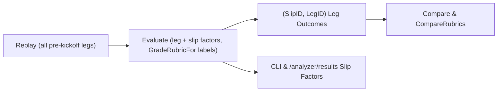

# Close-out

## Overview

## Consequences

- **Easier:** Measuring parlay-level rules (stacks, script conflicts, parlay drag, chalk drag) against actual slip outcomes without early-busted slips distorting leg counts or dropping slip factors.
- **Easier:** Comparing two rubrics on a shared dataset without silent positional mismatching.
- **Harder:** Reading `SlipFactors` lift and ROI on small datasets, because slip sample counts (`N`) are smaller than leg counts.
- **Revisit:** Exporting leg-level outcome keys in JSON reports if comparing saved JSON files offline becomes a requirement.

## Alternatives considered

- **Dropping slip-factor attribution or keeping positional comparison:** Rejected because parlay-level drag and correlation rules are central to rubric tuning, and unvalidated index zipping silently corrupts migration matrices.
- **Excluding early-busted slips from replay:** Rejected because early-busted parlays are real settled losses; omitting them would introduce survivorship bias into slip calibration.
- **Exporting `legOutcomes` in JSON `Report`:** Rejected to keep JSON reports compact and focused on aggregate metrics, using `CompareRubrics` for dataset-level diffs and `(SlipID, LegID)` joins for in-memory `Compare`.

## Implementation notes

- The design referenced `web/templates/analyzer-results.html`; the actual template path in the repository is `web/templates/analyzer_results.html`.
- Migration matching falls back to `(SlipID, legIdx)` when `LegID == 0` so synthetic fixtures without database leg IDs still compute migrations.
- `CombinedOdds` during replay and fallback `slipDecimalOdds` during evaluation only include counting settled legs, matching live settlement math while passing all pre-kickoff legs to `ScoreSlipWithRubric`.
- JSON-deserialized reports still omit `legOutcomes`, so passing deserialized reports to `Compare` yields empty migration matrices.

## Follow-ups

None.
