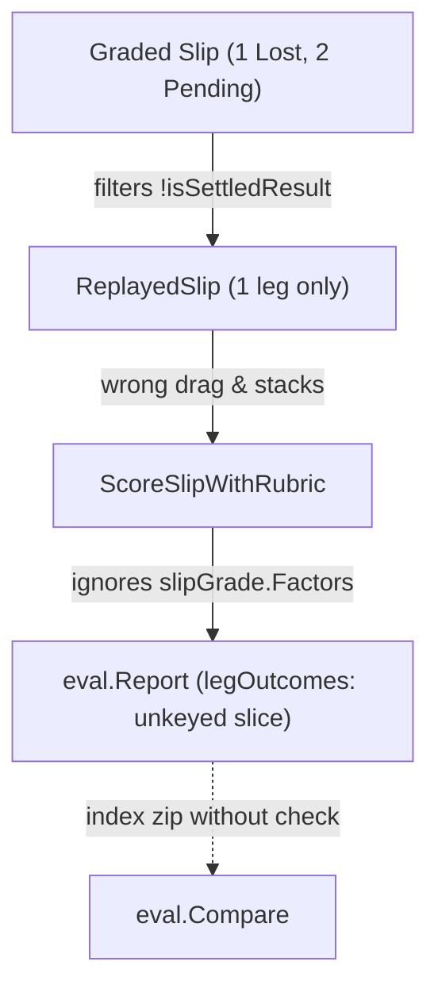
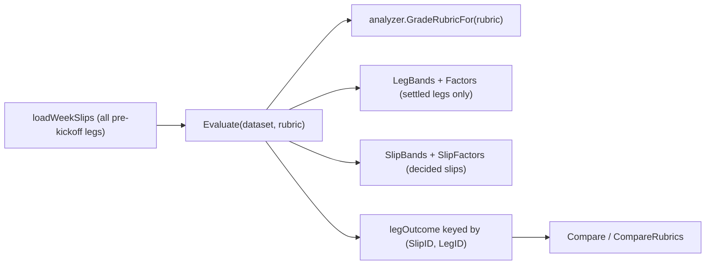

# Design: Deepen eval replay and comparison fidelity

## Context

`internal/eval/replay.go` and `internal/eval/metrics.go` currently exhibit three fidelity gaps between live grading and
offline/in-app evals:

1. **Early-busted slip truncation:** `slips.slipResult` (`internal/slips/rules.go`) marks a slip `SlipGraded` / `LOST`
   as soon as one leg loses, even while later legs remain `PENDING` or `NEEDS_GRADING`. `loadWeekSlips`
   (`internal/eval/replay.go:244`) skips any leg where `!isSettledResult(dl.Result)` before appending to
   `ReplayedSlip.Legs`. `Evaluate` then passes that shortened leg slice to `analyzer.ScoreSlipWithRubric`, changing
   `len(legs)` (`parlay_drag`), dropping `chalk_drag` legs, and breaking multi-leg stack/conflict rules.
2. **Missing slip-factor attribution:** `rubricFactorLabels()` (`internal/eval/metrics.go:229-239`) loads both
   `doc.LegFactors` and `doc.SlipFactors` (currently via global `analyzer.GradeRubric()`), but `Evaluate` only
   accumulates `lg.Factors` and discards `slipGrade.Factors`.
3. **Positional `Compare` coupling:** `Report.legOutcomes` is an unexported slice omitted from JSON.
   `Compare(baseline, candidate)` zips `baseline.legOutcomes[i]` and `candidate.legOutcomes[i]` by slice index with no
   identity or length validation.

## Approach

### 1. Retain full pre-kickoff legs on replayed slips (`internal/eval/replay.go`, `internal/eval/metrics.go`)

- In `loadWeekSlips`, include **every** leg on a `SlipGraded` slip in `ReplayedSlip.Legs` (preserving its `Result`,
  including `PENDING` / `NEEDS_GRADING`, and its `DecimalOdds`) so `analyzer.ScoreSlipWithRubric` always scores the
  exact pre-kickoff slip.
- Keep `parlayLegs` / `CombinedOdds` computed from legs whose `Result.Counts()` is true (matching live settlement math),
  and count `DataCoverage` only over legs included in the replay.
- In `Evaluate`:
  - Always pass all `slip.Legs` into `analyzer.ScoreSlipWithRubric(analyzerLegs, week.Games, week.Stats, rubric)`.
  - Only accumulate leg bands (`legBands`, `weekLegBands`, `weekOverallLegs`), leg factors, and decided `legOutcomes`
    for legs with settled results (`Won`, `Lost`, `Push`, `Void`). Unsettled legs on an early-busted slip still
    participate in slip-level scoring (`parlay_drag`, `chalk_drag`, stacks, conflicts) without polluting leg-level
    outcome counts.

### 2. Add slip-level factor attribution (`internal/eval/metrics.go`, `cmd/eval/main.go`, `internal/web/eval_results.go`)

- Use `analyzer.GradeRubricFor(rubric)` (from `unify-analyzer-evaluation`) inside `rubricFactorLabels(rubric)` so factor
  labels match the evaluated rubric rather than global `ActiveRubric`.
- Add `SlipFactors []FactorStats `json:"slip_factors,omitempty"`` to `eval.Report`.
- In `Evaluate`, when `slip.Result == parlay.Won || slip.Result == parlay.Lost`, iterate `slipGrade.Factors` and
  accumulate hit rate, lift over implied slip probability (`1 / slipDec`), and flat ROI against `slip.Result` and
  `slipDec`.
- Render `SlipFactors` in `cmd/eval/main.go` (text and markdown tables, when non-empty) and in
  `internal/web/eval_results.go` + `web/templates/analyzer-results.html` as a collapsible or secondary factor
  attribution section.

### 3. Identity-keyed leg outcomes and dataset-driven comparison (`internal/eval/metrics.go`)

- Add stable identity fields (`SlipID int64`, `LegID int64`) to `legOutcome` (sourced from `slip.SlipID` and
  `rl.Leg.ID`).
- In `computeMigrations(base, cand []legOutcome)`, match legs by `(SlipID, LegID)` key rather than slice index, ignoring
  unmatched entries and recording whether a mismatch occurred.
- Add `CompareRubrics(dataset ReplayDataset, baseline, candidate analyzer.Rubric) (Report, Report, DiffReport)` as the
  primary comparison seam so callers comparing two rubrics over a dataset cannot accidentally pair reports from
  different datasets.
- Keep `Compare(baseline, candidate Report) DiffReport` using the `(SlipID, LegID)` join (returning empty migrations
  cleanly if reports came from JSON without outcomes or have disjoint leg IDs) and update `EvaluateAll` and `cmd/eval`
  to use `CompareRubrics` / identity-keyed `Compare`.

### Trade-offs and rejected options

- **Exporting `legOutcomes` in JSON `Report`:** Rejected to keep JSON reports compact and focused on aggregate
  calibration metrics; `CompareRubrics(dataset, base, cand)` is the clean seam when comparing rubrics, while `Compare`
  handles in-memory `Report` pairs safely via `(SlipID, LegID)`.
- **Excluding early-busted slips from replay altogether:** Rejected because early-busted parlays are real settled
  losses; excluding them would introduce survivorship bias into slip calibration.

## Verification

- Run `go test -race ./...` and `golangci-lint run`.
- Replay + evaluation test with an early-busted 4-leg slip (1 `LOST`, 3 `PENDING`):
  - Assert `ScoreSlipWithRubric` receives all 4 legs (producing `parlay_drag` and any multi-leg stack/conflict factors
    matching live grading).
  - Assert `Report.SlipBands` counts 1 decided loss, while `Report.LegBands` counts only the 1 settled leg (ignoring the
    3 `PENDING` legs).
- Evaluation test asserting `Report.SlipFactors` accumulates `stack_shootout`, `parlay_drag`, and `chalk_drag` against
  parlay outcomes using `GradeRubricFor(rubric)` labels.
- Comparison tests verifying `(SlipID, LegID)` matching handles reordered/subset outcomes safely without silent index
  corruption, and `CompareRubrics` returns consistent reports and diffs.
- CLI (`cmd/eval/main_test.go`) and web handler (`internal/web/eval_results_test.go`) tests verifying slip-factor
  rendering when present and clean omission when empty.

## Risks

- **Benchmark fixture JSON compatibility (`internal/eval/testdata/benchmark_dataset.json`):** Ensure existing fixture
  legs have non-zero `Leg.ID` and `SlipID` so `(SlipID, LegID)` migration matching works on CI benchmark runs; if any
  synthetic fixture leg has `ID == 0`, fall back to `(SlipID, legIndex)` within that slip only when `Leg.ID == 0`.
- **Small sample sizes on `SlipFactors`:** Parlay counts are smaller than leg counts; display sample counts (`N`)
  alongside hit rate and lift in both CLI and web UI, matching leg factor tables.

## TODO

### Phase 1: Preserve full pre-kickoff slips in replay and filter unsettled legs during leg aggregation

Complexity: medium (touches replay leg retention, odds aggregation, and settled-leg filtering in `Evaluate`) Risk: low
(verified by deterministic early-busted slip replay tests)

- [x] Update `loadWeekSlips` in `internal/eval/replay.go` to keep all pre-kickoff legs on `SlipGraded` slips (computing
      `CombinedOdds` only from counting settled legs), and update `Evaluate` in `internal/eval/metrics.go` to score the
      full slip while restricting leg-band, leg-factor, and outcome accumulation to settled legs, with replay and
      metrics tests for early-busted slips.

### Phase 2: Track slip-level factor attribution and harden rubric comparison

Complexity: medium (adds `SlipFactors` aggregation using `GradeRubricFor(rubric)` and identity-keyed
`Compare`/`CompareRubrics`) Risk: low (pure metrics and comparison logic verified by table-driven tests)

- [x] Switch `rubricFactorLabels` in `internal/eval/metrics.go` to `analyzer.GradeRubricFor(rubric)`, add
      `SlipFactors []FactorStats` to `eval.Report` accumulated from `slipGrade.Factors` on decided slips, and key
      `legOutcome` by `(SlipID, LegID)` (with `(SlipID, index)` fallback for zero-ID fixtures) alongside
      `CompareRubrics`, with unit tests covering slip factors and mismatched/reordered comparisons.

### Phase 3: Surface slip-level factor attribution in CLI and Grading Results page

Complexity: low (additive presentation in `cmd/eval` and `internal/web` mirroring existing leg-factor tables) Risk: low
(read-only UI and CLI output covered by existing handler and CLI tests)

- [x] Render `SlipFactors` in `cmd/eval/main.go` (text and markdown outputs) and in `internal/web/eval_results.go` +
      `web/templates/analyzer-results.html`, updating `cmd/eval/main_test.go` and `internal/web/eval_results_test.go`.
- [x] Docs: update `docs/concepts/analyzer.md` to document slip-level factor attribution and full-slip replay behavior
      on `/analyzer/results` and `cmd/eval`, then run `good-vibes docs lint`.
