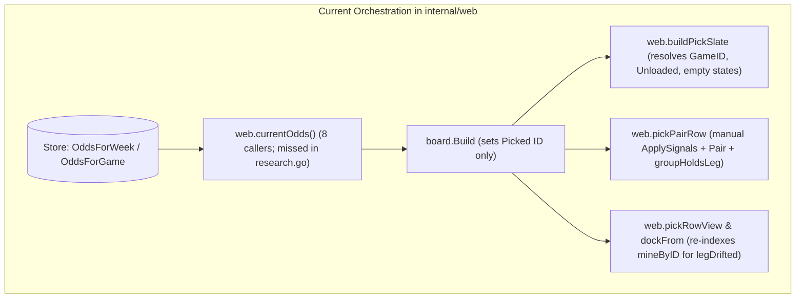
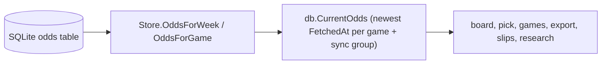
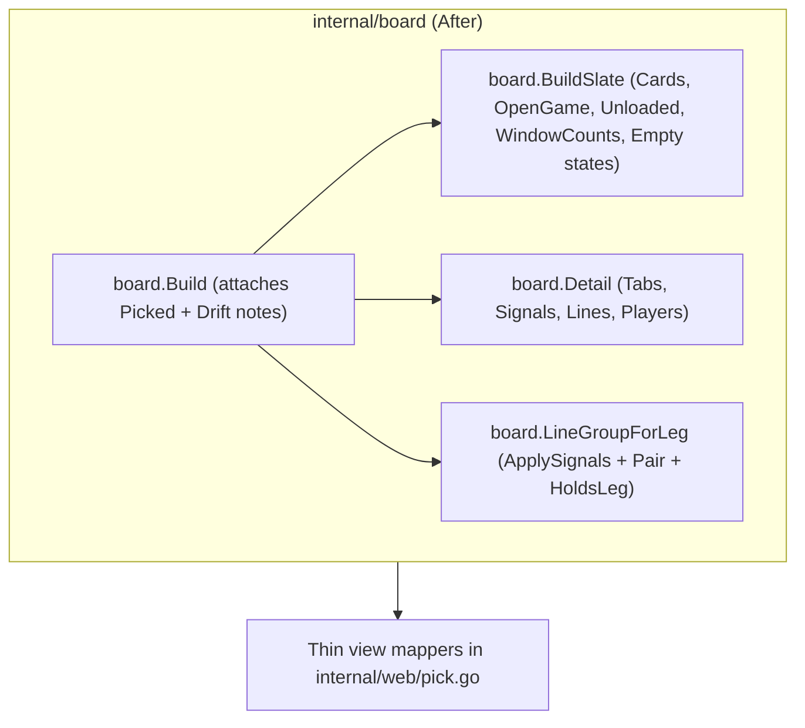

# Design: Deepen pick-board read assembly and current-odds filtering

## Context

Today, `internal/board` exposes low-level pure primitives (`Build`, `Slates`, `Detail`, `Pair`, `ApplySignals`), leaving
`internal/web/pick.go`, `internal/web/games.go`, `internal/web/export.go`, `internal/web/slips.go`, and
`internal/web/research.go` to coordinate multi-step data filtering and state assembly:

1. **`currentOdds` lives in `internal/web/games.go`:**
   - `db.UpsertOdds` never deletes rows from earlier syncs when a book drops a market. Instead, `currentOdds(rows)` in
     `internal/web/games.go` groups rows by `(gameID, isPropRow)` and keeps only rows matching the newest `FetchedAt`
     per group.
   - Eight call sites in `internal/web` (`pickPageData`, `pickSlateData`, `pickDetailData`, `pickDockData`,
     `pickPairRow`, `gameHandlers.props`, `exportView`, and `referenceOdds`) must remember to call `currentOdds` after
     `OddsForWeek` or `OddsForGame`.
   - `loadGameResearch` (`internal/web/research.go`) calls `OddsForGame` without `currentOdds`, leaking stale prop
     players from earlier syncs into the game research view.
2. **Picked-leg drift state is re-derived in `internal/web/pick.go`:**
   - `board.Build` matches `mine []db.Leg` against built rows and sets `row.Picked = leg.ID`, discarding the leg's saved
     `Line` and `Odds`.
   - `pickDetailView` and `dockFrom` in `internal/web/pick.go` must rebuild `mineByID` and `rowByLegID` maps to detect
     `legDrifted(leg, row)` and format `boardDriftNote` / `trayDriftNote`.
3. **Slate resolution and single-line partial swaps are stitched together in `internal/web/pick.go`:**
   - `buildPickSlate` (`internal/web/pick.go`) calls `board.Slates` without search text to resolve whether `q.GameID` is
     still open, calls `board.Slates` again when `q.Q != ""`, scans `rows` to compute
     `Unloaded = !card.HasProps && rowGames[card.ID]`, and derives `NoGames`, `AllStarted`, `NoLines`, `Empty`, and
     window chip counts.
   - `pickPairRow` (`internal/web/pick.go`) manually runs `board.ApplySignals` before `board.Pair` and scans groups with
     `groupHoldsLeg` because `board.Pair` does not attach signals or locate a leg's line group.

## Approach

### 1. Move `IsPropRow` and `CurrentOdds` into `internal/db` and filter at the storage seam

- Add `IsPropRow(row Odds) bool` and `CurrentOdds(rows []Odds) []Odds` in `internal/db/odds.go` (keeping
  `board.IsPropRow` as a delegate to `db.IsPropRow`).
- Have `Store.OddsForGame` and `Store.OddsForWeek` in `internal/db/odds.go` return `CurrentOdds(odds)` so every caller
  of the storage seam—including `loadGameResearch` in `internal/web/research.go`—receives only the current sync group's
  rows.
- Move `internal/web/current_odds_test.go` into `internal/db/odds_test.go` and remove the redundant `currentOdds` calls
  across `internal/web`.

### 2. Enrich `board.Row` with picked-leg drift state during `board.Build`

- Extend `board.Row` (`internal/board/board.go`) with:
  - `PickedLine *float64`
  - `PickedOdds int`
  - `Drifted bool`
  - `BoardDriftNote string`
  - `TrayDriftNote string`
- When `board.Build` binds each leg in `mine []db.Leg` to its matching `Row`, populate `PickedLine`, `PickedOdds`,
  `Drifted` (`leg.MarketType != "OTHER" && (!db.SameLine(leg.Line, row.Line) || leg.Odds != row.Odds)`),
  `BoardDriftNote`, and `TrayDriftNote`.
- Remove `mineByID`, `legDrifted`, `boardDriftNote`, and `trayDriftNote` from `internal/web/pick.go`.

### 3. Deepen `internal/board` with `BuildSlate` and `LineGroupForLeg`

- Add `Unloaded bool` to `board.GameCard` (true when `!card.HasProps` and the game has at least one built row).
- Add `board.Slate` and `board.BuildSlate(games []db.Game, rows []Row, roster []db.RosterPlayer, q Query) Slate` in
  `internal/board/board.go`:
  - Computes `Started`, resolves whether `q.GameID` is an open upcoming game in `q.Window` (`OpenGame *GameCard`,
    `ResolvedGameID string`), filters `Cards []GameCard` by `q.Q`, populates `Unloaded` on each card, counts rows per
    `Window` (`WindowCounts map[Window]int`), and sets `NoGames`, `AllStarted`, `NoLines`, and `Empty`.
- Add `(g LineGroup) HoldsLeg(leg db.Leg) bool` and
  `board.LineGroupForLeg(game db.Game, rows []Row, leg db.Leg, signals BoardSignals) (LineGroup, bool)` in
  `internal/board/board.go`, applying signals and pairing rows in one call so `pickPairRow` in `internal/web/pick.go`
  simply maps the returned `LineGroup` to `PickLineGroupView`.

## Verification

- Unit tests in `internal/db/odds_test.go` verifying `CurrentOdds`, `Store.OddsForGame`, and `Store.OddsForWeek` keep
  the newest game-line and prop sync groups per game while dropping superseded rows.
- Unit tests in `internal/board/board_test.go` verifying:
  - `Build` populates `Drifted`, `BoardDriftNote`, and `TrayDriftNote` when a picked leg's line or price moves.
  - `BuildSlate` resolves `OpenGame`, clears `ResolvedGameID` when a game kicks off or falls outside the window, sets
    `GameCard.Unloaded`, and computes `NoGames` / `AllStarted` / `NoLines` / `Empty`.
  - `LineGroupForLeg` attaches `BoardSignals` badges and locates the paired line group for both picked and just-deleted
    legs.
- Handler tests in `internal/web/pick_test.go`, `internal/web/export_test.go`, and `internal/web/research_test.go`
  verifying end-to-end rendering and stale-prop filtering in game research.
- Standard check: `go test -short -race ./...` and `golangci-lint run ./...`.

## Risks

- **Preserving scoped query performance:** `pickSlate` must continue skipping `dockFrom` and `Detail`, and `pickDetail`
  / `pickPairRow` must continue querying only the single open game (`GameByID`, `OddsForGame`, 2-team `RosterForTeams`).
  Keeping `Build`, `BuildSlate`, `Detail`, and `LineGroupForLeg` accepting caller-scoped slices preserves the exact
  SQLite query counts verified by `pick-board-performance`.

## TODO

Effort: medium (restructures the storage-to-board-to-web seam across odds queries, board state assembly, and six
pick/research endpoints)

### Phase 1: Move `CurrentOdds` into `internal/db` and filter in `OddsForGame` / `OddsForWeek`

Effort: easy (self-contained move of sync-group filtering into storage with direct unit tests)

- [x] Add `IsPropRow` and `CurrentOdds` in `internal/db/odds.go`, apply `CurrentOdds` inside `Store.OddsForGame` and
      `Store.OddsForWeek`, remove manual `currentOdds` calls from `internal/web`, and move
      `internal/web/current_odds_test.go` to `internal/db/odds_test.go` (plus add a stale-prop test in
      `internal/web/research_test.go`).

### Phase 2: Deepen `board.Build`, `board.BuildSlate`, and `board.LineGroupForLeg`

- [x] Extend `board.Row` with picked-leg drift fields (`PickedLine`, `PickedOdds`, `Drifted`, `BoardDriftNote`,
      `TrayDriftNote`) in `board.Build`, and add `BuildSlate`, `LineGroup.HoldsLeg`, and `LineGroupForLeg` in
      `internal/board/board.go`, with unit tests in `internal/board/board_test.go`.
- [x] Simplify `pickPageData`, `pickSlateData`, `pickDetailData`, `buildPickSlate`, `dockFrom`, `pickRowView`, and
      `pickPairRow` in `internal/web/pick.go` to use the deepened `board` types and functions, and verify with
      `internal/web/pick_test.go`.
- [x] Docs: update `docs/concepts/slips.md` if board/drift mechanics are referenced.

## Reviews

- [x] Final review: agy@gemini-4-argon-high
