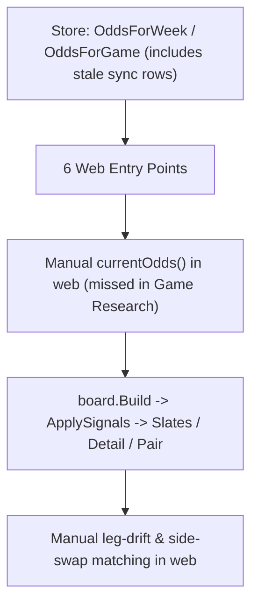
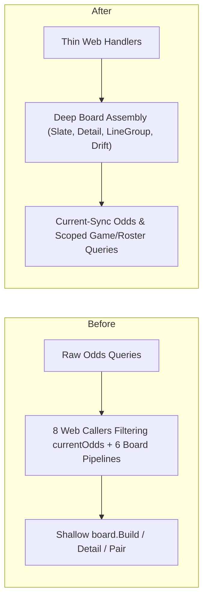

# Deepen pick-board read assembly and current-odds filtering

## Context

Building the pick board, its partial HTMX swaps, and on-demand game prop views currently requires six different web
handlers to manually sequence a seven-step pipeline over raw storage slices:

- **Manual `currentOdds` filtering leaks across handlers:** Because odds upserts retain rows from earlier syncs when a
  sportsbook drops a market, an unexported helper in the web package filters rows down to the newest fetch timestamp per
  `(game, syncGroup)`. Eight call sites across pick board, game props, slip reference pricing, and sportsbook export
  must remember to call that helper after querying odds—and the game research handler forgets to call it, exposing stale
  prop players from old syncs.
- **Fragmented board assembly:** Full-page pick loads, slate refreshes, game detail switches, dock/tray refreshes,
  single-row pick swaps, and standalone game prop panels each repeat their own combination of scope filtering,
  current-odds filtering, roster loading, board row building, signal attachment, row pairing, and leg-drift detection.
- **Inconsistent signal attachment on partial swaps:** Building a game detail view attaches matchup and slip signals
  automatically, whereas pairing rows for a single-line HTMX swap does not, forcing the web handler to manually wire
  signals before pairing so badges do not disappear after picking a leg.

## Goals and non-goals

**Goals:**

- Move current-sync odds filtering behind the storage seam so callers querying current game or week odds never receive
  stale rows from superseded sync passes.
- Deepen the board module so slate cards, game detail views, single-line group rebuilds, and picked-leg drift states are
  assembled behind a cohesive domain interface rather than stitched together in six web handlers.
- Preserve the fast, scoped query paths for slate-only and single-game detail partial requests.

**Non-goals:**

- Changing the game-first pick board UX, URL query parameters, or HTMX swap targets.
- Altering how odds are fetched or stored during background refreshes.

## Decision

Filter superseded odds rows at the storage seam and deepen the board module to own scoped board assembly, signal
attachment on paired line groups, and picked-leg drift state across full-page and partial views.

Pushing current-odds filtering into storage and deepening the board module beats keeping orchestration in the web
package because it eliminates the stale-odds footgun by construction and lets board tests verify signal persistence,
line pairing, and leg drift directly through the board interface instead of parsing rendered HTML.

The `effort` rating is `medium` because the change restructures the seam between storage, the board domain module, and
six HTMX/page endpoints while maintaining strict query scoping for performance.
