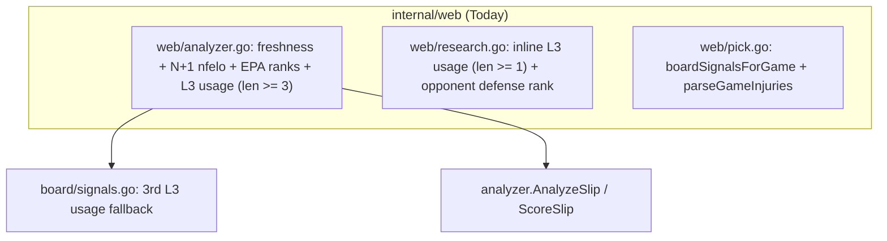
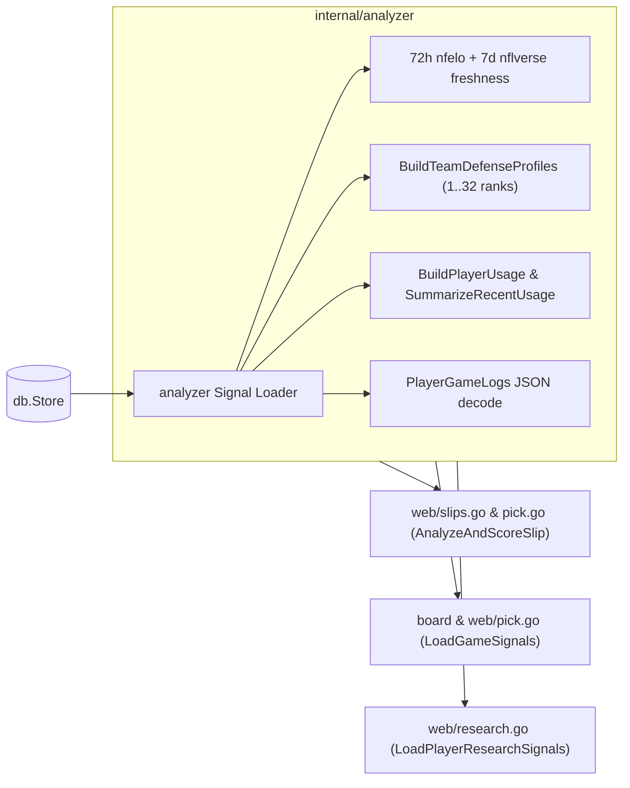

# Design: Deepen analyzer and board signal loading

## Context

`internal/analyzer` and `internal/board` evaluate deterministic rules over in-memory structs (`analyzer.Game`,
`analyzer.PlayerStats`, `board.BoardSignals`), but all signal loading, staleness enforcement, league ranking, and
rolling player usage aggregation currently live in `internal/web`:

1. **Misplaced domain aggregation in `internal/web/analyzer.go`:**
   - `nfeloSource`, `nfeloFreshFor` (`72h`), `nflverseSource`, and `nflverseFreshFor` (`7d`) are defined in
     `package web`.
   - `buildTeamDefenseProfiles` and `rankTeams` (`internal/web/analyzer.go`) compute season-to-date and last-4-week
     offensive/defensive EPA, plays per game, pass rate, and `1..32` league rankings inside `package web`.
   - `buildPlayerUsage` (`internal/web/analyzer.go`) computes last-3-week and season snap/target averages from
     `db.NFLversePlayerWeek` slices inside `package web`.
   - `playerStatsForLegs` (`internal/web/analyzer.go`) loads `Store.PlayerGameLogs` and unmarshals `StatsJSON` in
     `package web`.
2. **Three divergent player-usage calculations:**
   - `buildPlayerUsage` (`internal/web/analyzer.go`) requires `len(rows) >= 3` and computes `Last3SnapAvg`,
     `SeasonSnapAvg`, `Last3TargetShare`, and `SeasonTargetShare` (omitting `Last3WOPR`).
   - `populateNFLverseResearch` (`internal/web/research.go`) bypasses `buildPlayerUsage` and re-computes last-3-week
     averages inline for `len(pWeeks) >= 1` (`min(3, len(pWeeks))`), including `WOPR`.
   - `internal/board/signals.go` (`effectiveTargetShare`, `effectiveSnapAvg`, `effectiveSeasonSnapAvg`, `recentWOPR`,
     `avgCarries`) maintains a third set of fallback loops over `usage.Weeks` in case a caller passed a `PlayerUsage`
     without precomputed averages.
3. **N+1 `nfelo` queries and repeated caller orchestration:**
   - `nfeloForGames` (`internal/web/analyzer.go`) checks `sync_state` once and then loops over `games`, issuing a
     separate `Store.NfeloForGame` SQL query per game.
   - `slipPageData` (`internal/web/slips.go`), `dockFrom` (`internal/web/pick.go`), `buildPickDetail`
     (`internal/web/pick.go`), `pickPairRow` (`internal/web/pick.go`), and `populateNFLverseResearch`
     (`internal/web/research.go`) each sequence these helpers by hand.

## Approach

### 1. Batch `NfeloForGames` in `internal/db/nfelo.go`

- Add `NfeloForGames(ctx context.Context, gameIDs []string) (map[string]NfeloGame, error)` to `db.Store`
  (`internal/db/nfelo.go`), using a single `SELECT ... FROM nfelo_games WHERE game_id IN (...)` query on `s.readConn()`.
- Keep `NfeloForGame` for single-game lookups.

### 2. Move `nflverse` / `nfelo` profile builders and rolling usage math into `internal/analyzer`

- Extend `analyzer.PlayerUsage` (`internal/analyzer/analyzer.go`) with precomputed `Last3WOPR float64` and
  `AvgCarries float64`.
- Create `internal/analyzer/signals.go` holding:
  - Freshness constants `NfeloSource = "nfelo:projections"`, `NfeloFreshFor = 72 * time.Hour`,
    `NFLverseFreshFor = 7 * 24 * time.Hour`, and `NFLverseSource(season int) string`.
  - `BuildTeamDefenseProfiles(rows []db.NFLverseTeamWeek) map[string]*TeamDefenseProfile` and `rankTeams` (moved from
    `internal/web/analyzer.go`).
  - `BuildPlayerUsage(rows []db.NFLversePlayerWeek) *PlayerUsage` (for analyzer and board signals, requiring
    `len(rows) >= 3` and populating `Last3SnapAvg`, `SeasonSnapAvg`, `Last3TargetShare`, `SeasonTargetShare`,
    `Last3WOPR`, and `AvgCarries`).
  - `SummarizeRecentUsage(rows []db.NFLversePlayerWeek) (snapPct, targetShare, wopr float64, ok bool)` (for player
    research, computing up-to-last-3 averages whenever `len(rows) >= 1` using the same field definitions).
  - `GameFromDB(game db.Game, proj *db.NfeloGame, teamEPA map[string]*TeamDefenseProfile) Game` and
    `LegFromDB(leg db.Leg, owner string) Leg`.
- Simplify `internal/board/signals.go` (`isSmashMatchup`, `isHighVolume`, `isRoleBump`) to read `usage.Last3WOPR` and
  `usage.AvgCarries` when populated (retaining a call to `analyzer` helpers only when a test constructs a literal
  `PlayerUsage{Weeks: ...}` with zeroed summary fields).

### 3. Provide cohesive signal-loading entry points in `internal/analyzer`

- Add `LoadSlipSignals(ctx, store, now, weekID, games, legs)` returning `(map[string]Game, map[string]PlayerStats)`:
  - Loads fresh `nfelo` projections in one batch via `store.NfeloForGames`.
  - Loads fresh `nflverse` team defense profiles (`LoadFreshTeamProfiles`) and player usage (`LoadPlayerUsageForIDs`),
    merging regular-season and postseason rows during the postseason (`SeasonTypePostseason`).
  - Loads `store.PlayerGameLogs` and unmarshals `StatsJSON` into `map[string]PlayerStats`.
- Add `LoadGameSignals(ctx, store, now, weekID, playerIDs)` returning
  `(map[string]*TeamDefenseProfile, map[string]*PlayerUsage)` for `boardSignalsForGame` in `internal/web/pick.go`.
- Add `PlayerResearchSignals` and `LoadPlayerResearchSignals(ctx, store, now, athleteID, team, position, activeMarket)`
  for `populateNFLverseResearch` in `internal/web/research.go`.
- Shrink `internal/web/analyzer.go` to view-model mapping (`AnalyzerView`, `GradeView`, `analyzerGuide`, `legModel`,
  `analyzerSeverity`), and move `internal/web/analyzer_internal_test.go` to `internal/analyzer`.

## Verification

- Unit tests in `internal/db/nfelo_test.go` covering `NfeloForGames` batch queries with empty, partial, and full game ID
  slices.
- Unit tests in `internal/analyzer/nflverse_grade_test.go` covering `BuildTeamDefenseProfiles`, `BuildPlayerUsage`,
  `SummarizeRecentUsage`, postseason stat merging, and 72h/7d staleness cutoffs via `LoadSlipSignals` and
  `LoadPlayerResearchSignals`.
- Existing handler tests in `internal/web/analyzer_test.go`, `internal/web/pick_test.go`, and
  `internal/web/research_test.go` verifying identical grades, warnings, board badges, and research stats.
- Standard check: `go test -short -race ./...` and `golangci-lint run ./...`.

## Risks

- **Synthetic `PlayerUsage` literals in existing board tests:** Some unit tests in `internal/board/signals_test.go`
  construct `analyzer.PlayerUsage{Weeks: ...}` without setting `Last3WOPR` or `AvgCarries`. Having `PlayerUsage`
  accessor methods fall back to computing from `Weeks` when the precomputed field is zero keeps those table-driven tests
  passing without boilerplate.

## TODO

Effort: medium (moves signal loading, staleness windows, team EPA ranking, and player usage math across db, analyzer,
board, and web while preserving all grade and badge outputs)

### Phase 1: Batch `NfeloForGames` and move signal profile builders into `internal/analyzer`

- [x] Add `Store.NfeloForGames` in `internal/db/nfelo.go` (with tests in `internal/db/nfelo_test.go`) and create
      `internal/analyzer/signals.go` with `BuildTeamDefenseProfiles`, `BuildPlayerUsage`, `SummarizeRecentUsage`,
      `GameFromDB`, and `LegFromDB`, moving unit tests from `internal/web/analyzer_internal_test.go` into
      `internal/analyzer`.

### Phase 2: Wire `LoadSlipSignals`, `LoadGameSignals`, and `LoadPlayerResearchSignals` into `web` and `board`

- [x] Add `LoadSlipSignals`, `LoadGameSignals`, and `LoadPlayerResearchSignals` in `internal/analyzer/signals.go`,
      update `internal/web/analyzer.go`, `internal/web/slips.go`, `internal/web/pick.go`, `internal/web/research.go`,
      and `internal/board/signals.go` to use them, and verify with tests in `internal/analyzer` and `internal/web`.
- [x] Docs: update `docs/concepts/analyzer.md` and `docs/reference/analyzer-rules.md` if any package-level references
      name where signal aggregation lives.

## Reviews

- [x] Final review: agy@gemini-4-argon-high
