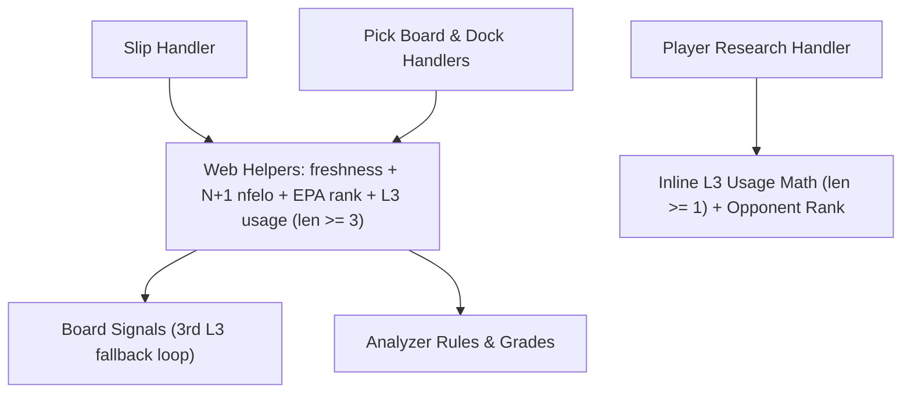
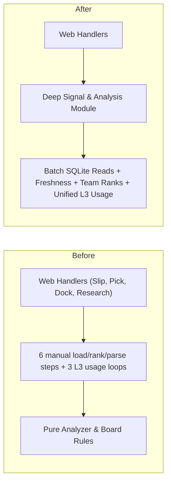

# Deepen analyzer and board signal loading

## Context

The sharp-friend analyzer and the pick board's suggestion engine are pure functions, which keeps their rule evaluation
deterministic. However, because no domain module owns loading and aggregating their inputs from storage, all signal
assembly, freshness windows, league rankings, and rolling usage math currently live in the web handler layer:

- **Three divergent player-usage implementations:** The web analyzer helper computes last-3-week and season snap/target
  averages only when a player has at least 3 games; the player research handler bypasses that helper and re-computes
  last-3-week averages inline for 1 or more games; and the pick board's signal scorer maintains a third set of fallback
  loops over weekly usage slices.
- **Domain logic and staleness constants in HTTP handlers:** The 72-hour `nfelo` and 7-day `nflverse` freshness windows,
  postseason-to-regular-season stat merging, 32-team defensive EPA ranking, ESPN injury JSON parsing, and game-log JSON
  unmarshaling are all implemented inside web handlers and sequenced by hand across the slip page, pick board, pick
  dock, and player research views.
- **Per-game N+1 queries:** Loading `nfelo` projections for a slip or dock checks `sync_state` and then issues a
  separate query for each game on the slate.

## Goals and non-goals

**Goals:**

- Move signal loading, source freshness checks, 32-team EPA ranking, rolling player usage aggregation, game-log
  decoding, and injury parsing out of the web layer into a deep domain seam.
- Unify last-3-week and season usage math so the analyzer, pick board badges, and player research screen read from one
  calculation.
- Replace the per-game `nfelo` projection loop with a single batch query per slate.

**Non-goals:**

- Changing any analyzer warning threshold, letter-grade rubric, or pick-board badge priority.
- Changing how or when the background refresh service fetches `nfelo`, `nflverse`, or ESPN data.

## Decision

Deepen the analyzer and signal domain seam so callers ask one module for slip analysis, game board signals, or player
research context, hiding storage queries, freshness windows, batch projection loading, team EPA ranking, and rolling
player usage math inside the implementation.

Giving the domain module ownership of both signal loading and pure rule evaluation beats keeping assembly helpers in the
web package because domain invariants—such as postseason stat merging, 72-hour/7-day freshness cutoffs, and rolling
usage averages—become directly testable through one domain interface without spinning up HTTP handlers.

The `effort` rating is `medium` because the refactor spans storage batching, analyzer input assembly, pick-board signal
wiring, and player research views while preserving exact scoring and badge behavior.
