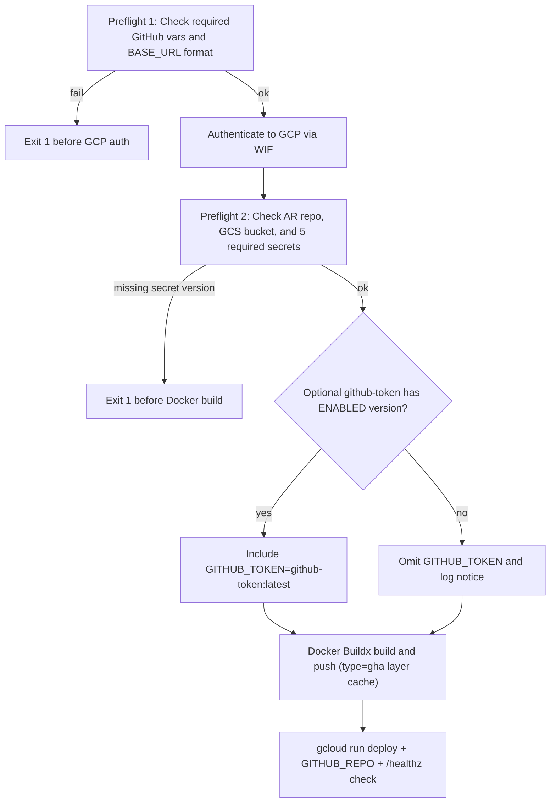

# Design: Deployment readiness and hardening

## Context

The app runs as a single Cloud Run container (`max-instances 1`) with Litestream wrapping `/app/server` (`deploy/entrypoint.sh`) to replicate SQLite (`./data/parlay.db` or `/data/parlay.db`) to GCS. Cloud Run sends `SIGTERM` with a 10-second hard kill window; `cmd/server/main.go` sets `shutdownTimeout = 8 * time.Second` so Litestream keeps 2 seconds for its final WAL sync.

Current seams and gaps across the codebase:

- **Shutdown (`cmd/server/main.go`, `internal/live/stream.go`, `internal/refresh/refresh.go`, `cmd/server/sandbox.go`):**
  - `live.Stream.ServeSlip` blocks on `r.Context().Done()`, timers, and hub channels. `http.Server.Shutdown` waits for active handlers without cancelling `r.Context()`, so one open browser tab stalls HTTP drain until the 8-second timeout expires.
  - `refresh.Service.KickContext` detaches via `context.WithoutCancel` and tracks goroutines in an unexported `wg sync.WaitGroup` (`wait()` is test-only). `run()` calls `defer database.Close()` as soon as `listenAndServe` returns, without cancelling or waiting on background syncs (`syncTimeout = 30 * time.Second`). In sandbox mode, `sandboxRuntime.Kick` launches an untracked goroutine calling `refresher.RunOnce(context.Background())`.
- **Startup and probes (`internal/config/config.go`, `internal/auth/provider.go`, `cmd/server/main.go`):**
  - `config.Load` verifies `BASE_URL` is non-empty in prod, but does not parse it or check for an `http`/`https` scheme and host.
  - `auth.NewGoogleProvider` calls `oidc.NewProvider(ctx, issuer)` once with no retry or per-attempt timeout.
  - `healthz` returns `200 ok` unconditionally without calling `database.PingContext`.
- **Proxy URLs (`internal/groups/handlers.go`):**
  - `inviteURL(r, token)` builds links from `r.Host` and `X-Forwarded-Proto`. Behind Cloudflare's Host rewrite Origin Rule, `r.Host` is the `.run.app` hostname instead of the custom domain in `BASE_URL`.
- **Deploy pipeline (`deploy/setup.sh`, `.github/workflows/deploy.yml`, `Dockerfile`):**
  - `deploy/setup.sh` creates five secrets (`session-key`, `google-client-id`, `google-client-secret`, `odds-api-key`, `the-odds-api-key`) and omits `github-token`. `.github/workflows/deploy.yml` mounts those five secrets, has no pre-flight variable/secret validation before building, does not pass `GITHUB_REPO`, and runs raw `docker build` with no layer cache.
  - `deploy/setup.sh` grants `parlay-deployer` `roles/run.admin` and `roles/artifactregistry.writer`, which cannot read Secret Manager metadata or GCS bucket metadata for pre-flight checks.

**Read before starting:**

- [plan/architecture.md](../../plan/architecture.md) — single-instance layout, server wiring, and SQLite invariants.
- [docs/concepts/live-updates.md](../../docs/concepts/live-updates.md) — SSE deadlines, `bye` event contract, and client reconnect behavior.
- [docs/concepts/data-refresh.md](../../docs/concepts/data-refresh.md) — `Kick()`, `RunOnce()`, single-flight, and timeout boundaries.
- [docs/concepts/groups.md](../../docs/concepts/groups.md) — invite links and `/join/{token}` flow.
- [docs/reference/config.md](../../docs/reference/config.md) — environment variables and rejected values.
- [docs/reference/routes.md](../../docs/reference/routes.md) — `/healthz` and route contracts.
- [docs/guides/gcp-setup.md](../../docs/guides/gcp-setup.md) — GCP resources, secrets, IAM, and first-deploy flow.
- [docs/runbooks/deploy.md](../../docs/runbooks/deploy.md) — Cloud Run deploy workflow and verification.
- [docs/runbooks/custom-domain.md](../../docs/runbooks/custom-domain.md) — Cloudflare Host rewrite and `BASE_URL` usage.

## Approach

### 1. Coordinated shutdown (SSE + refresh + SQLite)

Use one shared `shutdownTimeout` (8 seconds) across HTTP draining and background refresh shutdown so `database.Close()` always completes before Cloud Run's 10-second `SIGTERM` deadline:

```mermaid
sequenceDiagram
    participant CR as Cloud Run
    participant Main as cmd/server
    participant SSE as live.Stream
    participant HTTP as http.Server
    participant Ref as refresh.Service
    participant DB as SQLite and Litestream

    CR->>Main: SIGTERM (10s window)
    Main->>SSE: stream.Shutdown()
    SSE-->>Main: Active ServeSlip handlers return
    Main->>HTTP: server.Shutdown(shutdownCtx 8s)
    HTTP-->>Main: In-flight HTTP handlers finish
    Main->>Ref: refresher.Shutdown(shutdownCtx)
    Ref-->>Main: Cancel worker ctx & wg.Wait()
    Main->>DB: database.Close()
    Main->>CR: Process exits 0; Litestream final sync (2s+)
```

- **`internal/live/stream.go`:** Add `done chan struct{}` (closed once via `sync.Once`) on `Stream` and `func (s *Stream) Shutdown()`. `ServeSlip` selects on `<-s.done` and returns immediately without sending `event: bye`.
  - *Trade-off:* Returning without `bye` lets browser `EventSource` clients auto-reconnect after ~3s to the replacement Cloud Run revision instead of going dormant until the next tab visibility change, while preserving `bye` for planned stream deadlines.
  - *Rejected option:* Setting `http.Server.BaseContext` to the signal context would cancel `r.Context()` on normal in-flight `POST` handlers mid-write instead of letting them drain during `server.Shutdown`.
- **`internal/refresh/refresh.go`:** Hold an internal `stopCtx context.Context` and `stopCancel context.CancelFunc` initialized in `New`, plus a small mutex that makes "not stopping yet" and starting the goroutine one step, so `Shutdown` cannot miss a pass that starts just after its wait begins. `KickContext(reqCtx)` returns early once `s.stopCtx` is cancelled and runs the pass under `s.wg.Go` on `context.WithoutCancel(reqCtx)`. Each source's timeout context in `refreshWithTimeout` also cancels when `s.stopCtx` cancels (via `context.AfterFunc`, unregistered when the source returns), so a stop ends the fetch itself; the pass context stays alive because its child source goroutines still use it. A stop counts as a stop, not a source failure, so it logs no outage and leaves no failure backoff. Add `func (s *Service) Shutdown(ctx context.Context) error` that calls `s.stopCancel()`, waits for `s.wg.Wait()`, and returns `ctx.Err()` if `ctx` expires first.
- **`cmd/server/sandbox.go` and `cmd/server/main.go`:** Give `sandboxRuntime` a `stopCtx` / `wg` (or cancel/track `Kick` goroutines) and a `Shutdown(ctx context.Context) error` method so `SUNDAY_SANDBOX=1` drains identically. Wire `serve` in `cmd/server/main.go` to take a small `shutdownHooks` value holding the pre-HTTP hook (`stream.Shutdown`) and the post-HTTP drain (`refresher.Shutdown` / `runtime.Shutdown`), sharing the single `shutdownCtx`, before `defer database.Close()` runs.

### 2. Startup validation, OIDC retry, and DB health probe

- **`internal/config/config.go`:** Extract a `validateBaseURL(raw string) error` helper using `url.Parse` that requires `Scheme == "http" || Scheme == "https"` and `Host != ""`. Run it whenever `cfg.BaseURL != ""` (after `requiredInProd` checks empty in prod), returning `BASE_URL must be an http or https URL with a host, got %q`. Keep `http` allowed alongside `https` so local dev and prod-env smoke tests on loopback work without TLS termination.
- **`internal/auth/provider.go`:** Add bounded retry around `oidc.NewProvider` inside `NewGoogleProvider` (3 attempts total, short exponential backoff such as 200ms then 500ms, 5s per-attempt timeout derived from `ctx`, aborting immediately on `ctx.Done()`). Keep the exported `NewGoogleProvider` signature unchanged so callers and tests need no API migration; expose an unexported helper if tests inject delays.
- **`cmd/server/main.go`:** Replace the static `healthz` handler with `newHealthzHandler(database *sql.DB, logger zerolog.Logger) http.Handler` passed into `newMux`. On `GET /healthz`, ping SQLite with a 2-second timeout derived from `r.Context()`. Return `200 ok` on success, or log the error and return `503 unavailable` (`text/plain; charset=utf-8`) on failure without exposing internal SQLite error strings.

### 3. Proxy-safe group invite URLs

- **`internal/groups/handlers.go`:** Add a `baseURL string` parameter to `NewHandlers` (trimmed of trailing `/`) stored on `Handlers`. In `inviteURL(r, token)`:
  - When `h.baseURL != ""`, return `h.baseURL + "/join/" + token`.
  - Otherwise fall back to the existing `r.Host` / `X-Forwarded-Proto` logic (and `"/join/" + token` when `r.Host == ""`) so existing unit tests and any caller without a configured URL stay intact.
- **`cmd/server/main.go`:** Pass `cfg.BaseURL` to `groups.NewHandlers`.
  - *Trade-off:* Using `cfg.BaseURL` avoids trusting `X-Forwarded-Host` headers behind multi-hop proxies (Cloudflare -> Cloud Run) and matches how OAuth callbacks and bug report screenshot links already build URLs.

### 4. Secrets alignment, cached builds, and pre-flight checks



- **`deploy/setup.sh`:**
  - Add `github-token` to `SECRETS` so Secret Manager creates the resource and grants `parlay-runtime` `roles/secretmanager.secretAccessor`.
  - Grant `parlay-deployer` `roles/secretmanager.viewer` on the project (metadata-only: allows checking enabled versions without reading secret values) and `roles/storage.bucketViewer` on `gs://$BUCKET` so pre-flight checks succeed.
  - Keep `github-token` clearly noted as optional in script output (`Next:` steps).
- **`Dockerfile`:** Add BuildKit cache mounts (`--mount=type=cache,target=/go/pkg/mod` and `--mount=type=cache,target=/root/.cache/go-build`) to `go mod download` and `go build`.
- **`.github/workflows/deploy.yml`:**
  - Add a pre-auth variables check verifying `GCP_PROJECT`, `GCP_REGION`, `WIF_PROVIDER`, `DEPLOY_SA`, `RUNTIME_SA`, `LITESTREAM_BUCKET`, `AR_REPO`, and valid `http`/`https` `BASE_URL` (when set).
  - Add a post-auth GCP pre-flight step checking the Artifact Registry repo, GCS bucket, and that each required secret (`session-key`, `google-client-id`, `google-client-secret`, `odds-api-key`, `the-odds-api-key`) has at least one `ENABLED` version; check `github-token` separately and set an env flag (`MOUNT_GITHUB_TOKEN`) only if it has an `ENABLED` version.
  - Replace raw `docker build` / `docker push` with `docker/setup-buildx-action@v3` and `docker/build-push-action@v6` using `cache-from: type=gha` and `cache-to: type=gha,mode=max` (avoids consuming Artifact Registry's 0.5 GB free tier with cache layers).
  - Pass `GITHUB_REPO=${{ vars.GITHUB_REPO || github.repository }}` in `--update-env-vars` and append `GITHUB_TOKEN=github-token:latest` to `--set-secrets` when `MOUNT_GITHUB_TOKEN=true`.

## Verification

- **Unit & integration tests:** Run `go test -short -race ./...`, `golangci-lint run ./...`, and `deploy/blackout_test.sh`.
- **Shutdown drain:**
  - `live.Stream`: open SSE client receives updates, then `stream.Shutdown()` causes `ServeSlip` to return promptly (`< 100ms`) and close the stream without `bye`; `bye` still fires on idle/live deadlines; calling `Shutdown()` twice is safe.
  - `refresh.Service`: an in-flight slow source blocking on `ctx.Done()` aborts immediately when `Shutdown(ctx)` runs; `KickContext` after `Shutdown` is a no-op; `Shutdown` returns `context.DeadlineExceeded` if a misbehaving source ignores `ctx` past the caller's deadline.
  - `cmd/server`: `serve` with an open `/slips/{id}/events` SSE stream and a slow request drains cleanly within `shutdownTimeout` when `ctx` cancels.
- **Startup & health:**
  - `config.Load`: accepts `http://` and `https://` URLs with hosts, trims trailing slashes, and rejects schemes like `ftp://`, bare hostnames without schemes, and empty hosts in both dev and prod.
  - `auth.NewGoogleProvider`: retries a test OIDC server returning `503` twice before returning `200` on the third attempt; fails after exhausting attempts; stops immediately when `ctx` is cancelled mid-backoff.
  - `/healthz`: returns `200 ok` with an open SQLite handle and `503 unavailable` after `database.Close()`.
- **Proxy invite URLs:**
  - `GET /groups` with `baseURL = "https://parlay.example.com"` and `r.Host = "parlay-club-xyz.us-central1.run.app"` renders `https://parlay.example.com/join/{token}`; with empty `baseURL`, falls back to `r.Host`.
- **Deploy scripts & docs:**
  - `bash -n deploy/setup.sh`, validate `.github/workflows/deploy.yml` syntax, run `good-vibes docs lint` and `good-vibes docs index` after doc updates.

## Risks

- **Pre-flight permissions on an already-provisioned GCP project:** Adding `gcloud secrets versions list` and `gcloud storage buckets describe` to `deploy.yml` requires `parlay-deployer` to have `roles/secretmanager.viewer` and `roles/storage.bucketViewer`. Re-running `deploy/setup.sh` applies those bindings idempotently; documenting this in `docs/guides/gcp-setup.md` and `docs/runbooks/deploy.md` prevents surprise permission failures.
- **GHA BuildKit cache eviction:** GitHub Actions evicts caches unused for 7 days or over 10 GB, which is benign (falls back to a cold build) and safer than registry caching against Artifact Registry's 0.5 GB free-tier limit.
- **Shortened healthz ping timeout under heavy SQLite load:** A 2-second ping timeout on `/healthz` assumes `MaxOpenConns(1)` is not blocked by a slow query; refresh writes are bounded and short, and Cloud Run's probe tolerates transient latency before marking an instance unhealthy.

## TODO

Effort: medium (coordinates shutdown across SSE, refresh workers, and SQLite within an 8s budget alongside OIDC retry, config/health checks, and CI/GCP changes)

### Phase 1: Drain SSE streams and refresh workers on shutdown

- [x] Add `Stream.Shutdown()` in `internal/live/stream.go` so open SSE streams exit immediately on server stop without sending `bye`, and test SSE + normal HTTP shutdown together.
- [x] Add lifecycle cancellation and `Service.Shutdown(ctx)` in `internal/refresh/refresh.go` (and matching `sandboxRuntime.Shutdown(ctx)` in `cmd/server/sandbox.go`), wire both into `serve` in `cmd/server/main.go` before `database.Close()`, and test cancellation and timeout behavior.
- [ ] Docs: update `docs/concepts/live-updates.md` and `docs/concepts/data-refresh.md` for shutdown behavior.

### Phase 2: Harden startup validation, OIDC discovery, and health checks

- [ ] Validate `BASE_URL` scheme (`http`/`https`) and non-empty host in `internal/config/config.go` with table tests in `internal/config/config_test.go`, and update `docs/reference/config.md`.
- [ ] Add bounded retry with backoff and per-attempt timeout to `auth.NewGoogleProvider` in `internal/auth/provider.go` with transient-failure and cancellation tests in `internal/auth/provider_test.go`.
- [ ] Update `/healthz` in `cmd/server/main.go` to ping SQLite (`200 ok` / `503 unavailable`), update `cmd/server/main_test.go`, and update `docs/reference/routes.md`.

### Phase 3: Build group invite links from configured base URL

Effort: easy (single handler dependency addition and fallback preservation)

- [ ] Thread `cfg.BaseURL` into `groups.NewHandlers` (`internal/groups/handlers.go`, `cmd/server/main.go`) so `inviteURL` uses `BASE_URL` when set and falls back to `r.Host` when empty, with proxy-Host tests in `internal/groups/handlers_test.go`, and update `docs/concepts/groups.md` and `docs/runbooks/custom-domain.md`.

### Phase 4: Align GCP secrets, build caching, and deploy preflight

Effort: easy (script, Dockerfile cache mounts, and workflow steps with doc updates)

- [ ] Add `github-token` secret and deployer viewer bindings (`secretmanager.viewer`, `storage.bucketViewer`) to `deploy/setup.sh`, and add BuildKit cache mounts to `Dockerfile`.
- [ ] Update `.github/workflows/deploy.yml` with pre-auth variable checks, post-auth GCP/secret preflight, Buildx GHA layer caching, `GITHUB_REPO` env var, and conditional `GITHUB_TOKEN` secret wiring.
- [ ] Docs: update `docs/guides/gcp-setup.md` and `docs/runbooks/deploy.md` to document the six secrets, deployer viewer permissions, pre-flight checks, and build caching.
