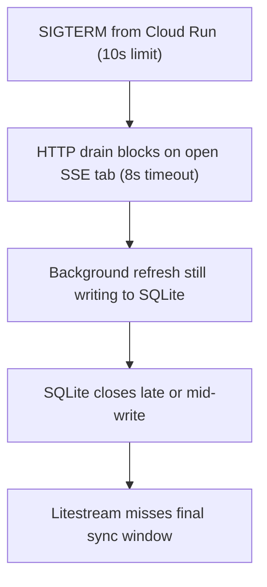
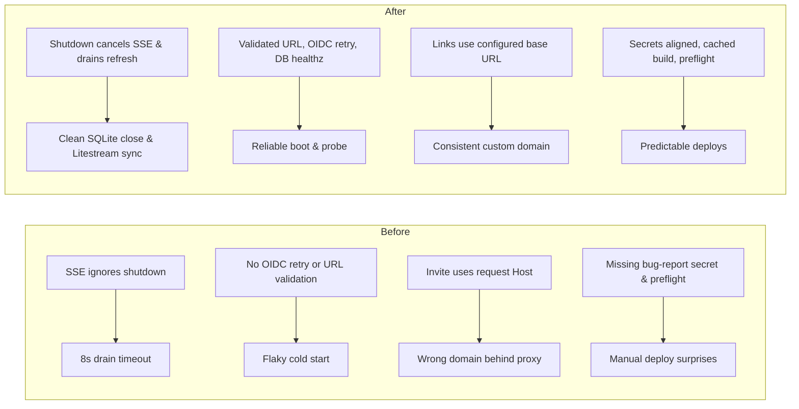

# Deployment readiness and hardening

## Context

The app is ready for its first Cloud Run deployment on paper, but several runtime and pipeline gaps put uptime, writes,
and smooth rollouts at risk.

Cloud Run gives a stopping container 10 seconds on `SIGTERM` before killing it. The server sets an 8-second HTTP drain
window so Litestream has 2 seconds for its final sync to Cloud Storage. Today, open live-update SSE streams do not close
on shutdown, so a single open browser tab forces the drain to time out at 8 seconds and exit non-zero. At the same time,
background refresh workers run on a detached context and are never waited on before closing SQLite.

Cold starts and proxy routing carry similar risks:

- Startup discovers Google's OpenID configuration synchronously with no retry, so a brief network blip fails the boot.
- Production requires a public base URL, but startup does not verify that it is a valid `http` or `https` URL, and the
  health probe does not check SQLite.
- Behind Cloudflare, the incoming `Host` header is rewritten to the Cloud Run hostname, so group invite links built from
  the request host point friends away from the custom domain.
- The setup script and deploy workflow omit the optional GitHub token secret that in-app bug reports need to file
  issues, offer no pre-flight check before deploying, and rebuild the container without layer caching.

## Goals and non-goals

**Goals:**

- Drain open SSE streams and background refresh workers cleanly on `SIGTERM` so SQLite closes and Litestream syncs well
  within Cloud Run's 10-second window.
- Make cold starts and configuration fail fast on bad inputs and ride out brief Google OIDC hiccups, with a health check
  that verifies database readiness.
- Build public links, including group invites, from the configured public base URL so custom domains behind proxies stay
  consistent.
- Align GCP setup and the deploy workflow with all documented runtime secrets, speed up container builds with caching,
  and add a pre-flight check before shipping.

**Non-goals:**

- Moving off single-instance Cloud Run, SQLite, or Litestream, or removing the game-window deploy blackout.
- Adding scheduled background jobs, external monitoring stacks, or multi-region failover.
- Automating Google OAuth console clicks or Cloudflare dashboard rules that require interactive login.

## Decision

Harden the server lifecycle, startup checks, proxy URL handling, and deploy pipeline in one focused pass before the
first production launch.

Coordinating shutdown across SSE streams, background refresh, and SQLite stops write loss during deploys and
scale-to-zero without changing the single-instance architecture. Checking configuration, proxy URLs, secrets, and build
caching together removes the most likely first-deploy failures rather than discovering them piecemeal on Cloud Run.

The `medium` effort rating fits because the work touches several independent seams—server shutdown, startup resilience,
proxy-aware URL generation, and CI/GCP wiring—while keeping every existing architectural boundary intact.
