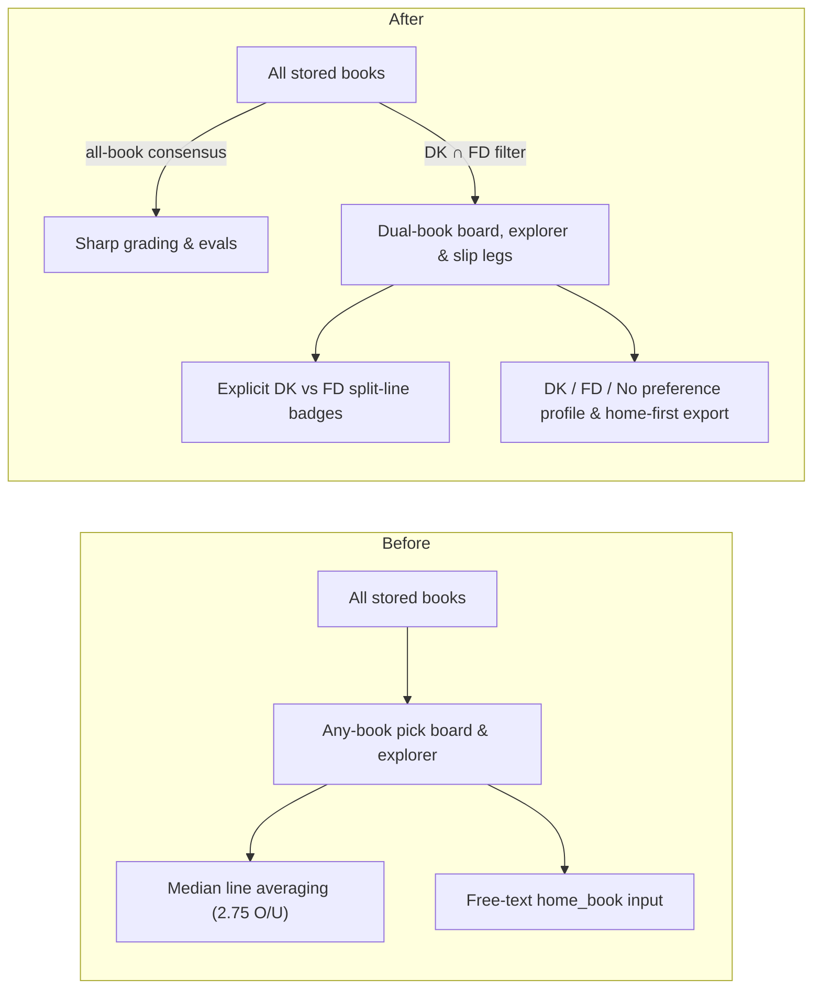

# Close-out

## Overview

## Consequences

- **Easier:** Members only see selections quoted by both DraftKings and FanDuel, avoiding picks that drop to manual entry on export.
- **Easier:** Differing DK and FD lines render side by side with the viewer's home book first instead of a synthetic median average.
- **Easier:** Setting a home book uses a validated DraftKings / FanDuel / No preference selector, and the export card puts that book first.
- **Harder:** Props quoted on only one of the two books—or mismatched across feeds by player name—stay hidden until both DK and FD quotes exist.
- **Harder:** Maintainers adding board callers must choose explicitly between dual-book mode (`board.BuildDualBook`) and all-book consensus (`board.BuildWithOptions`).
- **Revisit:** Adding a third retail sportsbook will require generalizing the two-book intersection, the `DK`/`FD` quote fields on `board.Row`, and the Profile/Export UI.

## Alternatives considered

- **Drop non-DK/FD books at ingest time:** Rejected because sharp-book grading and market-consensus evals rely on Pinnacle, Circa, LowVig, BetOnline, and other stored books remaining in `db.Odds`.
- **Show only one book's line silently when DK and FD disagree:** Rejected because hiding a 1–2 point difference misleads members placing the bet on the other book.
- **Switch `board.Build` globally to dual-book mode:** Rejected because offline market evals need all-book consensus; exposing `BuildDualBook` and `BuildWithOptions` keeps both modes explicit.

## Implementation notes

- The plan referenced `docs/concepts/pick-board.md`, which does not exist in this repo; pick board and Research behavior is documented in `docs/concepts/slips.md`.
- `board.LineKey` was aligned with `db.SameLineGroup` (`TOTAL` keyed by market alone and `TEAM_TOTAL` by `TEAM_TOTAL|<team>`) so split Over/Under rows stay paired in one `LineGroup` across half-point differences.
- When a viewer has no home book set, `Row.Line` and `Row.Odds` default deterministically to FanDuel while split-line badges still show both books.
- Legacy `home_book` values outside `""`, `"draftkings"`, and `"fanduel"` display as "No preference" on `GET /me` without breaking existing profiles, while `POST /me` rejects invalid values with `422`.

## Follow-ups

None.
