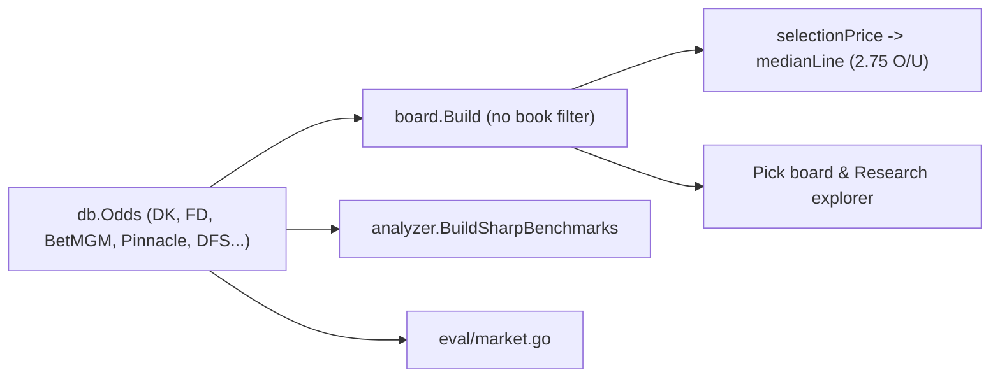
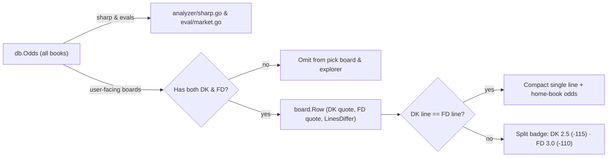

# Design: DK and FD dual-book board and split-line display

## Context

`internal/board/board.go` builds pickable `Row`s in `Build(games, odds, roster, homeBook, mine, now)`. Today:

- `Build` groups **all** `db.Odds` rows regardless of bookmaker, so a prop quoted only by BetMGM, BetRivers, or
  PrizePicks appears on the pick board and research explorer.
- `selectionPrice(rows, homeBook)` falls back to `medianLine(rows)` when `homeBook` is empty or missing from that
  selection. With two books at `2.5` and `3.0`, `analyzer.Median` averages them into `2.75`.
- `internal/eval/market.go` also calls `board.Build(..., "", nil, time.Time{})` to compute market-wide consensus rows
  for offline evaluation, and `internal/analyzer/sharp.go` reads all books in `db.Odds` (Pinnacle, Circa, LowVig,
  BetOnline) for sharp-book grading.
- `web/templates/profile.html` renders `home_book` as a free-text `<input type="text">` instead of a DraftKings /
  FanDuel selector, and `internal/web/slips.go` saves any arbitrary trimmed string.

## Approach

### 1. Dual-book (`draftkings` ∩ `fanduel`) filtering with explicit `BookQuote`s

Keep `db.Odds` storing all books unchanged (preserving sharp-book grading and `internal/eval/market.go`), and introduce
a dedicated dual-book representation in `internal/board`:

- Add `BookQuote{Book string; Line *float64; Odds int}` and attach `DK *BookQuote`, `FD *BookQuote`, and
  `LinesDiffer bool` to `board.Row`.
- Add a clean `BuildOptions` (or `BuildDualBook` / filter flag) so user-facing callers (`internal/web/pick.go`,
  `internal/web/games.go`, `internal/web/research.go`, `internal/web/slips.go`) require **both** `draftkings` and
  `fanduel` rows for a selection to appear on pickable surfaces, while `internal/eval/market.go` continues to use
  all-book consensus without regression.
- **No synthetic line averaging:** For dual-book rows, `Row.Line` and `Row.Odds` use the viewer's `homeBook` when set
  (`draftkings` or `fanduel`), and default to `fanduel` (or `draftkings` deterministically when `homeBook` is unset)
  rather than averaging two different numbers. `LinesDiffer` is true whenever `!db.SameLine(dk.Line, fd.Line)`.
- **Line grouping (`Pair` / `LineKey`):** Player props already group by `(market, canonicalPlayerKey)`, and `SPREAD` /
  `ML` group by `market`. Update `TOTAL` and `TEAM_TOTAL` `lineKey` grouping when DK and FD disagree by half a point so
  Over and Under stay paired in one `LineGroup` rather than splitting into two broken half-rows.

### 2. Clear split-line display at phone width

In `internal/web/pick.go`, `internal/web/research.go`, and `web/templates/` (pick game detail, slate cards, research
explorer, and bet detail):

- When `LinesDiffer` is false, keep the existing compact phone layout (line + primary odds, with optional subtle
  secondary book price in bet detail).
- When `LinesDiffer` is true, render a concise two-book line badge directly on the option/card—putting the viewer's
  `homeBook` first (e.g. `DK 68.5 (-111) · FD 66.5 (-115)` or `FD 228.5 (-113) · DK 229.5 (-111)`)—so both numbers are
  immediately obvious at 375px phone width with no synthetic `.25` or `.75` averages.
- On the slip leg list (`internal/web/slips.go`), when a picked leg's current DK and FD lines differ, show the compact
  split note beside the leg so friends on the other book know their exact number before locking.

### 3. DK / FD-first profile and home-book UX

- Replace the free-text `home_book` input in `web/templates/profile.html` with a segmented radio/button picker:
  **DraftKings**, **FanDuel**, or **No preference**.
- Validate `home_book` in `POST /me` (`internal/web/slips.go`) to accept `""`, `"draftkings"`, or `"fanduel"` (treating
  legacy unknown keys gracefully as `""` on display so existing rows never error).
- Order the export card's two books (`internal/web/export.go`) with the viewer's `homeBook` first when set, so their
  primary sportsbook is always the top tap target on mobile.

## Verification

- `go test -short ./... && golangci-lint run ./...`
- `internal/board/board_test.go`:
  - Verify selections quoted by only one of DK/FD (or only BetMGM/Bovada/PrizePicks) are excluded from dual-book boards.
  - Verify selections quoted by both DK and FD at different lines (`2.5` vs `3.0`) set `LinesDiffer = true`, populate
    both `DK` and `FD` quotes, and never produce a `2.75` average line.
  - Verify `TOTAL` and `TEAM_TOTAL` Over/Under stay paired in one `LineGroup` when DK and FD differ by 0.5 points.
- `internal/web/pick_test.go`, `internal/web/research_test.go`, `internal/web/slips_test.go`, and
  `internal/web/export_test.go`:
  - Verify split-line display renders both `DK` and `FD` lines with the viewer's `homeBook` first.
  - Verify Profile renders the DK/FD selector, `POST /me` validates allowed values, and export orders the viewer's home
    book first.
- Verify `go test ./internal/eval/...` and `go test ./internal/analyzer/...` pass unchanged (sharp books and market-wide
  evals unaffected).

## Risks

- **Reduced prop count before enrichment:** If Parlay API omits a prop on one book until The Odds API enriches it, that
  prop will be hidden until both DK and FD rows exist. Mitigated because both Parlay API and The Odds API quote DK and
  FD on standard NFL markets, and hiding single-book props is the exact goal so slips stay exportable on both books.
- **Player-name mismatches between DK and FD:** If DK and FD spell a player name slightly differently across feeds, a
  selection could fail to intersect. Mitigated because `board.Build` already keys player props by
  `canonicalPlayerKey(playerID, playerName, team)` using the ESPN roster index and `db.NormalizePlayerName`.

## TODO

### Phase 1: Dual-book intersection and split-line model in `internal/board`

Complexity: medium (modifies `board.Build` grouping, `BookQuote` modeling, and `TOTAL`/`TEAM_TOTAL` pairing while
preserving all-book consensus for `internal/eval/market.go`).

Risk: medium (changes core board-building behavior across pick, games, and research surfaces; strong unit test coverage
in `board_test.go` and `eval`).

- [x] Add `BookQuote`, `Row.DK`, `Row.FD`, `Row.LinesDiffer`, and dual-book filtering (`draftkings` ∩ `fanduel`) in
      `internal/board/board.go` (never averaging differing lines into a median), keep an explicit all-book mode for
      `internal/eval/market.go`, and update `lineKey` pairing so split `TOTAL`/`TEAM_TOTAL` rows stay paired; add unit
      tests in `internal/board/board_test.go`.
- [x] Switch user-facing board callers in `internal/web/pick.go`, `internal/web/games.go`, `internal/web/research.go`,
      and `internal/web/slips.go` to the dual-book board builder and verify `internal/eval` and `internal/analyzer`
      tests stay green.

### Phase 2: Split-line phone UI and DK/FD-first profile and export UX

Complexity: medium (coordinates view models and templates across pick board, research explorer, slip list, profile, and
export at phone width).

Risk: medium (UI/template changes across multiple screens; handler tests verify rendered HTML, while phone visual check
confirms layout density).

- [x] Render explicit DK vs. FD split lines (ordered with the viewer's `homeBook` first) in `web/templates/` and view
      builders (`internal/web/pick.go`, `internal/web/research.go`, `internal/web/slips.go`) whenever `LinesDiffer` is
      true, with handler tests in `internal/web/pick_test.go` and `internal/web/research_test.go`.
- [x] Replace the free-text `home_book` input in `web/templates/profile.html` with a DraftKings / FanDuel / No
  preference selector, validate `home_book` in `internal/web/slips.go`, and order the export card's books in
  `internal/web/export.go` with the viewer's `homeBook` first, with tests in `internal/web/slips_test.go` and
  `internal/web/export_test.go`.
- [ ] Docs: update `docs/concepts/pick-board.md` (or board/research concept docs) and `docs/concepts/export.md` to
  document the DK ∩ FD pickable filter, split-line display, and DK/FD home-book UX.
