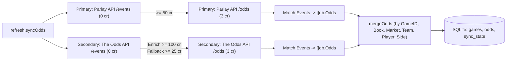

# Design: The Odds API fallback and enrichment

## Context

`internal/ingest/odds` currently targets Parlay API (`https://parlay-api.com/v1/sports/americanfootball_nfl`) for free event lists (`GET /events`), full-game lines (`GET /odds`), and flat bulk props (`GET /props`). `internal/refresh` calls `odds.Client` through `LinesClient` (`Events` + `Lines`), matches event IDs onto ESPN `games` rows via `odds.MatchEvents`, writes `db.Odds` rows inside one transaction, and tracks remaining credits in `sync_state` under `odds:lines` (`OddsLinesFloor = 50`). `internal/export` builds single-leg and combined betslip links from `odds.link`, `odds.sid`, and `odds.event_sid`, falling back to manual checklist items (`no link`) whenever `link` is `NULL`. `internal/ingest/archive` wraps the shared HTTP transport and already maps both `parlay-api.com` and `the-odds-api.com` to `SourceOdds` (`"odds"`).

Read before starting:

- `docs/reference/data-sources.md` — Parlay API endpoints, market keys, deep-link shapes, and credit budget
- `docs/concepts/data-refresh.md` — lazy sync passes, `sync_state` keys, failure backoff, and credit floors
- `docs/concepts/export.md` — `BookPlan`, FanDuel and DraftKings combiners, and `no link` / `line moved` rules
- `docs/reference/config.md`, `docs/guides/gcp-setup.md` — environment variables and Cloud Run secrets
- `plan/data-sources.md` — prop market table and saved fixtures (`odds_game_links.json`, `odds_prop_links.json`, `props_sample.json`)

### Provider wire formats and cost comparison

| Capability | Parlay API (`DefaultBaseURL`) | The Odds API (`TheOddsAPIBaseURL`) |
| --- | --- | --- |
| Base URL | `https://parlay-api.com/v1/sports/americanfootball_nfl` | `https://api.the-odds-api.com/v4/sports/americanfootball_nfl` |
| Free budget | 1,000 credits / month | 500 credits / month |
| Event list (`GET /events`) | 0 credits; `commence_time` may be `null` | 0 credits; standard RFC 3339 `commence_time` |
| Game lines (`GET /odds`) | 3 credits (`regions=us`, `h2h,spreads,totals`); FanDuel links/sids only | 3 credits (`regions=us`, `h2h,spreads,totals`); DraftKings, FanDuel, and US book links, `sid`, and `event_sid` |
| Per-game props | 3 credits flat (`GET /props?eventId={id}&limit=10000`), flat JSON array `[]propResponse`; FanDuel links/sids only | 1 credit per market returned (`GET /events/{id}/odds?regions=us`), nested `eventResponse`; DraftKings and FanDuel links, `sid`, and `event_sid` |

Because The Odds API bills `/odds` by `markets × regions` rather than by bookmaker count, requesting all US bookmakers (`regions=us`) costs the exact same 3 credits as filtering to `bookmakers=draftkings`.

## Approach



### 1. The Odds API base URL, nested per-event props, and prop merging (`internal/ingest/odds`)

- Add `TheOddsAPIBaseURL = "https://api.the-odds-api.com/v4/sports/americanfootball_nfl"` to `internal/ingest/odds/client.go`. `Client.Events` and `Client.Lines` already parse The Odds API's wire format without change.
- Add `EventSid string` to `odds.Prop` in `internal/ingest/odds/props.go` so DraftKings combined prop links have the bookmaker's event ID (`bookmakers[].sid`).
- Add `Client.EventProps(ctx context.Context, eventID string) ([]Prop, Credits, error)` in `internal/ingest/odds/props.go` to query The Odds API's per-event prop endpoint:
  ```text
  GET /events/{eventID}/odds?regions=us&markets={propsMarkets}&oddsFormat=american&includeLinks=true&includeSids=true
  ```
  `EventProps` decodes the single `eventResponse` object (`bookmakers[].markets[].outcomes[]`) and maps each priced outcome into `Prop`:
  - `market.Key` maps through `propMarketAliases`. Unknown market keys are ignored.
  - For `MarketAnytimeTD`, keep only outcomes with `outcome.Name == "Yes"` and non-nil `outcome.Price`; set `PlayerName = strings.TrimSpace(outcome.Description)`, `Side = SideYES`, `Line = nil`, `Link = outcome.Link`, `Sid = outcome.Sid`, `EventSid = book.Sid`.
  - For `MarketTeamTotal`, require non-nil `outcome.Price` and `outcome.Point`, map `outcome.Name` (`"Over"` / `"Under"`) via `totalSide`, and set `Team = strings.TrimSpace(outcome.Description)`.
  - For all other prop markets, require non-nil `outcome.Price` and `outcome.Point`, map `outcome.Name` (`"Over"` / `"Under"`), and set `PlayerName = strings.TrimSpace(outcome.Description)`.
  - Skip outcomes with an empty subject (`Description`), missing `Price`, or missing `Point` (on non-TD markets).
- Add `MergeProps(primary, secondary []Prop) []Prop` in `internal/ingest/odds/props.go`:
  - Keys rows by `(Book, MarketType, Team, PlayerName, Side)`.
  - If `primary` is empty, returns a copy of `secondary`; if `secondary` is empty, returns a copy of `primary`.
  - Records each book's non-empty `EventSid` from `secondary` so any primary row for that book with an empty `EventSid` inherits it.
  - For each `sec` row in `secondary`:
    - If the selection key is absent from `primary`, appends `sec`.
    - If present (`prim`):
      - When `prim.Link == ""` and `sec.Link != ""`: copies `sec.Link`, `sec.Sid`, and `sec.EventSid` (if non-empty). If `!samePropLine(prim.Line, sec.Line)`, also copies `sec.Line` and `sec.Price` so a newly linked DraftKings or FanDuel prop row never advertises a line that disagrees with its deep link.
      - When `prim.Link != ""`: keeps `prim`'s line, price, and link; backfills `prim.Sid` if empty and `samePropLine(prim.Line, sec.Line)`, and backfills `prim.EventSid` if empty.

### 2. Dual-provider game-line enrichment, fallback, and credit floors (`internal/refresh`)

- Add constants in `internal/refresh/refresh.go`:
  - `TheOddsAPISource = "odds:theoddsapi"` — `sync_state` and archive key for The Odds API calls. Because it has the `"odds:"` prefix, `archive.Transport` automatically labels its archived responses with `source = "odds"` and extracts `X-Requests-Remaining` and `X-Requests-Last`.
  - `TheOddsAPIEnrichFloor = 100` — minimum remaining credits on The Odds API to run routine enrichment when Parlay API succeeded.
  - `TheOddsAPIFallbackFloor = 25` — minimum remaining credits on The Odds API to serve as fallback when Parlay API is unconfigured, errors out, or sits below `OddsLinesFloor` (`50`).
- Add `FallbackLines LinesClient` to `refresh.Deps` and `fallbackLines LinesClient` to `refresh.Service`. A `nil` `FallbackLines` (or one returning `odds.ErrNoAPIKey`) leaves existing single-provider behavior and tests unchanged.
- Refactor `syncOdds` in `internal/refresh/sources.go` to coordinate both providers and normalize each into `[]db.Odds` before merging:
  ```mermaid
  sequenceDiagram
      participant R as refresh.syncOdds
      participant P as Primary (Parlay API)
      participant F as Fallback (The Odds API)
      participant DB as SQLite (Store)

      R->>P: Events(ctx) [key="odds:lines"]
      alt Primary Events & Lines >= 50 cr
          P-->>R: events, credits
          R->>DB: SetSyncCredits("odds:lines", credits)
          R->>P: Lines(ctx)
          P-->>R: primaryRows, lineCredits
          R->>DB: SetSyncCredits("odds:lines", lineCredits)
      else Primary ErrNoAPIKey / Error / < 50 cr
          P-->>R: primaryRows = nil (primaryOK = false)
      end

      opt FallbackLines != nil
          R->>F: Events(ctx) [key="odds:theoddsapi"]
          F-->>R: fbEvents, fbCredits
          R->>DB: RecordSync("odds:theoddsapi", now, fbCredits)
          alt (primaryOK && fbCredits >= 100) || (!primaryOK && fbCredits >= 25)
              R->>F: Lines(ctx) [key="odds:theoddsapi"]
              F-->>R: secondaryRows, fbLineCredits
              R->>DB: RecordSync("odds:theoddsapi", now, fbLineCredits)
          end
      end

      R->>R: mergeOdds(primaryRows, secondaryRows)
      R->>DB: Tx: SetGameOddsEvent + UpsertOdds + RecordSync("odds:lines")
  ```
- **Event matching across providers:** Each provider's `Events` list is matched independently against `matchGames(games)` using `odds.MatchEvents`, and its `[]odds.Line` slice is converted to `[]db.Odds` using that provider's own `eventGames` map. Because `db.Odds` is keyed by ESPN `GameID` and ESPN team abbreviations (`HomeTeam` / `AwayTeam`), provider event IDs never need to match each other.
- **Preserving `games.odds_event_id`:** `writeOdds` stores `primaryMatches` on `games.odds_event_id`. A game matched only in `fallbackMatches` updates `games.odds_event_id` only when the game has no `primaryMatches` entry and its stored `game.OddsEventID` is `nil`, preventing `odds_event_id` churn if Parlay API has a transient failure.
- **Row-level merging (`mergeOdds(primary, secondary []db.Odds) []db.Odds`):**
  - Keys rows by `(GameID, Book, MarketType, Team, PlayerName, Side)`.
  - Records each `(GameID, Book)`'s non-nil `EventSid` from `secondary` so any primary row for that game and book with `EventSid == nil` receives it.
  - For each `sec` row in `secondary`:
    - If absent from `primary`, appends `sec` (backfilling missing books or markets such as unquoted early-week moneylines).
    - If present (`prim`):
      - When `prim.Link == nil` and `sec.Link != nil`: copies `sec.Link`, `sec.Sid`, and `sec.EventSid` (when non-nil). If `!db.SameLine(prim.Line, sec.Line)`, also copies `sec.Line` and `sec.Price` so DraftKings (or backfilled FanDuel) rows always have a line matching their deep link.
      - When `prim.Link != nil`: keeps `prim`'s line, price, and link; backfills `prim.Sid` if `nil` and `db.SameLine(prim.Line, sec.Line)`, and backfills `prim.EventSid` if `nil`.
- **Error and unconfigured handling:**
  - `errors.Is(err, odds.ErrNoAPIKey)` on either provider is treated as "provider disabled", not a failure. If both providers are nil or return `ErrNoAPIKey`, `syncOdds` returns `odds.ErrNoAPIKey`.
  - If one provider is configured and succeeds while the other fails with a network/HTTP error, `syncOdds` logs a warning (`Warn()`) and commits the surviving provider's rows so `odds:lines` does not enter backoff.
  - If every configured provider fails with an error, `syncOdds` returns the joined error so `refresh` backs off `odds:lines` for 5 minutes and keeps cached rows.

### 3. Configuration and deployment wiring (`internal/config`, `cmd/server`, `deploy/`)

- Add `TheOddsAPIKey string` to `config.Config` in `internal/config/config.go`, populated from `env("THE_ODDS_API_KEY")`. Like `ODDS_API_KEY`, it defaults to empty in dev and is optional in prod.
- In `cmd/server/main.go`, pass `FallbackLines: odds.NewClient(odds.TheOddsAPIBaseURL, cfg.TheOddsAPIKey, ingestClient)` to `refresh.New(refresh.Deps{...})`.
- In `deploy/setup.sh` and `.github/workflows/deploy.yml`, add `the-odds-api-key` to Secret Manager and mount `THE_ODDS_API_KEY=the-odds-api-key:latest` alongside `ODDS_API_KEY=odds-api-key:latest`.

### Rejected options

- **Querying The Odds API with `bookmakers=draftkings` only:** Rejected because The Odds API bills `/odds` by `markets × regions` (3 credits for `regions=us` whether 1 bookmaker or 15 are returned). Fetching all of `regions=us` costs the exact same 3 credits while also allowing The Odds API to backfill missing FanDuel links, missing bookmaker lines, and full fallback slates.
- **Reconciling provider event IDs directly:** Rejected because matching each provider's `/events` list to ESPN `games` first converts every row to our canonical `GameID` and ESPN team abbreviations before merging.
- **Keeping primary's spread/total number when attaching a secondary link for a different number:** Rejected because attaching a `-3.5` deep link to a `-3.0` row would open the wrong line in the sportsbook app and bypass export's `line moved` check. Adopting secondary's line and price when `prim.Link == nil && sec.Link != nil && !SameLine` keeps the stored line and link consistent.

## Verification

- `go test ./...` and `golangci-lint run ./...` pass; `good-vibes docs lint` and `good-vibes check draftkings-links` pass.
- `Client.EventProps`: parses `internal/ingest/odds/testdata/odds_prop_links.json` into `[]Prop` with DraftKings and FanDuel `Link`, `Sid`, and bookmaker `EventSid` (`"34118128"` for DraftKings, `"35603243"` for FanDuel); normalizes `ANYTIME_TD` (`SideYES`, `Line: nil`) and `TEAM_TOTAL` (`Team` set, `PlayerName` empty); skips `"No"` anytime-TD outcomes, unpriced outcomes, and unknown markets; requires a non-empty `eventID`.
- `MergeProps`: merges Parlay API `props_sample.json` rows (where DraftKings `Link` and `Sid` are empty) with The Odds API `odds_prop_links.json` rows, populating DraftKings `Link`, `Sid`, and `EventSid`, adopting The Odds API's line/price when a newly linked DraftKings line differs (`268.5` -> `278.5`), preserving FanDuel's primary line/price/link, and appending any selection present only in secondary.
- `refresh.syncOdds` enrichment: when primary returns Parlay API lines (FanDuel linked, DraftKings unlinked) and fallback returns The Odds API lines (`>= 100` credits), stored `odds` rows carry FanDuel's primary prices/links and DraftKings' enriched `link`, `sid`, and `event_sid`, plus any book/market present only in The Odds API; `sync_state` records remaining credits for both `odds:lines` and `odds:theoddsapi`; `api_responses` archives calls under `"odds:lines"` and `"odds:theoddsapi"`.
- `refresh.syncOdds` credit floors: when primary succeeds and fallback has `< 100` credits (e.g. `80`), fallback's free `/events` call updates `odds:theoddsapi` credits and skips its paid `/odds` call; when primary is below `50` credits (or fails) and fallback has `>= 25` credits (e.g. `80`), fallback buys lines and updates the week's `odds` rows.
- `refresh.syncOdds` graceful degradation: when fallback returns `ErrNoAPIKey` or a 503 while primary succeeds, `syncOdds` commits primary's rows and does not back off; when primary returns `ErrNoAPIKey` or a 503 while fallback succeeds, `syncOdds` commits fallback's rows and does not overwrite an existing non-nil `games.odds_event_id`.
- End-to-end export compatibility: a locked slip with two DraftKings legs on the same game enriched by `syncOdds` produces a combined DraftKings event URL (`https://sportsbook.draftkings.com/event/{eventSid}?outcomes={sid1},{sid2}`) and per-leg DraftKings links via `export.Plan` with zero changes to `internal/export`.

## Risks

- **The Odds API monthly credit burn if staleness windows shorten:** At ~20 line syncs per week × 3 credits (~240 credits/month), The Odds API stays well under its 500-credit cap. If extra page loads or playoff weeks push usage higher, `TheOddsAPIEnrichFloor = 100` automatically pauses routine enrichment while keeping 100 credits in reserve for fallback.
- **Line divergence between providers at sync time:** Parlay API and The Odds API may briefly quote a half-point difference on DraftKings (`-3` vs `-3.5`). Because `mergeOdds` adopts The Odds API's `Line` and `Price` whenever it attaches a deep link to a previously unlinked row (`prim.Link == nil && sec.Link != nil`), the stored `odds` row always matches the selection opened by `odds.link` and `odds.sid`.
- **Event-ID churn on `games.odds_event_id`:** If Parlay API and The Odds API use different event IDs for the same game, writing fallback's event ID during a transient Parlay API error could overwrite Parlay API's event ID. Guarding `writeOdds` so fallback matches only set `games.odds_event_id` when it is currently `NULL` prevents flapping.

## TODO

Effort: medium (extends `internal/ingest/odds` with nested per-event props and prop merging, and updates `internal/refresh` to coordinate two metered odds providers with independent credit floors and row-level merging)

### Phase 1: Add The Odds API prop endpoint and prop merging

- [x] Add `TheOddsAPIBaseURL` to `internal/ingest/odds/client.go`, add `EventSid` to `odds.Prop`, and implement `Client.EventProps(ctx, eventID)` in `internal/ingest/odds/props.go` to fetch and parse The Odds API's nested `/events/{eventID}/odds` prop response, with unit tests against `testdata/odds_prop_links.json` and edge cases in `internal/ingest/odds/props_test.go`
- [x] Add `MergeProps(primary, secondary []Prop) []Prop` in `internal/ingest/odds/props.go` to backfill missing deep links (`Link`, `Sid`, `EventSid`) and missing selections while keeping newly linked lines consistent, with unit tests in `internal/ingest/odds/props_test.go`

### Phase 2: Wire dual-provider game-line enrichment, fallback, and config

- [x] Add `FallbackLines`, `TheOddsAPISource` (`"odds:theoddsapi"`), `TheOddsAPIEnrichFloor` (`100`), and `TheOddsAPIFallbackFloor` (`25`) to `internal/refresh`, and update `syncOdds` (`internal/refresh/sources.go`) with `mergeOdds` to enrich Parlay API lines with The Odds API deep links and missing quotes, fall back when primary fails or pauses, and degrade gracefully, with unit tests in `internal/refresh/refresh_test.go`
- [x] Add `TheOddsAPIKey` (`THE_ODDS_API_KEY`) to `internal/config/config.go`, wire `FallbackLines` in `cmd/server/main.go`, add `the-odds-api-key` to `deploy/setup.sh` and `.github/workflows/deploy.yml`, and add config tests in `internal/config/config_test.go`
- [ ] Docs: update `docs/reference/data-sources.md`, `docs/concepts/data-refresh.md`, `docs/concepts/export.md`, `docs/reference/config.md`, `docs/guides/gcp-setup.md`, and `plan/data-sources.md` for The Odds API enrichment and fallback, `THE_ODDS_API_KEY`, `odds:theoddsapi` credit tracking, tiered credit floors, and DraftKings deep-link export
