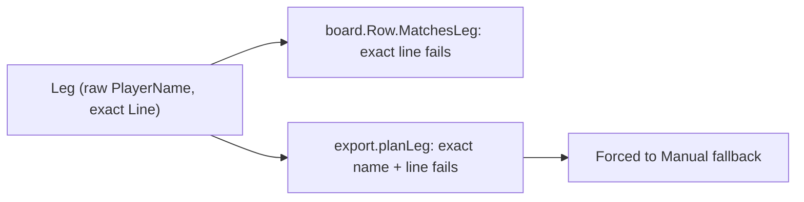
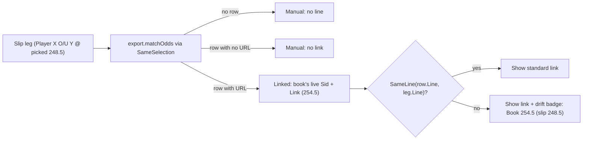

# Design: Track prop selections dynamically when lines move

## Context

Selection identity is currently split across four exact-match checks that treat `PlayerName` and `Line` as immutable
keys:

1. `db.Odds.MatchesSelection` (`internal/db/odds.go`) checks exact
   `o.Team == leg.Team && o.PlayerName == leg.PlayerName`.
2. `export.planLeg` (`internal/export/export.go`) runs `matchOdds` (`MatchesSelection`) and rejects any row where
   `!db.SameLine(row.Line, leg.Line)` with `ReasonLineMoved`.
3. `board.Row.MatchesLeg` (`internal/board/board.go`) checks exact
   `r.PlayerName == leg.PlayerName && lineEqual(r.Line, leg.Line)`.
4. `sameBoardLine` and `pickPairRow` (`internal/web/pick.go`) key on `board.LineKey` including exact `Line`.

In prod, Leg 19 (`Ollie Gordon`, `17.5`) failed DraftKings export (`"Ollie Gordon II"`, `17.5`) with `ReasonNoLine`, and
Leg 20 (`Bryce Young`, FanDuel `248.5`) failed DraftKings export (`254.5`) with `ReasonLineMoved`. Any half-point move
after picking also detaches the leg from the board UI.

## Approach

### 1. Canonical selection identity across `db`, `board`, and `export`

Introduce a shared selection-matching helper `db.SameSelection(leg Leg, o Odds) bool` (used by `Odds.MatchesSelection`,
`board.Row.MatchesLeg`, `sameBoardLine`, and `groupHoldsLeg`):

- **Player props:** Match on `GameID`, `MarketType`, `Side`, and canonical player — `o.PlayerID == leg.PlayerID` when
  both carry an ESPN athlete ID, otherwise `NormalizePlayerName(o.PlayerName) == NormalizePlayerName(leg.PlayerName)`
  and matching `Team` (ignoring empty `Team` if IDs match). **Ignore `Line`.**
- **Game markets (`SPREAD`, `ML`, `TOTAL`, `TEAM_TOTAL`):** Match on `GameID`, `MarketType`, `Team`, `Side`.
  **Ignore `Line`.**
- Note: `board.Row` and `db.Odds` matching only needs `PlayerID` passed or resolved (since `canonical-player-identity`
  populates canonical `PlayerName` and `Team` on `odds`, and `board.Row` already carries `PlayerID`).

### 2. Dynamic sportsbook export links with line-drift notice

- In `internal/export/export.go`:
  - `matchOdds` uses canonical selection matching (`SameSelection`) instead of raw `PlayerName`.
  - Remove the `ReasonLineMoved` block from `planLeg` when `row.Link` is valid: return `LegLink` populated with the
    book's current `row.Line`, `row.Price`, `row.Link`, `row.Sid`, and `row.EventSid`, plus `LineMoved bool` (true when
    `!db.SameLine(row.Line, leg.Line)`).
  - `DraftKings` and `FanDuel` combiners (`Combine`) already use `LegLink.Sid`, `EventSid`, and `URL` from the live
    `odds` row, so combined betslip links continue to work when lines move.
  - In `internal/web/export.go` (`ExportLinkView`) and `web/templates/partials.html`, surface a concise line-drift note
    on linked legs whenever `LineMoved` is true (e.g. `"Book at 254.5 · slip 248.5"`).

### 3. Keep board selection controls bound and allow open-slip line sync

- `board.Row.MatchesLeg` matches by canonical selection (ignoring `Line`) so the board always highlights the viewer's
  active pick with its `Picked = leg.ID` remove/swap buttons, even if the consensus or home-book line moved.
- When a leg is rendered on the board/tray and its saved `leg.Line` differs from the current board `row.Line` (or
  `row.Odds` drifted), display the drift on the row/tray and allow a one-tap refresh action (`UpdateLeg` with current
  `line`/`odds` and updated `selection` text).
- In `internal/slips/rules.go`, `UpdateLeg` keeps `leg_votes` when the canonical selection (`GameID`, `MarketType`,
  `Team`, `canonical player`, `Side`) is unchanged and only `Line` or `Odds` updated to track market drift on an open
  slip; changing the player, team, market, or side still clears votes.
- **Grading safety:** Locked and final slips keep their stored `leg.Line` untouched, so `internal/grader` continues
  grading against the line recorded on the slip.

**Trade-off:** Automatically mutating `legs.line` in the background on every odds sync was rejected because friends'
votes and agreed slip numbers would shift silently without anyone noticing. Matching dynamically by selection while
keeping `leg.Line` explicit (with opt-in refresh on open slips and drift callouts on export) preserves trust while
keeping links and UI controls working.

## Verification

- Unit tests in `internal/export/export_test.go` covering prod Leg 19 (`"Ollie Gordon"` leg matching `"Ollie Gordon II"`
  DraftKings row) and prod Leg 20 (`248.5` leg linking to DraftKings `254.5` with `LineMoved: true` and combined betslip
  URL intact).
- Board and slip handler tests in `internal/board/board_test.go`, `internal/slips/votes_test.go`, and
  `internal/web/pick_test.go` verifying a leg picked at `72.5` remains removable/swappable on the board after odds
  update to `73.5`, and that syncing a moved line keeps votes while changing selection clears them.
- Standard check: `go test -race ./...` and `golangci-lint run`.

## Risks

- **Exported betslip differs slightly from slip's stored line:** Clearly labeling `LineMoved` on `ExportLinkView` avoids
  surprising the bettor placing the slip.
- **Unmatched leg without `PlayerID`:** Falling back to `NormalizePlayerName` + `Team` covers unmatched players as long
  as `canonical-player-identity` has normalized incoming odds.
- **Vote preservation vs line change:** If a user manually edits a leg to a dramatically different hand-typed line on
  `OTHER`, keep `pickChanged` clearing votes for `OTHER` or large custom edits while preserving votes for board-synced
  line drift.

## TODO

Effort: hard (reworks selection identity across DB matching, board UI state, vote/update rules, sportsbook export links,
and grading invariants)

### Phase 1: Canonical selection identity in `db` and `board`

- [x] Add `SameSelection` in `internal/db/odds.go` (matching props by canonical player + market + side, ignoring `Line`)
      and update `board.Row.MatchesLeg`, `sameBoardLine`, and `groupHoldsLeg` in `internal/board/board.go` and
      `internal/web/pick.go` so picked legs stay bound when lines move, with tests.

### Phase 2: Dynamic sportsbook export links with drift callout

- [x] Update `internal/export/export.go` (`matchOdds`, `planLeg`, `LegLink.LineMoved`) to resolve deep links by
      `SameSelection` across line moves and name variants, surface drift in `internal/web/export.go` and
      `web/templates/partials.html`, and add tests in `internal/export/export_test.go` and
      `internal/web/export_test.go`.
- [x] Docs: update `docs/concepts/export.md` to describe dynamic line linking and drift notes.

### Phase 3: Open-slip line-drift indicator and one-tap refresh

- [x] Update `internal/slips/rules.go` (`pickChanged` / `UpdateLeg`) so syncing a moved line on an open slip preserves
      votes unless the canonical selection changed, and add a line-drift indicator + refresh action in
      `internal/web/pick.go` and `web/templates/partials.html`, with tests in `internal/slips/votes_test.go` and
      `internal/web/pick_test.go`.
- [x] Docs: update `docs/concepts/slips.md` to document selection identity and open-slip line updates.

## Reviews

- [x] Final review: agy@gemini-4-argon-high
