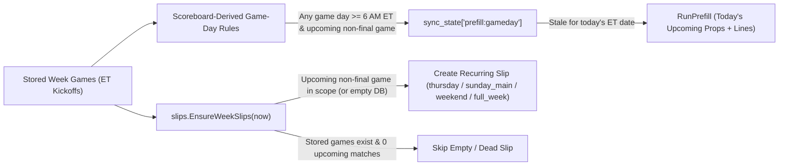

# Close-out

## Overview

## Consequences

- **Easier:** Thanksgiving, Black Friday, Christmas, late-season Saturdays, and playoff weekends get automatic 6:00 AM ET pre-fill and game-day staleness windows straight from stored ESPN kickoffs without maintaining a holiday calendar.
- **Easier:** Recurring schedules support `weekend` (`Weekend Slate`, Sat/Sun/Mon ET) and stop creating empty or already-closed slips when a week has no upcoming matching games.
- **Harder:** Multi-day holiday or playoff weeks trigger `RunPrefill` once per Eastern game date instead of once on Sunday, spending one `odds:lines` call per game day while date-scoped prop warming keeps weekly Parlay prop spend flat.
- **Harder:** `slips.EnsureWeekSlips` now requires a `now time.Time` argument and `GamesForWeek` on its store interface, so callers and tests must supply a clock and week games when testing slip auto-creation.
- **Revisit:** Add dedicated `saturday` or dynamic holiday slate scopes if groups want recurring slips for Wednesday Christmas, Black Friday, or Saturday-only slates without using `full_week` or one-off slips.
- **Revisit:** Revisit the single `prefill:gameday` marker if late-day game flexes ever require re-running bulk prop pre-fill on a date that already ran.

## Alternatives considered

- **Static holiday and playoff calendar table:** Rejected because NFL flex scheduling, weather reschedules, and shifting weekday holidays (like Christmas) would need yearly updates, whereas ESPN's scoreboard already stores exact kickoff timestamps.
- **Warming all upcoming week props on every game day:** Rejected because running bulk props across every remaining game on each day of a Thanksgiving or playoff week would multiply monthly Parlay API credit spend; scoping automatic `RunPrefill` props to `upcomingGamesOnDate` preserves credit budgets while keeping a week-wide fallback for manual non-game-day `POST /internal/prefill` calls.
- **Per-date `sync_state` keys (such as `prefill:gameday:YYYY-MM-DD`):** Rejected in favor of reusing one `prefill:gameday` row checked by Eastern calendar date so `sync_state` does not grow unboundedly.
- **Auto-creating recurring slips unconditionally and asking groups to delete empty ones:** Rejected because empty or immediately closed slips add avoidable clutter on playoff and completed weeks.

## Implementation notes

- **No `0016` schema migration needed:** The design planned a migration for `slate_scope` `CHECK` constraints, but neither `slips` nor `group_slip_schedules` defines one, so `SlateScopeWeekend` needed no SQL migration.
- **Both kickoff time and `FINAL` status gate upcoming checks:** `upcomingGamesOnDate`, `upcomingWeekGames`, and `EnsureWeekSlips` exclude `db.GameFinal` alongside `!now.Before(g.Kickoff)` so finished games with synthetic future kickoff times are never treated as upcoming.
- **Cold-DB bootstrap fallback remains:** When `games` is empty (`len(games) == 0`), `isGameDay` falls back to Thu/Sun/Mon staleness and `EnsureWeekSlips` still creates slips for every active schedule so initial bootstrap works before the first scoreboard sync.
- **Shared form options without schedule-handler edits:** `internal/web/schedules.go` already validates via `db.SlateScope.Valid()`, so adding `SlateScopeWeekend` to `defaultSlateScopeOptions` surfaced it in both recurring schedule forms and `/slips/new`.
- **Legacy `prefill:sunday` row:** Existing databases leave any old `prefill:sunday` key untouched in `sync_state`; `prefill:gameday` takes over on the first game-day pre-fill after deploy.

## Follow-ups

- Add Saturday, Friday, and Wednesday kickoff window buckets to `internal/board` (`Window` and `Windows` in `internal/board/board.go`, plus `docs/concepts/slips.md` and `docs/reference/routes.md`) so irregular holiday and playoff games appear under matching pick-board filter chips.
- Clean up stale Sunday-only references in out-of-scope docs (`docs/reference/data-sources.md` line 58 on filtering scoreboard events to Sunday/Monday kickoffs, and `docs/guides/gcp-setup.md` lines 234–236 on the Sunday-only Cloud Scheduler cron example).
