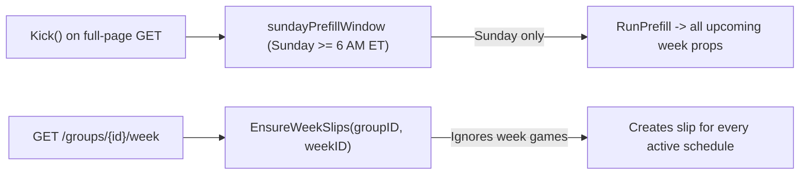
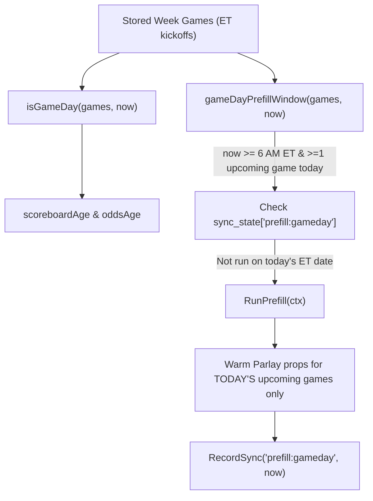
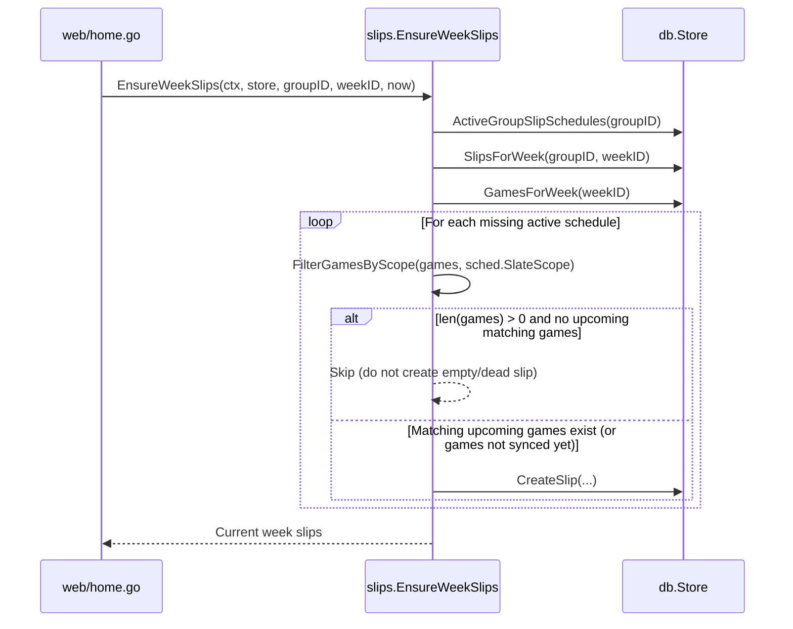

# Design: Dynamic NFL schedule slip management and data loading

## Context

Today, two subsystems hardcode regular-season NFL weekday assumptions:

1. **`internal/refresh` (`rules.go`, `refresh.go`)** assumes games happen on Thursday, Sunday, and Monday (`gameDay(now)`), hardcodes Sunday-only morning pre-fill (`sundayPrefillWindow` + `SundayPrefillSource = "prefill:sunday"`), and warms Parlay-only bulk props for every upcoming game in the week during `RunPrefill`.
2. **`internal/slips` (`slips.go`, `next.go`) and `internal/db` (`slips.go`, `schedules.go`)** define only three `SlateScope` values (`thursday`, `sunday_main`, `full_week`), and `EnsureWeekSlips` blindly creates a slip for every active `GroupSlipSchedule` in `weekID` without checking whether any upcoming games in `weekID` match that schedule's scope.

Constraints:
- Single Cloud Run instance with SQLite `sync_state` and in-memory `singleflight` / backoff.
- Scarce metered API budgets: The Odds API (500/month) and The Parlay API (1,000/month). Multi-day holiday weeks (Thanksgiving Thursday + Black Friday + Sunday + Monday) and playoff weekends (Saturday + Sunday + Monday) must not multiply weekly credit burn.
- No new scheduled background jobs; triggers remain authenticated full-page loads plus the optional `POST /internal/prefill` fallback.

## Approach

### 1. Scoreboard-driven game days and per-date pre-fill (`internal/refresh`)

Replace weekday-hardcoded checks with pure functions over the week's stored `[]db.Game` in `America/New_York`:

- **`isGameDay(games []db.Game, now time.Time) bool`**: returns `true` when any game in `games` has a kickoff on `now`'s Eastern calendar date. When `games` is empty (cold DB before first scoreboard fetch), falls back to Thu/Sun/Mon so bootstrap still uses short scoreboard staleness.
- **`gamesOnDate(games []db.Game, now time.Time) []db.Game`**: returns games whose kickoff falls on `now`'s Eastern calendar date.
- **`upcomingGamesOnDate(games []db.Game, now time.Time) []db.Game`**: filters `gamesOnDate` to `now.Before(g.Kickoff)`.
- **`gameDayPrefillWindow(games []db.Game, now time.Time) bool`**: returns `true` when `now.In(eastern).Hour() >= prefillStartHour` (6 AM ET) AND `len(upcomingGamesOnDate(games, now)) > 0`.
- **`GameDayPrefillSource = "prefill:gameday"`**: replaces `"prefill:sunday"` in `sync_state`. `gameDayPrefillStale(last, now)` returns `true` when `last.IsZero()` or `last` and `now` are on different Eastern calendar dates. Keeping one `sync_state` key avoids unbounded row growth while gating pre-fill to once per game date.
- **`oddsAge(now, games)`**:
  - If `upcomingGamesOnDate(games, now)` has ≥2 games (e.g., Thanksgiving, Christmas multi-game, Playoff Saturday, Sunday): `oddsGameDayAge` (45m).
  - If `upcomingGamesOnDate(games, now)` has 1 game (e.g., TNF, Black Friday single, MNF, Super Bowl): `oddsLateAge` (3h).
  - If tomorrow (ET) has games: `oddsEveAge` (12h).
  - Otherwise: `oddsWeekdayAge` (24h).
- **Scoped `RunPrefill` prop warming**: `RunPrefill` still refreshes scoreboard, `odds:lines` (1 credit for the whole NFL board, 15m idempotency), and free sources, then warms Parlay-only bulk props for `upcomingGamesOnDate(games, now)`. If `POST /internal/prefill` is invoked manually on a non-game day (so `upcomingGamesOnDate` is empty), it falls back to all upcoming week games so manual pre-fill retains predictable behavior.

**Trade-off / rejected option:** Maintaining a static holiday/playoff date table was rejected because NFL flex scheduling, weather reschedules, and shifting Christmas weekdays would require yearly edits. The ESPN scoreboard already carries exact kickoff timestamps.

### 2. Schedule-aware recurring slip auto-creation and Weekend slate (`internal/db`, `internal/slips`)

- **Add `SlateScopeWeekend` (`"weekend"`)** to `internal/db/slips.go`: matches Saturday, Sunday, and Monday in Eastern time, labeled `"Weekend Slate"`. This gives recurring schedules a clean option for late-season Saturday games and NFL playoff weekends without opening Thursday/Wednesday games.
- **Migration `0016_weekend_slate_scope.sql`**: inspect/update any `CHECK` constraint on `slips.slate_scope` and `group_slip_schedules.slate_scope` if present (or no-op/table-rebuild if constrained) so `"weekend"` is accepted cleanly.
- **Extend `slips.Store`** with `GamesForWeek(ctx context.Context, weekID int64) ([]db.Game, error)` (already implemented by `*db.Store`).
- **Update `slips.EnsureWeekSlips(ctx, store, groupID, weekID, now time.Time)`**:
  - Load `games` via `store.GamesForWeek(ctx, weekID)`.
  - When `len(games) > 0`, only auto-create a missing scheduled slip if `FilterGamesByScope(games, sched.SlateScope)` contains at least one game with `now.Before(g.Kickoff)`.
  - When `len(games) == 0` (fresh DB before scoreboard sync), keep existing creation behavior so unit tests and initial bootstrap remain compatible.
  - Existing slips already created for the week are never deleted or modified.

## Verification

- `go test ./internal/refresh/... ./internal/slips/... ./internal/db/... ./internal/web/...` and `golangci-lint run`.
- **Irregular game-day pre-fill scenarios** (clock-injected tests in `internal/refresh/prefill_test.go` and `rules_test.go`):
  - Thanksgiving Thursday (3 games) at 6:05 AM ET triggers `RunPrefill`, warms props only for Thursday's 3 games (not Sunday's), records `prefill:gameday`, and skips on subsequent Thursday visits.
  - Black Friday (1 game) at 6:05 AM ET triggers `RunPrefill` again on the new ET date, warming only Friday's game.
  - Playoff Saturday (2 games) and Christmas Wednesday (2 games) trigger `RunPrefill` identically.
  - Non-game day (Tuesday) or after the day's last kickoff does not trigger `RunPrefill`.
  - Credit floor still halts Parlay props when remaining credits drop below the floor.
- **Schedule-aware slip creation scenarios** (`internal/slips/slips_test.go`):
  - A group with an active `thursday` schedule in a playoff week (only Sat/Sun games) does not get an empty Thursday slip created.
  - A group with an active `sunday_main` schedule on Monday night after all Sunday/Monday games have kicked off does not get a dead slip auto-created.
  - A group with a `weekend` schedule gets its slip on a Sat/Sun playoff week and includes Saturday games in `FilterGamesByScope` and `NextStep`.

## Risks

- **Multi-day credit burn on holiday weeks:** Running `odds:lines` once per game day on a 4-day Thanksgiving week uses 4 lines calls instead of 1 (still negligible against 500/month), and scoping `prefillProps` to today's games keeps total weekly Parlay prop calls identical to warming the whole week once. We notice regressions via `PrefillReport` metrics and credit-floor tests.
- **Signature change on `EnsureWeekSlips`:** Adding `now time.Time` updates callers in `internal/web/home.go` and tests; the Go compiler catches every call site.
- **Legacy `prefill:sunday` row in `sync_state`:** Leaving the old key unused in SQLite is harmless; the first game day after deploy records `prefill:gameday`.

## TODO

### Phase 1: Schedule-derived game-day rules and per-date pre-fill

Complexity: high (coordinates staleness windows, per-date pre-fill idempotency, credit-bounded prop scoping, and clock-driven concurrency tests across `internal/refresh`)
Risk: medium (mistakes in pre-fill gating or prop scoping could overspend monthly API credits or miss a game day; mitigated by clock-injected unit/integration tests and credit-floor assertions)

- [x] Replace hardcoded weekday checks in `internal/refresh/rules.go` (`gameDay`, `oddsAge`, `sundayPrefillWindow`, `sundayPrefillStale`) with scoreboard-derived `isGameDay`, `gamesOnDate`, `upcomingGamesOnDate`, `gameDayPrefillWindow`, and `gameDayPrefillStale`, with unit tests covering Thanksgiving, Black Friday, Christmas, playoff Saturdays, and non-game days.
- [x] Update `internal/refresh/refresh.go` (`maybeRunGameDayPrefill`, `RunPrefill`, `GameDayPrefillSource = "prefill:gameday"`) to trigger once per ET game date and scope automatic Parlay-only prop warming to that date's upcoming games, with integration tests verifying credit conservation and multi-day idempotency.
- [x] Docs: update `docs/concepts/data-refresh.md` and the Free-tier guardrails in `AGENTS.md` to document per-game-day pre-fill (`prefill:gameday`) and date-scoped prop warming.

### Phase 2: Schedule-aware recurring slip auto-creation and weekend slate scope

Complexity: medium (touches `internal/db`, `internal/slips`, and `internal/web` schedule/week seams while keeping existing schedules backward-compatible)
Risk: low (additive `weekend` scope and guard on empty/past schedules; covered by store, domain, and handler tests)

- [x] Add `SlateScopeWeekend` (`"weekend"`, matching Sat/Sun/Mon ET) in `internal/db/slips.go` (plus migration `0016_weekend_slate_scope.sql` if schema constraints restrict `slate_scope`) and expose it in recurring schedule forms in `internal/web/schedules.go` and `web/templates/week.html`, with tests.
- [x] Update `slips.EnsureWeekSlips` in `internal/slips/slips.go` (and callers in `internal/web/home.go`) to load week games and skip auto-creating recurring slips when the stored week has no upcoming games matching the schedule's scope, with tests covering playoff weeks and completed weeks.
- [x] Docs: update `docs/concepts/slips.md` and `docs/concepts/groups.md` for `weekend` slate scope and schedule-aware `EnsureWeekSlips` skipping.
