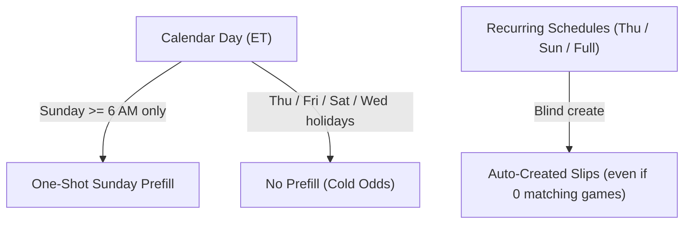
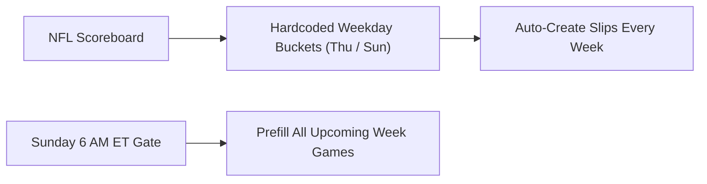
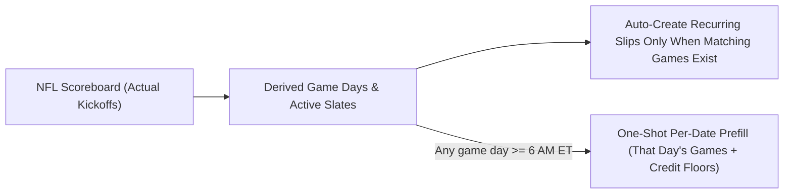

# Dynamic NFL schedule slip management and data loading

## Context

The app assumes a standard regular-season NFL week: one Thursday game, a Sunday main slate, and a Monday game. That assumption is baked into both slip auto-management and data loading:

1. **Sunday-only pre-fill.** Automatic odds and prop pre-fill only triggers on Sundays at or after 6:00 AM ET. On Thanksgiving, Black Friday, Christmas, late-season Saturdays, and playoff Saturdays, pre-fill never runs, so groups open the pick board to cold lines and props.
2. **Hardcoded weekday scopes.** Recurring schedules only know `thursday`, `sunday_main`, and `full_week`. They cannot naturally represent holiday slates, Saturday doubleheaders, or playoff rounds without manual workarounds.
3. **Blind slip auto-creation.** Recurring schedules create slips for the active week even when that week has no games matching the schedule's weekday bucket (for example, a Thursday schedule during a playoff week), leaving behind empty or immediately closed slips.

As Thanksgiving, Christmas, late-season Saturday games, and the playoffs approach, these "special cases" become the norm rather than the exception.

## Goals and non-goals

### Goals

- Drive data pre-fill and slip auto-management from the **actual stored NFL game schedule** (kickoff dates and times) instead of hardcoded Sunday/Thursday assumptions.
- Generalize the one-shot morning pre-fill to any **game day** that has upcoming games (Thanksgiving, Black Friday, Saturday, Sunday, Christmas, Playoffs), warming odds/props only for that day's upcoming games while preserving free-tier credit floors and single-instance guardrails.
- Prevent recurring schedules from auto-creating slips for weeks that have zero upcoming games matching their scope.
- Support dynamic, schedule-aware slate grouping so holiday and playoff slates work cleanly without adding one-off calendar hacks.

### Non-goals

- Adding paid or always-on background polling; all refreshes still run on authenticated full-page loads (plus the optional internal pre-fill fallback) within existing API credit budgets.
- Supporting non-NFL sports or multi-league calendars.
- Removing manual one-off slip creation (which handles arbitrary custom game subsets separately).

## Decision

Replace weekday-hardcoded automation with a **game-day-driven** model: the stored NFL scoreboard is the source of truth for when slates exist, when recurring slips should be created, and when morning pre-fill should run.

### Before

### After

Deriving game days and pre-fill windows directly from the stored scoreboard beats maintaining a hardcoded holiday/playoff calendar because the NFL moves games (flex scheduling, weather reschedules, Christmas shifting weekdays every year) and the scoreboard already reflects the truth. Scoping each game-day pre-fill to that day's upcoming games beats warming the entire week on every game day because it protects scarce Odds API and Parlay API credits during multi-day holiday and playoff weeks. Skipping recurring slip creation when a week has no matching upcoming games beats creating empty slips and asking users to ignore or delete them.

`complexity: high` fits because this redesigns the scheduling invariants shared across background refresh triggers, credit-budgeted pre-fill idempotency, recurring slip auto-creation, and slate-scope evaluation across irregular regular-season, holiday, and playoff calendars. `risk: medium` fits because a mis-scoped pre-fill trigger could overspend monthly API credits or miss a game day, though per-date idempotency keys, existing credit floors, and clock-injected tests keep the blast radius contained and verifiable.
