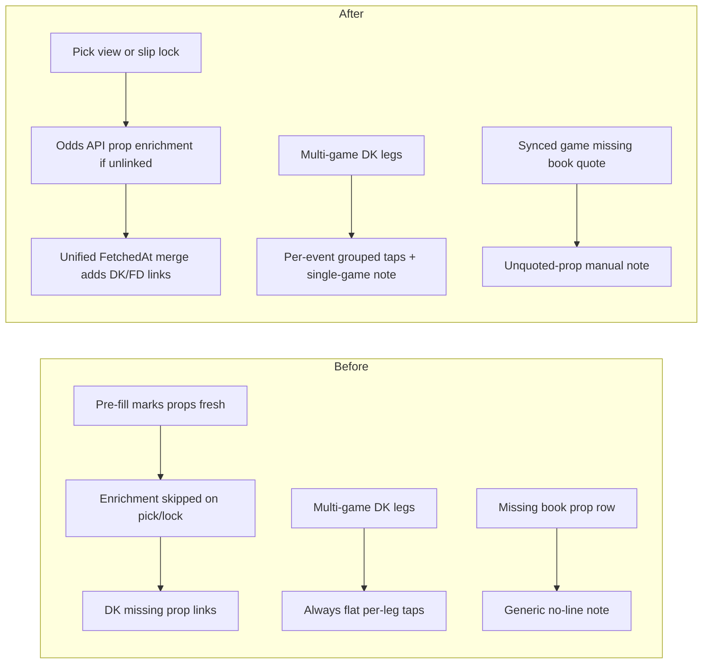

# Close-out

## Overview

## Consequences

- **Easier:** Populating DraftKings and FanDuel prop links on pre-filled games without spending Odds API credits on unpicked Sunday games, and opening same-game legs from a multi-game DraftKings slip in one tap per game.
- **Easier:** Distinguishing a sportsbook that is not offering a prop market from a game whose props have not synced yet.
- **Harder:** Reasoning about prop freshness, because `odds:props:{gameID}` and `odds:props:enrich:{gameID}` must keep a unified `FetchedAt` timestamp on merged rows so `db.CurrentOdds` does not hide Parlay-only markets.
- **Revisit:** DraftKings multi-game combining if DraftKings adds a verified multi-event betslip URL, which is isolated behind `draftKingsCombiner`.

## Alternatives considered

- **Run The Odds API during Sunday pre-fill:** Rejected because enriching a full 14-game slate would burn ~100–140 Odds API credits per week on unpicked games and exhaust the 500/month free tier in 3–4 weeks.
- **Use DraftKings' root `/?outcomes=` URL across games:** Rejected because a 2026-11-07 phone test showed it loads only one selection, and DraftKings exposes no public multi-event GET betslip URL.
- **Enrich inside `GET /slips/{id}/export`:** Rejected to keep `internal/export` and export rendering strictly read-only so SSE refreshes and reloads never spend API credits.

## Implementation notes

- **Plan accuracy:** Both phases shipped as designed with no deviations.
- **DraftKings single-game limit:** DraftKings' combined URL is event-scoped, so multi-game slips still require one tap per game (grouped when a game has 2+ linked legs, individual otherwise).
- **Credit floor and unquoted props:** Enrichment skips without failure backoff once The Odds API balance drops below `TheOddsAPIEnrichFloor` (100), and props that a book genuinely does not quote still require manual entry.
- **Cross-provider name matching:** Merging Parlay API and The Odds API props relies on `normalizePropSubject` for punctuation, casing, and generational suffixes (`Jr.`, `III`); materially different spellings across feeds will not merge.

## Follow-ups

- **Post-deploy phone verification:** Test a per-game combined DraftKings event link and the background SSE `#slip-export` refresh after locking a slip with a pre-filled prop leg on a live phone.
