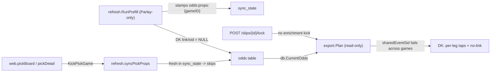
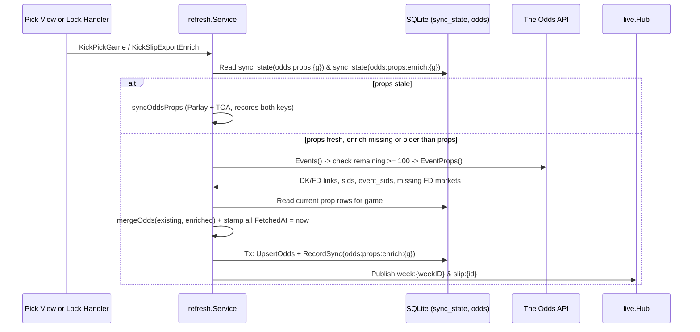
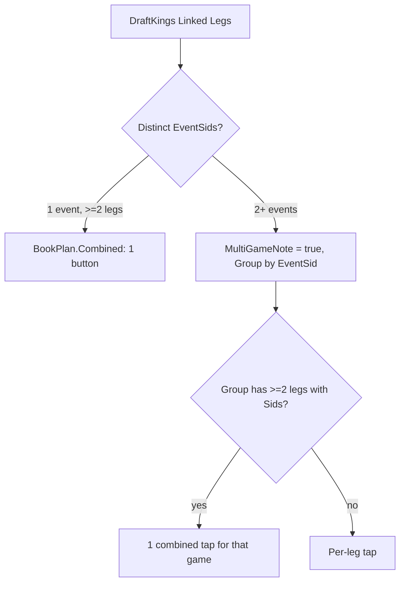

# Design: Fix DraftKings and FanDuel export links

## Context

Export links flow through four packages:

- `internal/ingest/odds` parses Parlay API (`/props`, `/odds`) and The Odds API (`/events/{id}/odds`, `/odds`) responses into `odds.Line` and `odds.Prop`, and merges primary and secondary props in `MergeProps`.
- `internal/refresh` owns staleness (`rules.go`), credit floors (`refresh.go`), game-line syncs (`sources.go`), and prop/research syncs (`research.go`). It writes merged rows to SQLite through `db.Store.UpsertOdds` and records freshness in `sync_state`.
- `internal/export` is pure. `Plan` reads stored `db.Odds` rows (already filtered to each game's newest sync by `db.CurrentOdds`), matches each leg via `db.MatchBookOdds`, and calls a book's `Combiner` (`draftKingsCombiner` or `fanDuelCombiner`).
- `internal/web` renders `#slip-export` in `internal/web/export.go` and `web/templates/partials.html`. `slipHandlers.exportView` never fetches odds and never writes.



Key invariants to preserve:

1. **Free-tier credit guardrails:** Parlay API (1,000/month, prop floor 150) and The Odds API (500/month, enrich floor 100, fallback floor 25) credits are scarce. Sunday morning `RunPrefill` must stay Parlay-only so unpicked games never spend The Odds API credits.
2. **`db.CurrentOdds` timestamp grouping:** `db.CurrentOdds` keeps only rows matching the newest `fetched_at` per `(game_id, is_prop_row)`. Any partial prop upsert with a newer timestamp hides untouched prop rows for that game.
3. **Pure export:** `internal/export` and `slipHandlers.exportView` remain read-only with zero network calls or database writes.
4. **Verified book URLs:** A phone check on 2026-11-07 confirmed DraftKings' combined URL is event-scoped (`https://sportsbook.draftkings.com/event/{eventSid}?outcomes={sid1},{sid2}`); the root `/?outcomes=` URL only loads one selection, and DraftKings does not expose a public multi-event GET betslip URL. FanDuel's indexed `/addToBetslip` works across games.

## Approach

### 1. Separate prop deep-link enrichment from Parlay-only pre-fill freshness

Add a dedicated enrichment source key in `internal/refresh`:

```go
const oddsPropsEnrichSourcePrefix = "odds:props:enrich:"

func OddsPropsEnrichSource(gameID string) string {
    return oddsPropsEnrichSourcePrefix + gameID
}
```

How enrichment runs without double-spending Parlay API credits:

- **`syncOddsProps` (full prop sync):** Runs when `odds:props:{gameID}` is stale or forced. It continues to fetch Parlay API + The Odds API `EventProps`. Whenever `fallback.bought` is true, `writeOddsProps` also records `OddsPropsEnrichSource(game.ID)` in `sync_state` inside the same transaction.
- **`enrichGameProps(ctx, game, now)` (enrichment-only path):** Runs when `odds:props:{gameID}` is already fresh (for example, right after Sunday `RunPrefill`) **and** `odds:props:enrich:{gameID}` is missing or older than `odds:props:{gameID}`'s `FetchedAt` (or stale under `oddsPropsStale`), provided `now.Before(game.Kickoff)` and `s.fallbackProps != nil`.
  1. Calls `fetchFallbackProps(ctx, game, TheOddsAPIEnrichFloor, now)` only (never calls Parlay API).
  2. Maps fallback props to `db.Odds` via `mapPropsToOdds`.
  3. Loads existing current prop rows for `game.ID` (`store.OddsForGame` filtered by `db.IsPropRow`), merges via `mergeOdds(existingProps, enrichedRows)`, and stamps **every** merged prop row with `FetchedAt = now` so `db.CurrentOdds` keeps Parlay-only rows alongside newly enriched DraftKings/FanDuel rows.
  4. Upserts the merged prop rows and records `OddsPropsEnrichSource(game.ID)` (plus `odds:props:{game.ID}` updated to `now` so timestamps stay aligned) in one transaction.
  5. Calls `s.publishWeek(ctx, game.WeekID)` when rows changed so open pick boards (`board-updated`) and locked slips (`slip-updated`) refresh over SSE.



### 2. Trigger enrichment on pick views and on slip lock

- **Pick views (`SyncPickGame`, `SyncGameProps`):** After checking `odds:props:{gameID}` (which skips if pre-filled recently), run the `odds:props:enrich:{gameID}` source through `refreshSync` (preserving `singleflight`, 5-minute backoff, and `TheOddsAPIEnrichFloor`).
- **Slip lock (`KickSlipExportEnrich`):** Add `KickSlipExportEnrich(ctx context.Context, slipID int64)` to `refresh.Service` and the `web.Refresher` interface. In `slipHandlers.lockIn`, after `h.deps.Slips.LockIn` succeeds, check whether the slip is now `LOCKED`; if so, call `h.deps.Refresh.KickSlipExportEnrich(r.Context(), slip.ID)`.
  - `KickSlipExportEnrich` detaches request cancellation (`context.WithoutCancel`), registers with `s.wg` and `s.stopCtx` (identical to `kickPick`), loads the slip's legs and games, and finds unique upcoming games that have at least one prop leg (`db.IsPropRow` equivalent: `TEAM_TOTAL` or `db.IsPlayerMarket(leg.MarketType)`) whose stored DraftKings or FanDuel row lacks a link (or is missing).
  - For each such game, it runs `enrichGameProps` through `refreshSync`. When enrichment completes and writes new links, `publishWeek` triggers `slip-updated` over SSE and `#slip-export` swaps in the links automatically.

### 3. Normalize player names during cross-provider prop merge

In `internal/ingest/odds/props.go`, `propKeyOf` currently keys on raw `prop.PlayerName`, so punctuation or suffix differences between Parlay API and The Odds API (e.g., `"Kenneth Walker III"` vs `"Kenneth Walker"`, `"D.J. Moore"` vs `"DJ Moore"`) miss the merge and emit duplicate rows. Update `propKeyOf` to normalize `prop.PlayerName` with the existing `normalizePropSubject` helper so cross-provider enrichment reliably attaches DraftKings/FanDuel links and sids to the matching player row.

### 4. Multi-game DraftKings grouping and clearer manual prop notes

Because DraftKings' verified combined URL is scoped to one `event_sid`, a slip spanning 6 games cannot become a single DraftKings URL. However, a slip with 2+ legs in the same game *can* combine per game, and every multi-game DraftKings export should explain the book's single-game rule clearly.

Extend `internal/export`:

```go
// LinkGroup is one game's worth of linked legs at a book whose combined URL
// is scoped to a single event (DraftKings). Combined is set when 2+ legs in
// the group share an EventSid and each carries a Sid.
type LinkGroup struct {
    GameID   string
    EventSid string
    Combined string
    Legs     []LegLink
}

type BookPlan struct {
    Book          string
    Linked        []LegLink
    Manual        []ManualLeg
    Combined      string
    Groups        []LinkGroup // populated when Linked spans multiple events and a book supports per-event combining
    MultiGameNote bool        // true when DraftKings cannot combine all linked legs because they span multiple games
}
```

- When all linked DraftKings legs share one `event_sid` (single-game slip), `BookPlan.Combined` works unchanged as one "Open in DraftKings" button.
- When linked DraftKings legs span multiple games, `draftKingsCombiner` leaves `BookPlan.Combined` empty, sets `BookPlan.MultiGameNote = true`, and groups `Linked` by `EventSid` (in first-appearance slip order) into `BookPlan.Groups`:
  - A group with 2+ legs sharing an `EventSid` and all having `Sid` gets `group.Combined = draftKingsEvent + eventSid + "?outcomes=..."` (one tap for that game's legs).
  - A group with 1 leg (or missing `Sid`/`EventSid`) renders its per-leg tap as before.
- In `internal/web/export.go` and `web/templates/partials.html`:
  - When `MultiGameNote` is true, render a short heads-up under the DraftKings heading: *"DraftKings links load one game at a time — tap each game below to add its legs."*
  - Render grouped game taps when `Groups` has any combined group (showing matchup label like `BUF @ HOU (2 legs)` with each leg's selection and any drift note), falling back to the flat numbered list when every game has a single leg.
  - For `ReasonNoLine` on player/team-total props when the game already has stored prop rows for *other* markets or books (i.e., props have been synced, the book simply doesn't quote this prop), refine `manualNote` from `"has no line for this pick yet"` to `"isn't offering this prop right now, so add it by hand if it appears on their board"` (distinguishing an unquoted market from an unsynced game via a boolean `PropsSynced` flag on `ManualLeg` or computed from `odds` for that `game_id`).



### Trade-offs and rejected options

- **Running The Odds API during Sunday `RunPrefill`:** Rejected. A 14-game Sunday slate would spend ~100–140 Odds API credits per week on games nobody picks, blowing the 500/month free tier in 3–4 weeks.
- **Unverified DraftKings root `?outcomes=` multi-game URL:** Rejected. Already disproved by the 2026-11-07 phone test (loaded only one selection). The `Combiner` interface remains isolated so if DraftKings later supports a verified multi-event URL, it is a single-type swap.
- **Triggering enrichment on `GET /slips/{id}/export`:** Rejected. Rendering the export card must stay strictly read-only so SSE refreshes and reloads never spend credits.

## Verification

- **Unit & integration tests:** Run `go test ./...` and `golangci-lint run`.
- **Pre-fill then pick/lock enrichment scenario:**
  - Seed a Sunday morning `RunPrefill` (Parlay-only) for two games; verify `odds:props:{gameID}` is fresh and DraftKings prop rows have `link = NULL`, while `odds:props:enrich:{gameID}` is absent.
  - Call `SyncPickGame` (and separately `KickSlipExportEnrich` after locking a slip with a prop leg on a pre-filled game): verify Parlay API `Props()` is **not** called again, The Odds API `EventProps()` **is** called once, DraftKings `link`/`sid`/`event_sid` and any FanDuel-only prop markets (`RUSH_ATT`, `REC_YDS`) are populated, and Parlay-only rows remain visible under `db.CurrentOdds`.
  - Repeat the call immediately: verify 0 upstream calls (fresh `odds:props:enrich:{gameID}`).
  - Verify credit floor enforcement: when The Odds API balance `< 100` (`TheOddsAPIEnrichFloor`), `enrichGameProps` skips `EventProps()` without entering failure backoff.
  - Verify started games and already-linked games skip enrichment on lock.
- **Cross-provider prop merge edge cases:**
  - Verify `odds.MergeProps` merges `"Kenneth Walker III"` with `"Kenneth Walker"` and `"D.J. Moore"` with `"DJ Moore"` into a single linked row without duplicating selections.
- **Multi-game DraftKings export & manual notes:**
  - Single-game 2-leg DraftKings slip still produces `BookPlan.Combined` and `MultiGameNote == false`.
  - Multi-game 4-leg DraftKings slip (e.g., 2 legs in Game A, 1 in Game B, 1 in Game C) sets `MultiGameNote == true`, combines Game A's 2 legs into one event-page URL in `Groups`, and keeps Game B and C as single taps.
  - Multi-game 4-leg DraftKings slip across 4 distinct games sets `MultiGameNote == true` and renders the single-game explanation above the 4 taps.
  - FanDuel `ReasonNoLine` on a game with synced props renders the unquoted-market note; a game with zero prop rows keeps the `"no line ... yet"` note.
  - Live phone verification (manual post-deploy check): verify a combined per-game DraftKings event link and a locked slip's SSE update after lock.

## Risks

- **The Odds API credit spend on busy Sundays:** Enriching on both game open (`KickPickGame`) and slip lock (`KickSlipExportEnrich`) could spend more credits if users click through all 14 games. *Mitigation:* `OddsPropsEnrichSource(gameID)` shares `singleflight`, the 30m/2h freshness window, and `TheOddsAPIEnrichFloor = 100`; `KickSlipExportEnrich` only runs for games on the locked slip whose prop legs actually lack a DraftKings or FanDuel link. Monitored via `sync_state["odds:theoddsapi"].odds_credits_remaining` and structured refresh logs.
- **Hidden Parlay-only props from `CurrentOdds`:** If enrichment upserted only The Odds API rows at `now`, Parlay-only rows with an older `FetchedAt` would vanish from `db.CurrentOdds`. *Mitigation:* `enrichGameProps` always merges against all existing current prop rows for the game and stamps the unified set with `now`, covered by a regression test.
- **DraftKings URL scheme drift:** Sportsbooks occasionally change deep-link query params. *Mitigation:* DraftKings URL construction remains isolated in `internal/export` behind `Combiner` and `LinkGroup`.

## TODO

### Phase 1: Separate prop enrichment from Parlay-only pre-fill

Complexity: medium (coordinates `sync_state` freshness keys, `db.CurrentOdds` timestamp invariants, cross-provider prop normalization, and credit floors across `ingest/odds` and `refresh`)
Risk: medium (touches metered Odds API call paths and `odds` table upserts where a timestamp bug could hide props or overspend credits)

- [x] Normalize player names with `normalizePropSubject` in `odds.MergeProps` (`internal/ingest/odds/props.go`) so cross-provider enrichment matches punctuation and generational-suffix variants, with unit tests in `internal/ingest/odds/props_test.go`.
- [x] Add `OddsPropsEnrichSource(gameID)` and `enrichGameProps` in `internal/refresh/research.go` and `internal/refresh/refresh.go` so `syncOddsProps` records enrichment freshness when The Odds API buys props, and `SyncPickGame`/`SyncGameProps` run enrichment-only when `odds:props:{gameID}` was populated by Parlay-only `RunPrefill`, merging against existing current prop rows at a unified `FetchedAt` and enforcing `TheOddsAPIEnrichFloor`, with tests in `internal/refresh/prefill_test.go` and `internal/refresh/pick_test.go`.
- [x] Add `KickSlipExportEnrich(ctx, slipID)` to `internal/refresh` and `web.Refresher`, and invoke it from `slipHandlers.lockIn` (`internal/web/slips.go`) when a slip transitions to `LOCKED` so upcoming games with unlinked prop legs enrich in the background and push `slip-updated` over SSE, with tests in `internal/refresh/` and `internal/web/export_test.go`.
- [x] Docs: update `docs/concepts/data-refresh.md` and `docs/reference/data-sources.md` to document `odds:props:enrich:{gameID}`, enrichment-only refreshes after `RunPrefill`, and `KickSlipExportEnrich` on slip lock.

### Phase 2: Multi-game DraftKings grouping and clearer manual prop guidance

Complexity: low (pure data-shaping changes in `internal/export`, view mapping in `internal/web/export.go`, and template rendering in `web/templates/partials.html`)
Risk: low (pure logic and UI rendering with full unit and handler test coverage and zero external API calls)

- [x] Extend `export.BookPlan` in `internal/export/export.go` with `LinkGroup` per-event grouping, `MultiGameNote` for multi-game DraftKings slips, and synced-prop awareness on `ReasonNoLine` manual legs, with unit tests in `internal/export/export_test.go`.
- [x] Update `internal/web/export.go` and `web/templates/partials.html` (`slip-export`) to render DraftKings' single-game explanation, per-game combined taps when a multi-game slip has 2+ legs in one game, and clearer unquoted-prop manual notes, with tests in `internal/web/export_test.go`.
- [x] Docs: update `docs/concepts/export.md` to document multi-game DraftKings per-game grouping, the single-game note, and the unquoted-prop manual note.

## Reviews

- [x] Final review: agy@gemini-4-neon-medium
