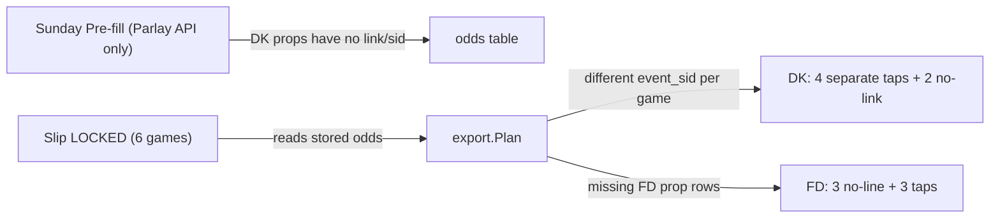
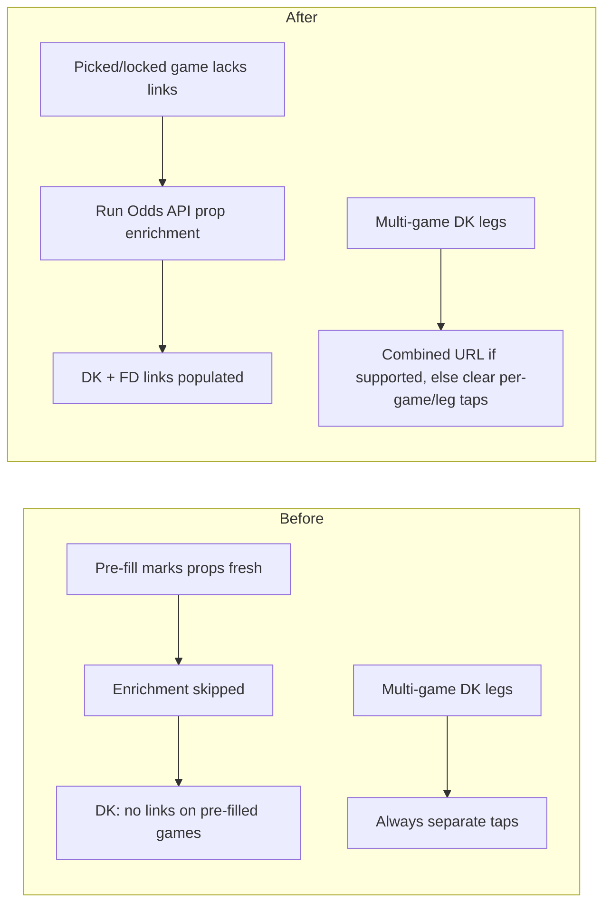

# Fix DraftKings and FanDuel export links

## Context

On the November 22, 2026 Sunday slate, a locked 6-leg slip across 6 games showed two export failures:

1. **Multi-game DraftKings slips never combine:** 4 of 6 legs had valid DraftKings links and selection IDs, but each belonged to a different game (`event_sid`). Because DraftKings' combiner requires all legs to share one event ID, it fell back to 4 separate links instead of one combined link.
2. **Pre-filled games had no DraftKings prop links:** 2 of the 6 games (`401873069` and `401873071`) had their props synced during Sunday morning pre-fill, which runs Parlay API-only. Parlay API omits DraftKings `link` and `sid` values, and because `sync_state` marked those games fresh, The Odds API enrichment never ran for them.
3. **Missing FanDuel prop lines:** FanDuel had no `odds` rows for 3 of the 6 picks (`RUSH_ATT` on two players, `REC_YDS` on one), leaving those legs as manual `no line` entries.

## Goals and non-goals

**Goals:**

- Ensure every game on a locked slip (or picked from the board) has deep-link enrichment when credits allow, even if its props were first populated by Parlay API-only pre-fill.
- Research and support multi-game combined DraftKings betslip links if DraftKings supports a multi-event URL format; otherwise make the single-game limitation explicit and minimize manual steps.
- Improve FanDuel/DraftKings fallback matching or surface clearer guidance when a book does not quote a picked prop market.

**Non-goals:**

- Raising free-tier API credit limits or adding paid sportsbook APIs.
- Placing bets automatically or integrating with sportsbook accounts.

## Decision

We will separate deep-link enrichment from initial pre-fill freshness so picked or locked games still fetch The Odds API links/sids when their stored rows lack links, and we will verify whether DraftKings supports a multi-event combined URL (falling back to grouped/clear per-leg taps only where the book's URL scheme forces it).

This beats running The Odds API on all games during Sunday morning pre-fill, which would burn ~100+ scarce Odds API credits per Sunday on games nobody picks.

- **Complexity: medium** — Coordinates across odds refresh staleness rules, prop enrichment, and sportsbook URL combining while respecting tiered credit floors.
- **Risk: medium** — Deep-link URL formats can only be verified against live sportsbooks on a phone, and enrichment triggers must not regress Odds API credit budgets.
