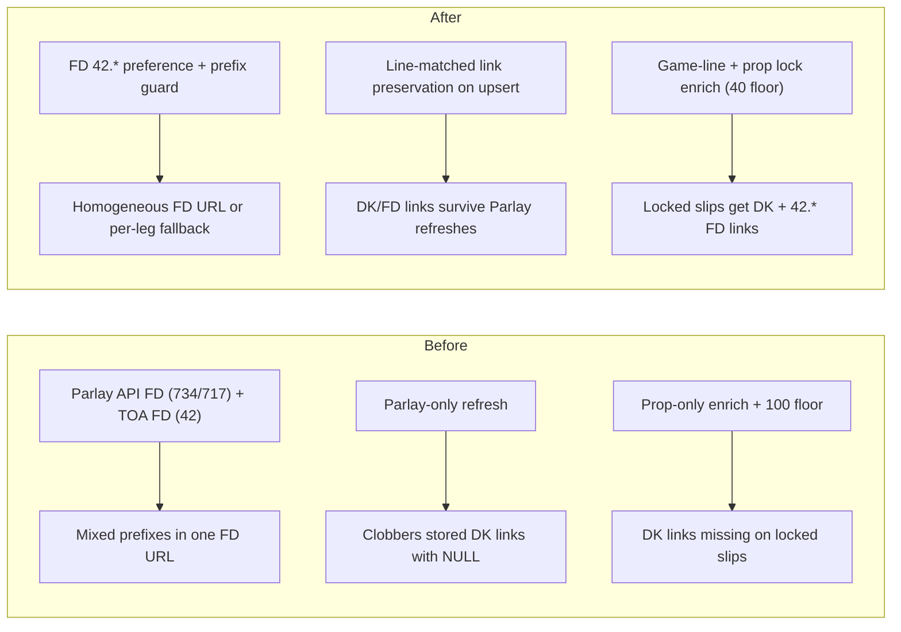

# Close-out

## Overview

## Consequences

- **Easier:** Exporting locked slips to DraftKings and FanDuel without Parlay-only refreshes wiping enriched deep links or FanDuel combining mixed-jurisdiction `marketId`s.
- **Easier:** Enriching both game-line and prop legs at slip lock when DraftKings links are missing or FanDuel links carry non-`42.*` prefixes.
- **Harder:** Replacing an existing stored link on an unchanged line requires supplying a non-null replacement row, because `NULL` now preserves the stored link.
- **Harder:** Diagnosing FanDuel export failures in states that might expect a prefix other than `42.*`, since merges prefer `42.*` and mismatched prefixes fall back to per-leg taps.
- **Revisit:** The `40`-credit `TheOddsAPIEnrichFloor` and lock-time game-line enrichment if monthly Odds API credit burn spikes during high-volume weeks.
- **Revisit:** Whether non-`42.*` FanDuel links (`734.*`, `717.*`) should also be suppressed on single-leg taps if phone testing shows they fail across US accounts.

## Alternatives considered

- **Drop combined FanDuel links entirely:** Rejected because it would remove one-tap multi-leg exports when the failure came from mixing incompatible `marketId` prefixes and keeping non-US IDs over `42.*` IDs.
- **Fetch The Odds API for every pre-fill game:** Rejected because it would exhaust the 500/month credit cap in a few weeks; lock-time enrichment gated by a `40`-credit floor keeps usage bounded.
- **Keep unconditional overwrites in `Store.UpsertOdds`:** Rejected because Parlay-only refreshes arrive with `NULL` links and wipe earlier DraftKings enrichment on unchanged lines.

## Implementation notes

- The plan shipped with no deviations.
- Automated tests cover recorded Week 12 payloads, not live sportsbook apps; FanDuel jurisdiction routing and mobile app handoff still depend on user state and device behavior.
- `Store.UpsertOdds` preserves `link` and `sid` only when the line is unchanged; when a line moves and the incoming row has `NULL`, stale `link` and `sid` are cleared while game-level `event_sid` is kept.

## Follow-ups

- Run the 5-case phone verification matrix on iOS and Android for both DraftKings and FanDuel after deploy (single game-line leg, single prop leg, same-game parlay, cross-game parlay, and moved-line leg), and suppress non-`42.*` FanDuel links on single-leg taps if they fail on US phones.
