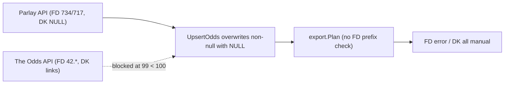
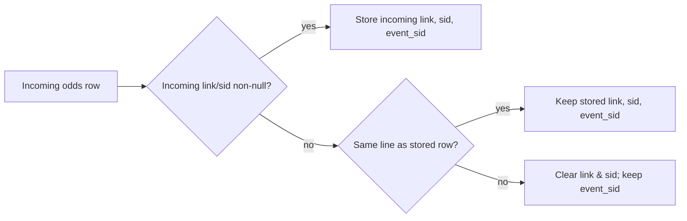

# Design: Reliable DraftKings and FanDuel export deep links

## Context

Deep links flow through four packages:

1. `internal/ingest/odds` parses `link`, `sid`, and `event_sid` from Parlay API (`/odds`, `/props`) and The Odds API
   (`/odds`, `/events/{id}/odds`), and merges prop boards in `MergeProps`.
2. `internal/refresh` merges game lines in `mergeOdds` (`sources.go`), writes rows via `Store.UpsertOdds`, and runs
   background lock-time enrichment via `KickSlipExportEnrich` (`refresh.go`), which currently inspects only
   `db.IsPropLeg(leg)` and enforces `TheOddsAPIEnrichFloor = 100`.
3. `internal/db/odds.go` runs `UpsertOdds` with
   `ON CONFLICT DO UPDATE SET link = excluded.link, sid = excluded.sid, event_sid = excluded.event_sid`, unconditionally
   overwriting stored non-null links with `NULL` whenever a Parlay-only refresh runs later.
4. `internal/export/export.go` builds `BookPlan` for `draftkings` and `fanduel`. `fanDuelCombiner.Combine` extracts
   `marketId` from each leg's stored `URL` and pairs it with `Sid` into
   `https://sportsbook.fanduel.com/addToBetslip?marketId%5B0%5D=...`.

Production inspection (`parlay-good-20261126`) showed three distinct failures:

- FanDuel rows carried three `marketId` jurisdiction prefixes: `734.*` (2,385 rows), `42.*` (571 rows), and `717.*` (90
  rows). Slip 12 combined all three prefixes into one FanDuel URL, and Slip 14 sent all `734.*` IDs; FanDuel opened and
  returned "can't add these bets".
- `odds:theoddsapi` hit `99` credits remaining (< `TheOddsAPIEnrichFloor` 100), stalling all DraftKings enrichment.
- Subsequent Parlay-only prop refreshes overwrote previously enriched DraftKings `link`/`sid`/`event_sid` columns with
  `NULL` (leaving only 13 of 791 Week 12 DraftKings rows linked).



## Approach

### 1. Link-preserving `UpsertOdds` on matching lines

Change `db.Store.UpsertOdds` so an incoming row with `NULL` `link`, `sid`, or `event_sid` preserves the existing stored
value when the line has not changed (`odds.line IS excluded.line`). When the line moves
(`odds.line IS NOT excluded.line`), clear stale `link` and `sid` if the incoming row has `NULL` so we never serve a deep
link for an old number, while still preserving `event_sid` (which belongs to the game, not the line).



### 2. FanDuel `marketId` jurisdiction validation and preference

Add a helper in `internal/export` and `internal/ingest/odds` / `internal/refresh` to parse the FanDuel `marketId`
jurisdiction prefix (the digits before `.` in `marketId=<prefix>.<id>`):

- **Merge preference (`mergeOdds` and `odds.MergeProps`):** Define the preferred US FanDuel prefix (`42`, confirmed from
  The Odds API fixtures and the 2026-11-07 phone test). When a primary (Parlay API) FanDuel row carries a non-`42`
  prefix (such as `734.` or `717.`) and the secondary (The Odds API) row carries a `42.` link, prefer the `42.` link,
  `sid`, line, and price instead of keeping the primary row's non-US link.
- **Combiner safety (`fanDuelCombiner.Combine`):** Reject combining legs whose FanDuel `marketId` prefixes disagree
  (return `"", false` so the card falls back to per-leg taps instead of sending a guaranteed-broken mixed-jurisdiction
  URL). Also add a unit-tested helper so if a phone probe confirms `734.`/`717.` fail even on single taps, those non-US
  links can be gated or flagged cleanly via one constant.

```mermaid
sequenceDiagram
  participant Parlay as Parlay API (FD 734.*)
  participant TOA as The Odds API (FD 42.*, DK links)
  participant Merge as mergeOdds / MergeProps
  participant Export as fanDuelCombiner
  Parlay->>Merge: FD row (marketId=734.199156488)
  TOA->>Merge: FD row (marketId=42.627958622) + DK row
  Merge->>Merge: Prefer 42.* FD link over 734.*; fill DK link
  Merge->>Export: Stored odds rows
  Export->>Export: Verify all linked FD legs share one prefix
```

### 3. Lock-time enrichment for game lines + props and credit-floor tuning

- Lower `TheOddsAPIEnrichFloor` from `100` to `40` (keeping `TheOddsAPIFallbackFloor` at `25`) so a healthy remaining
  balance does not stall DraftKings and FanDuel link enrichment mid-month, while still reserving 15 credits of headroom
  above the fallback floor.
- Extend `syncSlipExportEnrich` in `internal/refresh/refresh.go` to check **both** game-line legs (`SPREAD`, `ML`,
  `TOTAL`) and prop legs for missing DraftKings links or non-`42` FanDuel `marketId` prefixes. If any upcoming game-line
  leg on a locked slip needs links, trigger a one-shot Odds API lines enrichment pass (3 credits for the whole week,
  gated by `TheOddsAPIEnrichFloor` and a staleness key) in addition to per-game prop enrichment.
- Add a lightweight CLI or test fixture capture helper (or documented `sqlite3` query in `docs/concepts/export.md`) plus
  recorded Week 12 payload fixtures in `internal/export` and `internal/refresh` so mixed-prefix FanDuel links and
  Parlay-over-enriched refreshes are permanently regression-tested.

## Verification

- `go test -short ./... && golangci-lint run ./...`
- `internal/db/odds_test.go`: verify `UpsertOdds` preserves `link`, `sid`, and `event_sid` when a Parlay-only refresh
  upserts `NULL` on the same line, clears `link`/`sid` (keeping `event_sid`) when the line moves, and overwrites when a
  new non-null link arrives.
- `internal/ingest/odds/props_test.go` and `internal/refresh/sources_test.go`: verify `MergeProps` and `mergeOdds`
  prefer FanDuel `42.*` links over `734.*`/`717.*` links when both are present.
- `internal/export/export_test.go`: verify `fanDuelCombiner` refuses to combine mixed `42.*`/`734.*`/`717.*` legs and
  falls back to per-leg taps, while combining homogeneous `42.*` legs cleanly.
- `internal/refresh/pick_test.go`: verify `KickSlipExportEnrich` enriches both game-line legs and prop legs missing DK
  links or carrying non-`42` FD links, and respects the updated `TheOddsAPIEnrichFloor`.
- **Post-deploy phone verification matrix** (both DraftKings and FanDuel on iOS/Android):
  1. Single game-line leg
  2. Single player-prop leg
  3. 2+ legs in the same game (combined)
  4. 2+ legs across different games (FD combined; DK per-game groups)
  5. Moved-line leg after pick

## Risks

- **FanDuel prefix behavior varies by user state:** If a user's state uses a prefix other than `42.`, preferring `42.`
  could still fail on their phone. Mitigated by isolating the preferred prefix constant and running the 5-case phone
  matrix immediately after deploy.
- **Odds API credit burn:** Lowering `TheOddsAPIEnrichFloor` to `40` and enriching game lines on lock spends 3 credits
  per locked slip week when game lines lack links. Mitigated by single-flight + staleness gating and only enriching
  games with unlinked legs.

## TODO

### Phase 1: Preserve links on upsert and prefer valid FanDuel jurisdiction links

Complexity: medium (touches SQLite upsert conflict logic, cross-provider merge rules for both game lines and props, and
FanDuel URL combining).

Risk: medium (changes core `UpsertOdds` SQL and merge precedence; unit tests verify all SQL and merge edge cases).

- [x] Update `Store.UpsertOdds` in `internal/db/odds.go` to preserve stored `link`, `sid`, and `event_sid` when an
      incoming row has `NULL` on an unchanged line, and clear stale `link`/`sid` (while keeping `event_sid`) when the
      line moves, with unit tests in `internal/db/odds_test.go`.
- [ ] Add FanDuel `marketId` prefix parsing and preference (`42.*` preferred over non-`42` prefixes like `734.*` /
  `717.*`) in `internal/ingest/odds/props.go` (`MergeProps`) and `internal/refresh/sources.go` (`mergeOdds`), plus
  regression tests using Week 12 mixed-prefix payloads.
- [ ] Update `fanDuelCombiner.Combine` in `internal/export/export.go` to refuse combining legs with mismatched FanDuel
  `marketId` prefixes (falling back to per-leg taps), with unit tests in `internal/export/export_test.go`.

### Phase 2: Extend lock-time enrichment to game lines and tune credit floor

Complexity: medium (coordinates lock-time enrichment across game-line and prop sources while maintaining credit-floor
and staleness invariants).

Risk: high (directly affects Odds API credit spend and live sportsbook deep-link reliability, requiring phone
verification after deploy).

- [ ] Lower `TheOddsAPIEnrichFloor` to `40` and extend `syncSlipExportEnrich` in `internal/refresh/refresh.go` to detect
      and enrich both game-line legs and prop legs that lack DraftKings links or carry non-`42` FanDuel `marketId`
      prefixes, with unit tests in `internal/refresh/pick_test.go`.
- [ ] Docs: update `docs/concepts/export.md`, `docs/concepts/data-refresh.md`, and `docs/reference/data-sources.md` to
      document link-preserving upserts, FanDuel jurisdiction prefix handling, the updated enrichment floor, and the
      5-case phone verification matrix.
