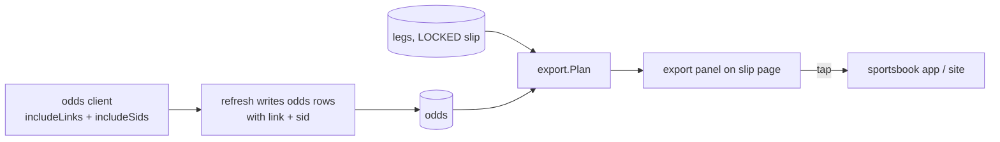

# Design: Export locked slips to DraftKings and FanDuel

## Context

A `LOCKED` slip has every leg fixed. Each leg already has the keys of an `odds` row: `game_id`, `market_type`, `team`,
`player_name`, `side`, and `line`. The `odds` table holds one row per book, so the app already knows what DraftKings and
FanDuel quoted for that selection. What it lacks is the sportsbook's link for that selection. This change stores those
links and shows them on a locked slip. Read before starting:

- `plan/data-sources.md`: "The Odds API" (credits, endpoints, market keys) and the credit floors.
- `plan/architecture.md`: Refresh, and the routes table (the slip panel partial).
- `plan/product.md`: "Editing and locking" and the slip screen.
- `docs/reference/schema.md`: the `odds` and `legs` tables.
- `changes/slate-and-lines/design.md`: the odds client and how refresh writes `odds`.
- `changes/props-research/proposal.md`: props arrive per game, on demand.

Facts and unknowns:

- The Odds API documents two flags on the odds endpoints: `includeLinks` and `includeSids`. Its deep-links page shows an
  `h2h` response where each outcome carries its own betslip `link` and `sid`, and the market-level `link` is null. The
  page is old. Nothing public says what the flags cost, whether DraftKings or FanDuel return links, or whether props
  have them.
- Outcome links point at one selection. Whether a book accepts several selections in one URL is unknown. This design
  makes the one-selection-per-link case the guaranteed path and treats a combined link as an upgrade.
- The seam stays the same as other sources: the odds client parses, `refresh` writes, a handler reads `odds`. No new
  outside call, no new request path to the Odds API, and no credit spent beyond what lazy sync and the cache already
  fetch.

## Approach



**Data.** A migration adds nullable `link` and `sid` columns to `odds`. They hold the outcome-level values for that
book, and are NULL when the book gave none. The odds client adds `includeLinks=true&includeSids=true` to the two odds
calls and parses both fields onto each outcome. The same upsert that refreshes `price` refreshes `link` and `sid`, so a
link is as fresh as its price. If Phase 1 shows the flags cost credits, the design stops there and the cost goes into
the credit-floor math before any other work.

**Planning.** A new `internal/export` package is pure. `export.Plan(slip, legs, odds, book, now)` returns a `Plan` per
book:

```go
type Plan struct {
    Book     string      // "draftkings" or "fanduel"
    Linked   []LegLink   // leg + deeplink + the quoted line and price
    Manual   []ManualLeg // leg + reason: "no link", "line moved", "game started", "no line"
    Combined string      // one URL for all linked legs; empty unless the book supports it
}
```

A leg is linked when its game has not kicked off and an `odds` row for this book matches the leg's keys with the same
`line` and a non-NULL `link`. Everything else is a `ManualLeg` with a one-line reason, so no leg disappears. A leg whose
line has moved since the member added it is listed manual with the new line, since the sportsbook would otherwise put a
different bet on the slip. Price drift alone does not block a link. The sportsbook shows its own price, and the person
decides. The match is exact on `line` and uses the same key the odds table is keyed on, so there is one definition of
"the same selection".

**Combined links.** `Combined` is built by a per-book function from the stored `sid`s, behind a small interface:

```go
type Combiner interface{ Combine(linked []LegLink) (url string, ok bool) }
```

Phase 1 records, from live responses and by hand on a phone, whether either book takes several selections in one URL and
how. A book with a verified format gets a `Combiner`. A book without one returns `ok = false`, and the panel shows one
tap per leg instead. No format is guessed. The per-leg path ships first and is complete without a `Combiner`.

**UI.** The slip panel gains an export panel, shown only when `slips.status = 'LOCKED'`. At phone width it is a card
with:

- one button per book: "Open in DraftKings", "Open in FanDuel". With a `Combined` link it is one tap. Without, it
  expands to a numbered list of per-leg taps, each labeled with the selection.
- under each book, the manual legs by name with the reason in plain words ("Heads up: this prop didn't come with a
  DraftKings link, so add it by hand").
- "Copy slip as text" for the whole slip, always shown.

A book with no linked legs shows only its manual list. Copy is plain text: one line per leg with member, selection, and
the price at lock. The panel is a partial at `GET /slips/{id}/export`, loaded with the slip page and refreshed when the
slip's SSE `slip-updated` event arrives, so an unlock hides it. It renders from `odds` only and never triggers a fetch.
Links open with `target="_blank"` and `rel="noopener"`.

**Staleness.** A link is only offered while its game is unstarted. Prices go stale within the cache window, so the panel
shows "links as of {time}" from the odds `fetched_at`, the same note the Games tab uses. Link rows past the cache window
are still shown, since the sportsbook corrects the price, and the note tells the person how old they are.

Rejected:

- Building links from `sid`s alone for every book. It guesses URL formats and breaks silently. Verified formats only.
- A new fetch at export time to get fresh links. It spends credits on a button press, which the free-tier rules forbid.
- A separate `book_links` table. The link belongs to the same outcome row as the price, and one upsert already refreshes
  it.
- Blocking export on any manual leg. Product rules say friendly, never blocking.

## Verification

`go test ./...` and `golangci-lint run ./...` pass; the live test below skips under `-short`.

- **Live test (one real game, run once by hand):** call the game odds endpoint with and without both flags and compare
  `x-requests-last`, to confirm the credit cost; record the response for a game line and a prop on DraftKings and
  FanDuel into `testdata/`; and note which fields are present, which are NULL, and the link shape. Fix
  `plan/data-sources.md` where it differs.
- Saved fixtures parse `link` and `sid` onto the right outcome, and a missing field stores NULL without failing the
  parse.
- Re-running a sync with the flags updates `link` with `price` in one upsert and changes no other rows.
- `export.Plan` table tests: all legs linked; one prop with no link; a line that moved; a game that has started; a leg
  with no `odds` row for the book; a hand-typed `OTHER` leg with no `game_id`; a leg matching only the other book. Every
  leg appears in exactly one of `Linked` or `Manual`.
- With a verified `Combiner`, `Combined` holds all linked legs; with `ok = false`, `Combined` is empty and per-leg links
  show.
- The panel appears only on a `LOCKED` slip and disappears after an unlock arrives over SSE. Rendering and the copy text
  make no Odds API call and no DB write.
- Leg selections in the panel and in the copy text are HTML-escaped, since `OTHER` legs are free text.
- At phone width, check the export card with all legs linked, some manual, and none linked.

## Risks

- **Links may be missing or differ by book.** The API says "if available". The live test settles it. If props or a book
  have no links, the panel lists those legs by name, which is the designed fallback and not a failure.
- **Credit cost.** If `includeLinks` or `includeSids` costs extra credits, the cost multiplies across every lines and
  props fetch. The live test measures it before code lands. If it is large, the change needs a new decision, and we
  stop.
- **Link format changes.** A sportsbook can change its URL scheme without notice. Per-leg links come straight from the
  API, so they follow the change. A `Combiner` is ours and can rot; the `live-api-watch` live test should include one
  link-shape check, and a broken `Combiner` can be turned off by returning `ok = false`.
- **Linked bet differs from the agreed bet.** The line check handles a moved line. A mismatch in side or market would be
  a matching bug. The `Plan` tests cover each market type.
- **Odds API terms.** Confirm that storing and showing bookmaker links fits the plan's terms before shipping.

## TODO

Effort: medium (small UI, but the first phase depends on unknown API behavior and a verified link format)

### Phase 1: Probe and store links

- [ ] Run the live probe on one real game for a game line and a prop on both books, measure the credit cost of both
      flags, save the responses to `testdata/`, and write the findings into `plan/data-sources.md`. Stop and ask a
      person if the cost is more than the lines-and-props budget can take.
- [ ] Add `link` and `sid` to `odds` with a migration, send both flags from the odds client, parse them from the saved
  fixtures, and write them in the same upsert as `price`, tested against a fake server and a temp DB
- [ ] Docs: add the two columns to `docs/reference/schema.md` and the flags to the Odds API section of the data-sources
      doc

### Phase 2: Plan and show the export

- [ ] Add `internal/export` with `Plan`, the match rules, and the manual reasons, with table tests for every case in
  Verification
- [ ] Add `GET /slips/{id}/export` and the export card on the locked slip at phone width, with per-leg taps, the manual
      list with friendly notes, "links as of", "Copy slip as text", and SSE refresh on unlock
- [ ] Docs: write `docs/concepts/export.md` and add the route to `plan/architecture.md`

### Phase 3: Combined links

Effort: hard (needs hands-on checks of each book's link behavior on a phone)

- [ ] For each book where the probe and a phone test show a multi-selection URL works, add a `Combiner` and one-tap
  `Combined` link, with tests on saved `sid`s; leave other books on per-leg taps
- [ ] Docs: record each verified format in `docs/concepts/export.md`, with the date checked
