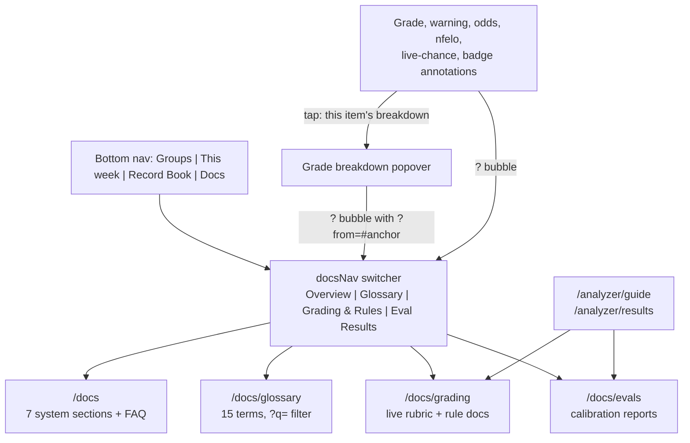

# Close-out

## Overview

The app now has a fourth primary tab, Docs, and every inline annotation can deep-link into it.

`docsNav` in `internal/web/docs.go` is the only switcher definition, and it renders once as the `docs-nav` partial for
all four docs screens. Old `/analyzer/*` bookmarks resolve on the same handlers rather than through redirects, so
fragments survive. The bottom bar moved from `grid-cols-3` to `grid-flow-col auto-cols-fr` and now sizes any number of
tabs evenly.

Help bubbles live in one `help-bubble` partial and forward `?from=` so docs render a checked back link. They cover leg
and slip grades, warning cards, the pick-detail badge header, the `nfelo` chip, implied and reference odds, and live hit
chance.

## Consequences

- Easier: a curious user reaches grading rules, evals, and a plain-language glossary from the bottom bar instead of
  through a slip link.
- Easier: adding a new annotation explainer is one `{{template "help-bubble" ...}}` call plus a stable anchor; a new
  docs screen is one entry in `docsNav`.
- Easier: route and anchor tests (`help_bubble_test.go`, `TestDocsHubAnchorsResolveInData`) fail on a typo instead of
  shipping a dead deep link.
- Easier: `/analyzer/guide` and `/analyzer/results` keep working with the Docs tab lit, so existing bookmarks and
  handler tests stay valid.
- Harder: anchor names (`#sys-*`, `#term-*`, `#leg-grades`, `#rule-<id>`) are now a cross-file contract between
  templates, tests, and `docs/concepts/docs-hub.md`. Renaming one means touching all three.
- Harder: user-facing copy sits in Go structs next to engineer docs that describe the same systems, so a threshold or
  terminology change can land in one and not the other.
- Harder: docs pages render two `aria-current="page"` anchors (bottom tab plus switcher section), which surprises tests
  that count occurrences.
- Revisit: the week card shows a live chance without a bubble, the only remaining unexplained annotation the change
  scoped out.
- Revisit: the bottom bar is flexible but the four labels are still long words; a fifth tab from a sibling change should
  be checked at 375px.

## Alternatives considered

- **HTTP redirects for `/analyzer/guide` and `/analyzer/results`.** Rejected: redirects can drop `#fragment` anchors and
  break handler tests that expect `200 OK`. Registering both paths on one handler keeps bookmarks, anchors, and the
  Docs tab intact.
- **Parsing `docs/*.md` into the user-facing hub.** Rejected: repo docs are written for engineers with package names,
  table names, and handler signatures. Static Go structs keep the public copy plain and let unit tests check unique
  slugs and anchors.
- **HTMX or client-side instant glossary filtering.** Not chosen: a server-rendered `?q=` form filters in memory with no
  JavaScript and no database read, which keeps the page deterministic and testable. The trade-off is a page reload per
  query.
- **A `?` bubble inside each pick-board badge button.** Rejected: an anchor inside a button is invalid HTML and
  double-fires on mobile Safari. The badge explanation went into the pick-detail header instead, so badges on the row
  still have no adjacent bubble.
- **Separate popover selectors for leg grades and slip grades.** Collapsed into one `data-help-popover` marker shared by
  both `
` elements, so the outside-click close handles any future popover that adopts the marker.
- **Splitting the two concept docs that hit their line budgets.** Rejected in favor of explicit budget overrides with
  reasons; the help-bubble pattern belongs with the analyzer and slip docs it explains.

## Implementation notes

- Phase 1 necessarily shipped a temporary state: the switcher's grading and eval entries pointed at
  `/analyzer/guide` and `/analyzer/results` until Phase 2 registered `/docs/grading` and `/docs/evals`. The final state
  has no legacy links left in the analyzer or docs templates.
- The design budgeted a pick-board bubble on the badges themselves; that was impossible inside `<button>`, so only the
  detail header carries the `#suggestions` bubble. If a reader expects a bubble next to every badge row, it is not
  there by design.
- The grading screen keeps its own anchors (`#leg-grades`, `#slip-grade`, `#suggestions`, `#rule-<id>`) on both the
  `/docs/grading` and `/analyzer/guide` paths, so templates can deep-link without knowing which URL the user came from.
  `/docs/evals` is the canonical eval screen; `/analyzer/results` renders the same page.
- Overview prose in `internal/web/docs.go` is static. Only the grading screen reads live thresholds and rules, so a
  rubric change updates the rubric and rules sections but not the plain-language overview paragraphs.
- The glossary search box is a plain GET form, so every query is a full page load and results are not swapped in place.
- Bubbles are deliberately outside `
` elements. A bubble inside a summary would trigger both the popover and
  the navigation on mobile Safari.

## Follow-ups

- Add a live-chance `?` bubble to the week card in `web/templates/week.html` (target `/docs#sys-live`) so the same
  metric is explained everywhere it appears.
- Re-check the bottom bar at 375px once the Research tab lands, and shorten labels or padding if five tabs crowd.
- Add a docs-lint or test check that the annotation table in `docs/concepts/docs-hub.md` lists the same anchors that
  `internal/web/help_bubble_test.go` asserts, so the doc cannot drift from the templates.
- Consider generating the overview's plain-language system sections from the same source as the grading rules, or add a
  review note to `internal/web/docs.go` pointing at the analyzer package, so threshold prose cannot go stale silently.
- Fold the duplicate `/docs/grading` and `/docs/evals` rows that appear in both the analyzer and Docs tables of
  `docs/reference/routes.md` into one table during the next docs prune.
