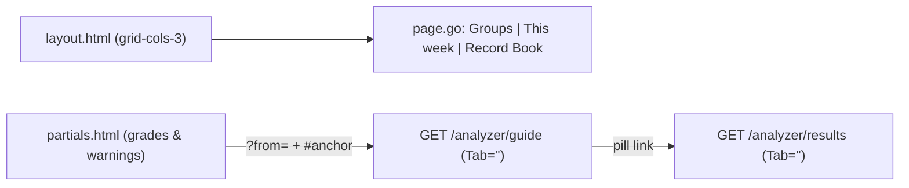
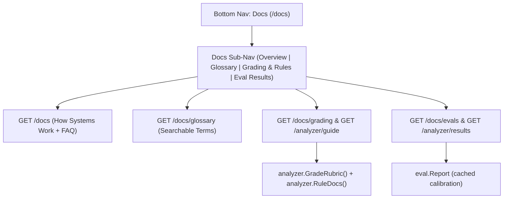
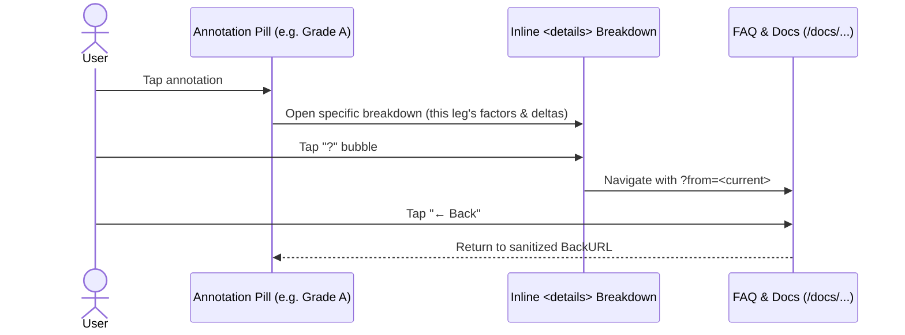

# Design: FAQ and docs primary view

## Context

Primary navigation is defined by `navTabs` in `internal/web/page.go` (`TabGroups`, `TabWeek`, `TabRecord`) and rendered
in `web/templates/layout.html` inside a fixed bottom `<nav>` with a hardcoded `grid-cols-3` container.

User-facing reference screens currently live outside primary navigation:

- `GET /analyzer/guide` (`internal/web/analyzer.go`, `web/templates/analyzer_guide.html`) renders
  `analyzer.GradeRubric()` and `analyzer.RuleDocs()` with `page.Tab = ""` and a `safeReturnPath` `BackURL` from
  `?from=`.
- `GET /analyzer/results` (`internal/web/eval_results.go`, `web/templates/analyzer_results.html`) renders global
  calibration from `internal/eval` across `source=slips|market`, `season`, and `rubric`, also with `page.Tab = ""`.
- `web/templates/partials.html` renders leg and slip grades as `<details>` popovers containing a `See full rubric` link
  to `/analyzer/guide?from=...#leg-grades` or `#slip-grade`, and warning cards linking to `#rule-<id>`. Other inline
  annotations (`nfelo` model chips, pick-board signal badges, implied probability percentages, reference odds, and live
  hit chance) have no consistent inline explainer or doc deep-link.



Constraints:

- All content must remain deterministic, server-rendered Go/HTML templates with zero LLM calls and zero paid API
  fetches.
- Phone-first layout: popovers and nav tabs must fit cleanly at 375px width without horizontal overflow.
- Existing `/analyzer/guide?from=...#...` and `/analyzer/results?...` URLs and `safeReturnPath` open-redirect
  protections must remain valid.

## Approach

### 1. Primary navigation tab and flexible bottom bar

Add `TabDocs Tab = "docs"` (`Label: "Docs"`, `Href: "/docs"`) to `navTabs` in `internal/web/page.go`. Replace
`grid-cols-3` on the bottom `<nav>` container in `web/templates/layout.html` with `grid-flow-col auto-cols-fr` so the
bar adapts cleanly whether 3, 4, or 5 primary tabs are registered.

### 2. Unified FAQ & Docs hub (`internal/web/docs.go`)

Add a dedicated `docsHandlers` (or methods on `slipHandlers` in a new `internal/web/docs.go`) backed by
`web/templates/docs.html` and registered in `pageFiles` in `internal/web/render.go`. All docs routes set
`page.Tab = TabDocs`, carry an optional sanitized `BackURL` (`safeReturnPath(r.URL.Query().Get("from"))`), and share a
compact top section switcher (`Overview`, `Glossary`, `Grading & Rules`, `Eval Results`) that forwards `?from=` when
present.



Route and content layout:

- `GET /docs` renders the main hub: quick-jump cards, plain-language system explainers with stable anchors
  (`#sys-grading`, `#sys-odds`, `#sys-badges`, `#sys-live`, `#sys-autograde`, `#sys-sources`, `#sys-export`), and common
  FAQ items.
- `GET /docs/glossary` renders a static, structured Go slice (`[]GlossaryEntry{Slug, Term, Category, Summary, Example}`)
  covering betting and app concepts (`implied-prob`, `de-vig`, `price-edge`, `epa`, `wopr`, `target-share`,
  `snap-share`, `nfelo`, `key-numbers`, `line-drift`, `chalk`, `correlation`, `push-void`, `reference-odds`,
  `slate-scope`). Each entry has anchor `#term-<slug>` and supports instant filtering via `?q=` (and an HTMX swap on
  `#docs-glossary-list` or client-side filter) with zero database queries.
- `GET /docs/grading` and `GET /analyzer/guide` both invoke the same handler with `page.Tab = TabDocs`, preserving every
  existing `#leg-grades`, `#slip-grade`, `#suggestions`, and `#rule-<id>` anchor without relying on HTTP redirects that
  could drop URL fragments.
- `GET /docs/evals` and `GET /analyzer/results` both invoke the same `evalResults` handler with `page.Tab = TabDocs`,
  preserving all `source`, `season`, `rubric`, and `from` query parameters.

### 3. Two-step annotation and `?` help-bubble pattern

Define a reusable template fragment `help-bubble` (in `web/templates/partials.html` or a shared
`web/templates/help.html` parsed into both full pages and partials by `Renderer` in `internal/web/render.go`):

```go
type HelpLink struct {
    Href  string // e.g. "/docs/grading?from=/slips/42#leg-grades"
    Label string // aria-label, e.g. "How leg grades work"
}
```

It renders a compact, accessible circular `?` anchor
(`inline-flex h-4 w-4 items-center justify-center rounded-full border ...`).



Roll out the pattern across `web/templates/partials.html`:

- **Leg grades & slip grades** (slip panel, pick tray, A-grade highlight cards): tapping the grade opens the existing
  `<details>` factor breakdown for *that specific leg or slip*; the popover header replaces the verbose
  `See full rubric` link with a `?` bubble pointing to `/docs/grading?from=<current>#leg-grades` or `#slip-grade`.
- **Analyzer warning cards**: add a `?` bubble pointing to `/docs/grading?from=<current>#rule-<id>`.
- **Pick-board signal badges** (`Smash matchup`, `High volume`, `Role bump`, `Fits slip`): keep compact badges on rows,
  and in the detail/card header or breakdown provide a `?` bubble linking to `/docs/grading?from=<current>#suggestions`.
- **Model chips (`nfelo`) and odds/live metrics** (implied probability, reference odds, live hit chance): pair with a
  `?` bubble linking to `/docs/glossary?from=<current>#term-nfelo`, `#term-implied-prob`, `#term-reference-odds`, or
  `/docs?from=<current>#sys-live`.

In `web/static/app.js`, ensure clicking outside an open `[data-help-popover]` / `[data-leg-grade]` `<details>` closes it
so popovers never stack awkwardly on phones.

### Trade-offs

- **Serving `/analyzer/guide` and `/analyzer/results` directly as aliases instead of 301/302 redirects:** HTTP redirects
  can drop `#fragment` anchors in some clients and break existing handler tests expecting `200 OK`. Sharing the handler
  across both URLs keeps bookmarks, tests, and anchors intact while unifying the UI under `TabDocs`.
- **Static Go structs for glossary and system explainers instead of parsing `docs/*.md` at runtime:** Repo docs in
  `docs/` are written for engineers (with package names, SQLite tables, and handler signatures). Dedicated user-facing
  structs keep the copy plain, jargon-free, strongly typed, and checked by unit tests for unique slugs and valid
  anchors.

## Verification

- Run `go test ./...` and `good-vibes docs lint` to verify compilation, unit tests, template parsing, and doc validity.
- **Navigation & layout:** Verify `Page.Tabs()` includes `TabDocs` (`Docs`, `/docs`), marks it `aria-current="page"`
  across `/docs`, `/docs/glossary`, `/docs/grading`, `/docs/evals`, `/analyzer/guide`, and `/analyzer/results`, and
  renders cleanly at 375px width with `grid-flow-col auto-cols-fr`.
- **Deep links & open-redirect safety:** Verify `?from=/slips/1` renders a working `← Back` link and forwards `from`
  across docs sub-tabs, while external/malformed `?from=https://evil.example` is stripped by `safeReturnPath`.
- **Glossary search & anchors:** Verify every glossary slug is unique, every `#term-<slug>` and `#sys-<id>` anchor
  referenced by a `?` bubble exists in the rendered docs HTML, and `?q=epa` filters glossary terms accurately.
- **Two-step help bubbles:** Verify leg grade, slip grade, warning, model chip, and pick-badge templates render the
  specific breakdown on tap and include a valid `?` bubble link targeting the matching `/docs/...` anchor.

## Risks

- **Broken `#anchor` links between templates and docs:** A typo in a `?` bubble `Href` could land users at the top of
  `/docs` instead of the intended section. Mitigate with a table-driven test asserting every help-bubble anchor target
  exists in the rendered docs pages.
- **Bottom nav crowding at phone width (375px):** Adding `Docs` (and `Research` in the sibling change) increases the
  bottom bar from 3 to up to 5 items. Mitigate with short single-word labels (`Groups`, `Week` / `This week`,
  `Research`, `Record`, `Docs`), compact horizontal padding, and `grid-flow-col auto-cols-fr`.
- **Nested interactive elements inside `<summary>`:** Placing an `<a>` `?` bubble inside a `<summary>` can cause
  double-triggering on mobile Safari. Keep `?` bubbles inside the expanded `<details>` panel (or adjacent to the
  `<details>` element, never nested inside `<summary>`).

## TODO

### Phase 1: Primary Docs nav tab and unified hub

Complexity: medium (touches shared layout/nav contract, template registration, and new docs hub + searchable glossary
data model) Risk: low (read-only routes and additive navigation; existing routes unchanged and covered by layout/route
tests)

- [x] Add `TabDocs` (`Docs`, `/docs`) to `internal/web/page.go` and switch the bottom nav container in
      `web/templates/layout.html` from `grid-cols-3` to `grid-flow-col auto-cols-fr`, updating
      `internal/web/page_test.go` and `internal/web/layout_test.go`.
- [x] Implement `internal/web/docs.go` and `web/templates/docs.html` serving `GET /docs` (How Systems Work + FAQ with
      stable `#sys-*` anchors) and `GET /docs/glossary` (structured glossary with `#term-*` anchors and `?q=`
      filtering), wired into `internal/web/render.go` and `internal/web/slips.go` with handler and anchor-uniqueness
      tests.
- [x] Docs: document the new `/docs` and `/docs/glossary` routes in `docs/reference/routes.md`.

### Phase 2: Integrate Grading Guide and Eval Results into Docs

Complexity: low (reuses existing `analyzerGuide` and `evalResults` handlers with shared `TabDocs` shell and sub-nav)
Risk: low (existing `/analyzer/guide` and `/analyzer/results` routes stay valid; existing test suites verify backward
compatibility)

- [x] Register `GET /docs/grading` and `GET /docs/evals` alongside `GET /analyzer/guide` and `GET /analyzer/results`,
      set `page.Tab = TabDocs` on both, and add the shared Docs sub-navigation bar (forwarding sanitized `?from=`) to
      `web/templates/analyzer_guide.html` and `web/templates/analyzer_results.html` with tests in
      `internal/web/analyzer_test.go` and `internal/web/eval_results_test.go`.
- [ ] Docs: update `docs/reference/routes.md` for `/docs/grading` and `/docs/evals`.

### Phase 3: Reusable `?` help bubbles and two-step annotation popovers

Complexity: medium (coordinates a shared template partial across slip, pick, highlight, and research annotations while
validating every anchor target) Risk: low (UI-only markup and progressive-enhancement popover dismissal; no state or
grading math changes)

- [ ] Add a reusable `help-bubble` partial and wire it into leg grades, slip grades, analyzer warnings, pick-board
      signal badges, `nfelo` model chips, implied probability / reference odds, and live hit chance in
      `web/templates/partials.html` (plus outside-click popover close in `web/static/app.js`), keeping `?` bubbles
      outside `<summary>` elements and adding tests that verify every rendered `?` bubble anchor exists in `/docs`,
      `/docs/glossary`, or `/docs/grading`.
- [ ] Docs: update `docs/concepts/analyzer.md` and `docs/concepts/slips.md` to describe the Docs hub and two-step `?`
      help-bubble pattern.
