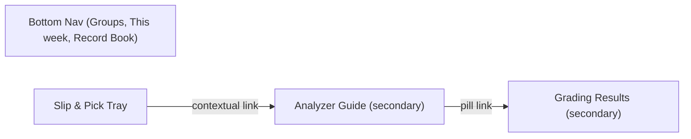
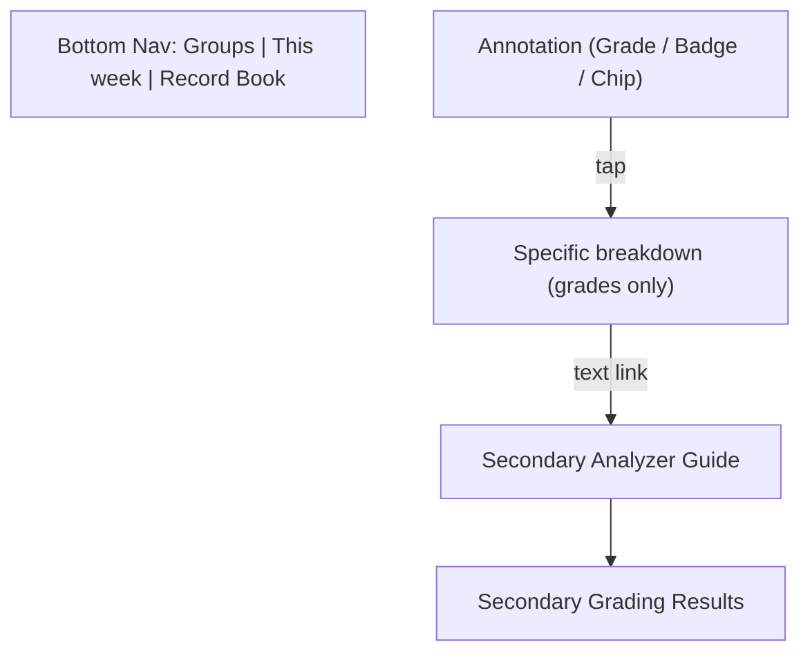
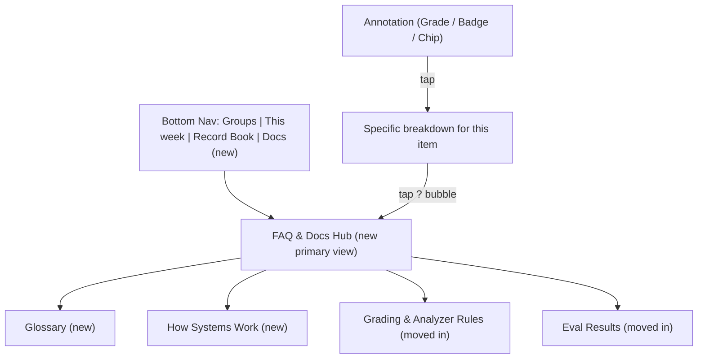

# FAQ and docs primary view

## Context

The main navigation bar holds three views: Groups, This week, and Record Book. User-facing explanations do not have a
home there. Today, two secondary pages carry the analyzer guide and grading calibration results, and users only find
them through links buried inside a slip or pick tray.

This leaves three gaps for curious users:

1. **Hard to find.** Someone wanting to learn how grading works or check eval accuracy has to open a slip first.
2. **Incomplete coverage.** The guide covers analyzer rules, pick badges, and grades, but leaves out a plain-language
   glossary (implied probability, de-vig, EPA, WOPR, target share, line drift, key numbers, nfelo) and explanations of
   other systems (odds pricing, live progress, auto-grading, data sources, sportsbook export).
3. **Inconsistent inline help.** Tapping a grade pill opens a breakdown for that specific leg or slip, with a text link
   to the guide. Other annotations (pick badges, model chips, odds percentages, live hit chance) have no uniform way to
   explain what they mean or jump to the general docs.

## Goals and non-goals

**Goals:**

- Add an FAQ & Docs page as a primary destination in the main navigation.
- Bring all user-facing reference material into one browsable hub: a glossary of terms, plain-language explanations of
  how each system works, the live analyzer rules and grading rubric, and grading evaluation results.
- Introduce a consistent two-step help pattern on annotations: tapping an annotation explains how that specific value
  was computed, and tapping a `?` bubble jumps directly to the matching general explanation in FAQ & Docs with a clear
  way back.
- Keep every page and popover phone-first, deterministic, and written in the app's friendly, jargon-free tone.

**Non-goals:**

- Replacing developer docs or building a CMS/editor for help content.
- Changing analyzer grading math, warning rules, or evaluation calculations.
- Adding LLM-generated answers or changing authentication.

## Decision

Promote a unified FAQ & Docs hub to the primary navigation bar, consolidating the analyzer guide, grading evals, a user
glossary, and system explainers under one home, and wire a reusable `?` help-bubble pattern onto annotations so users
can inspect a specific grade or metric first and jump to the general explanation in one tap.

### Before

### After

Keeping separate secondary pages behind slip links forces users to hunt for answers and leaves non-analyzer concepts
undocumented. Stuffing full explanations into inline popovers would crowd phone screens. A single primary hub paired
with lightweight `?` deep-links keeps slips clean while making every concept one tap away.

**Complexity (`medium`):** Spans the shared navigation shell, a multi-section documentation hub, and contextual `?`
bubble wiring across slip, pick, and research annotations while keeping existing deep-link and back-navigation flows
intact. **Risk (`low`):** Read-only documentation and navigation additions do not alter betting state, grading math, or
paid API credit usage, and route, anchor, and rendering tests cover the new links and pages.
