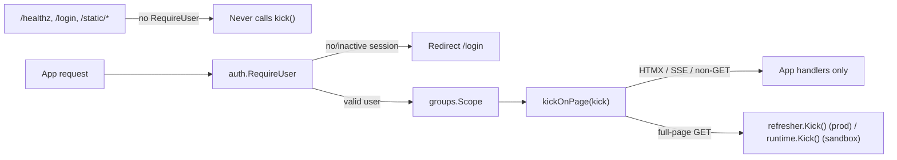
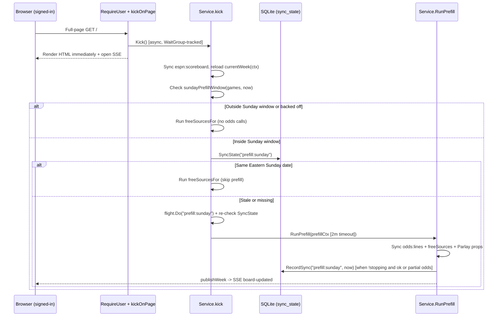

# Design: Run Sunday prefill on first authenticated visit

## Context

Three seams currently separate page-load refreshes, auth gating, and Sunday pre-fill:

- **HTTP middleware (`cmd/server/main.go`, `internal/auth/middleware.go`, `internal/groups/groups.go`):** `newMux` mounts `/healthz`, `/readyz`, `/static/{path...}`, `/screenshots/{file}`, and auth routes outside `RequireUser`. Every app route sits behind `handlers.RequireUser(scope(kickOnPage(kick)(app)))`. `kickOnPage` calls `kick()` only when `isFullPageGet(r)` is true (plain `GET`, no `Hx-Request: true`, not an SSE stream). `POST /internal/prefill` sits on an outer mux outside `CSRF` and `RequireUser`, gated by `PREFILL_TOKEN`.
- **Refresh service (`internal/refresh/refresh.go`, `rules.go`, `research.go`, `sources.go`):** In production (`cfg.Sandbox == false`), `kick` is `refresher.Kick`, which calls `s.kick(ctx)` in a `WaitGroup`-tracked goroutine detached from request cancellation (`context.WithoutCancel`) and bounded on shutdown by `s.stopCtx`. Today, `s.kick(ctx)` syncs `espn:scoreboard` and runs `freeSourcesFor` (`weather`, `espn:summary`, deduped week-team `espn:roster`, `nfelo`, `grade`, `espn:gamelog`), omitting `odds:lines` and props. `RunPrefill(ctx)` runs the full Sunday sweep synchronously (scoreboard, `odds:lines` with 15m `prefillStale` idempotency, bounded free sources, and Parlay-only `prefillProps` for upcoming games).
- **Sandbox isolation (`cmd/server/sandbox.go`):** When `cfg.Sandbox == true`, `kick` is `sandboxRuntime.Kick()`, which runs `r.refresher.RunOnce(r.stopCtx)` instead of `refresher.Kick()`. `POST /internal/prefill` returns `503` in sandbox mode.
- **Persistence (`internal/db/sync.go`):** `sync_state` stores `(source, fetched_at, odds_credits_remaining)` in SQLite, replicated by Litestream on the single Cloud Run instance (`--min-instances 0 --max-instances 1`).

## Approach

Trigger `RunPrefill` inside `refresh.Service.kick(ctx)` on the first full-page load that enters the Sunday morning Eastern-time window while upcoming Sunday games remain, using a dedicated `sync_state` key (`SundayPrefillSource = "prefill:sunday"`) and `singleflight` deduplication so concurrent visits and cold starts never double-run.

### 1. Sunday window and persistence rules (`internal/refresh/rules.go`, `refresh.go`)

Add `SundayPrefillSource = "prefill:sunday"` and two pure rules using the injected `eastern` (`tz.Eastern`, `America/New_York`) location:

- `sundayPrefillWindow(games []db.Game, now time.Time) bool`:
  - Converts `now` to `America/New_York` (`nowET := now.In(eastern)`).
  - Returns `false` unless `nowET.Weekday() == time.Sunday` and `nowET.Hour() >= sundayPrefillStartHour` (`6`, i.e., 6:00 AM ET or later). Starting at 6:00 AM ET prevents late Saturday-night browsing (00:00–05:59 ET Sunday) from consuming Sunday's single pre-fill hours before Sunday inactives and morning line movement settle.
  - Computes `lastSunday := lastKickoffOn(games, time.Sunday)`. Returns `false` if `lastSunday.IsZero()` or `!now.Before(lastSunday)`. This guarantees at least one Sunday game has not yet kicked off, and avoids firing on Sunday night when only a Monday night game remains.
- `sundayPrefillStale(last, now time.Time) bool`:
  - Returns `true` when `last.IsZero()`.
  - Compares Eastern calendar dates (`last.In(eastern).Date()` vs `now.In(eastern).Date()`) and returns `true` when they differ. Using the `America/New_York` calendar date rather than a fixed `24h` duration handles DST transitions cleanly and ensures a manual `POST /internal/prefill` run on Saturday does not suppress Sunday's run.

### 2. Orchestration in `Kick` and `RunPrefill` (`internal/refresh/refresh.go`)

Key behaviors and edge cases:

1. **Scoreboard runs before the window check:** `s.kick(ctx)` syncs `espn:scoreboard` first and reloads `currentWeek(ctx)`, just as it does today. That ensures a fresh week's Sunday games are present in SQLite before `sundayPrefillWindow(games, now)` inspects kickoffs. Inside `RunPrefill`, `scoreboardSource` sees `fetched_at == now` and skips a second ESPN call in `<1ms`.
2. **Non-blocking page load with SSE continuity:** Running `RunPrefill` asynchronously inside `s.kick(ctx)` keeps the first Sunday visitor's `GET /` response fast instead of blocking on 13+ sequential/batched API calls. The rendered page opens its SSE stream and HTMX partials immediately, keeping Cloud Run CPU allocated while `publishWeek` pushes updates as lines and props commit. If the visitor navigates into `/slips/{id}/pick` mid-prefill, `SyncPickLines` and `SyncPickGame` share the same `s.flight` keys (`OddsLinesSource`, `OddsPropsSource(game.ID)`) and deduplicate.
3. **Singleflight and fast-path checks:** `maybeRunSundayPrefill` checks `sundayPrefillWindow` (pure in-memory) before touching SQLite, so weekday/Saturday/post-kickoff page loads incur zero extra DB reads. Inside the Sunday window, it checks `s.paused(SundayPrefillSource, now)` and `shouldRun`, then enters `s.flight.Do(SundayPrefillSource, ...)` and re-checks `SyncState` inside the flight so a second concurrent visitor joining right as the first finishes does not re-run pre-fill.
4. **Partial failure vs. full failure:** `RunPrefill` collects errors across `odds:lines`, free sources, and per-game `prefillProps`.
   - When `!s.stopping()` and either `len(errs) == 0` or at least some odds prefill succeeded (`report.LinesSynced || report.PropsSynced > 0`), `RunPrefill` records `SundayPrefillSource` using a short timeout off `s.stopCtx` (`syncTimeout`, independent of `prefillCtx` expiring on the last game). That prevents a single broken game prop or flaky free source like `nfelo` from causing `Kick()` to re-buy 40+ credits every 15 minutes.
   - When `RunPrefill` fails with zero odds progress (`err != nil && !report.LinesSynced && report.PropsSynced == 0`), `SundayPrefillSource` is not recorded; `maybeRunSundayPrefill` applies `s.backOff(SundayPrefillSource, now)` (5 minutes) and returns `false` so `s.kick` still runs `freeSourcesFor` without starving free data.
   - Ignore `odds.ErrNoAPIKey` on `linesSrc` inside `RunPrefill` (matching `syncPickLines` and `prefillProps`) so local dev or minimal test configs without odds keys complete cleanly without triggering backoff.
5. **Interplay with `POST /internal/prefill`:** Because `RunPrefill` itself writes `SundayPrefillSource`, an optional Cloud Scheduler hit to `POST /internal/prefill` also marks Sunday as done for subsequent page loads, while `POST /internal/prefill` continues to obey its own 15-minute `prefillStale` idempotency window when invoked directly.
6. **Auth and sandbox invariants:** `cmd/server/main.go` requires no route or middleware changes: `kickOnPage` already sits inside `handlers.RequireUser(scope(...))`, and `cfg.Sandbox` already passes `sandboxRuntime.Kick` (`RunOnce`) instead of `refresher.Kick`.

### Rejected alternatives

- **Blocking the first Sunday `GET /` synchronously:** Rejected because `RunPrefill` fetches up to 16 games' bulk props (several seconds to 2 minutes), which would stall first-paint latency on mobile.
- **Checking `odds:lines` staleness instead of a dedicated `prefill:sunday` key:** Rejected because Saturday or midnight pick-time refreshes update `odds:lines` without warming Sunday Parlay bulk props, and a dedicated key cleanly separates "Sunday bulk pre-fill completed" from per-source staleness.
- **Starting the Sunday window at 00:00 ET:** Rejected because someone checking Saturday night's scores after midnight ET would trigger Sunday's one-shot pre-fill 9+ hours before Sunday morning line and injury updates.

## Verification

- Run `go test ./...`, `go vet ./...`, `golangci-lint run ./...`, and `good-vibes docs lint` after edits.
- **Rules (`internal/refresh/rules_test.go`):** Table-driven tests for `sundayPrefillWindow` (Mon–Sat false, Sunday 05:59 ET false, Sunday 06:00 ET true when Sunday game upcoming, Sunday after last Sunday kickoff false even when Monday game remains, no games false) and `sundayPrefillStale` (zero time true, same Eastern day false including across DST boundaries, prior Sunday or Saturday true).
- **Orchestration, singleflight, restart persistence, and partial failures (`internal/refresh/prefill_test.go`):**
  - First Sunday 06:00+ ET `KickContext` triggers `RunPrefill` (`odds:lines`, free sources, Parlay-only props) and records `prefill:sunday` in `sync_state`.
  - Second `KickContext` on the same Sunday (including on a brand-new `refresh.Service` instance sharing the same SQLite store to simulate a Cloud Run cold start) omits `odds:lines` and props while still refreshing due free sources.
  - Concurrent `KickContext` calls on Sunday morning execute `RunPrefill` once via `singleflight`.
  - Zero-progress failure (`odds:lines` error with no props synced) enters 5m backoff, leaves `prefill:sunday` unset, falls back to `freeSourcesFor`, and retries after backoff expires; partial prop failure (`LinesSynced == true`, 1 prop error) still records `prefill:sunday` so credits are not re-spent.
  - `RunPrefill` via `POST /internal/prefill` records `prefill:sunday` so a later Sunday `KickContext` does not re-run.
  - Update `TestKickSyncsSummariesAndUniqueRostersWithoutOddsLines` to verify non-prefill `Kick` (outside Sunday window or after `prefill:sunday` is recorded) still syncs summaries and unique rosters while omitting `odds:lines`.
- **Auth & route isolation (`cmd/server/main_test.go`):** Integration test through `newMux` verifying unauthenticated `GET /`, `GET /healthz`, `GET /readyz`, `GET /login`, `HX-Request: true` partials, and `/events` SSE streams never invoke `kick`, while an authenticated full-page `GET /` invokes `kick` once per request.

## Risks

- **Cloud Run scale-to-zero before background `RunPrefill` finishes:** If the sole visitor closes the browser before the SSE stream opens and Cloud Run freezes CPU immediately after the `GET /` response, `RunPrefill` could stall until the next request or shutdown drain. In practice, every full-page load immediately triggers HTMX partials and an SSE connection, keeping the request/stream active, and `Shutdown` drains `s.wg` inside `shutdownTimeout`. `Prefill` logs and `sync_state["prefill:sunday"]` surface whether the run completed.
- **Broken ESPN scoreboard on first Sunday visit:** If `espn:scoreboard` fails on the first Sunday morning visit and no week games exist in SQLite yet, `sundayPrefillWindow` sees no upcoming Sunday games and skips pre-fill. Once `espn:scoreboard` recovers after its 5-minute backoff, the next full-page visit triggers pre-fill normally.
- **Test clock assumptions:** Any test calling `Kick()`/`KickContext()` with a Sunday morning clock and upcoming Sunday games will now invoke the pre-fill path; tests expecting free-only `Kick()` behavior must use a non-Sunday/post-kickoff clock or pre-seed `prefill:sunday`.

## TODO

Effort: medium (multi-seam change across Eastern-time window rules, `sync_state` persistence, `singleflight` and shutdown-safe background orchestration in `internal/refresh`, and auth-boundary verification in `cmd/server`)

### Phase 1: Sunday window rules, persistence, and `Kick` orchestration

- [x] Add `SundayPrefillSource`, `sundayPrefillStartHour`, `sundayPrefillWindow`, and `sundayPrefillStale` in `internal/refresh/rules.go` and `refresh.go` with table-driven unit tests in `internal/refresh/rules_test.go`
- [x] Update `RunPrefill` (ignore `odds.ErrNoAPIKey` on lines, persist `SundayPrefillSource` under `s.stopCtx` on success or partial odds progress) and wire `maybeRunSundayPrefill` into `s.kick(ctx)` with `singleflight`, `prefillKickTimeout`, 5-minute failure backoff, and `freeSourcesFor` fallback, updating `TestKickSyncsSummariesAndUniqueRostersWithoutOddsLines` and adding orchestration, cold-start persistence, concurrency, and failure tests in `internal/refresh/prefill_test.go`

### Phase 2: Mux auth-boundary tests and documentation

Effort: easy (narrow HTTP integration tests against existing `newMux` composition and doc updates across existing files)

- [ ] Add `newMux` HTTP integration tests in `cmd/server/main_test.go` verifying unauthenticated requests, `/healthz`, `/readyz`, `/login`, HTMX partials, and SSE streams never trigger `kick`, while authenticated full-page `GET /` invokes it
- [ ] Docs: update `AGENTS.md`, `docs/concepts/data-refresh.md`, `docs/reference/data-sources.md`, `docs/guides/gcp-setup.md`, and `docs/runbooks/deploy.md` for first-authenticated-Sunday-visit pre-fill, `prefill:sunday` in `sync_state`, and optional `POST /internal/prefill` / Cloud Scheduler fallback, then run `good-vibes docs lint`
