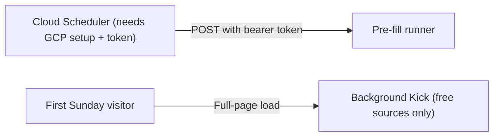
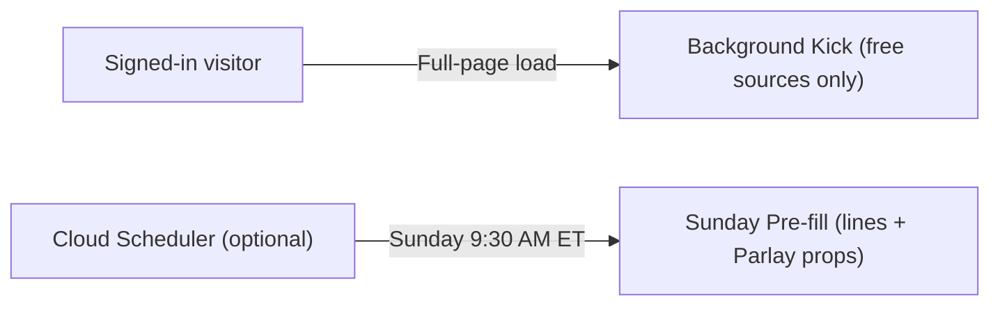
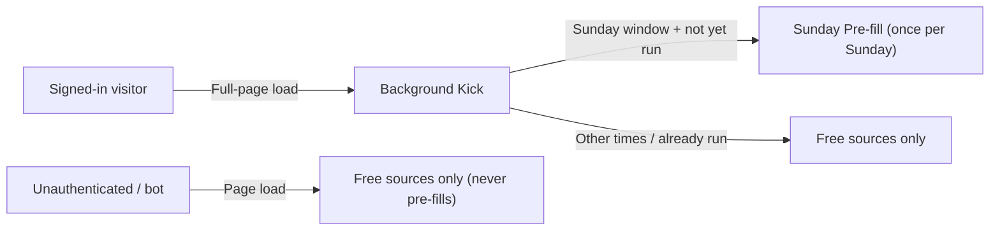

# Run Sunday prefill on first authenticated visit

## Context

Today, Sunday morning pre-fill only runs when an external Cloud Scheduler job calls the internal pre-fill endpoint with a bearer token. If the token secret and scheduler job are not configured in GCP, the pre-fill endpoint returns `404` and Sunday pre-fill never runs.

## Goals and non-goals

**Goals:**

- Automatically run the Sunday pre-fill once per Sunday when the first signed-in user loads a full page on Sunday morning (Eastern time) while upcoming games remain.
- Persist the pre-fill completion state so Cloud Run cold starts, restarts, and subsequent page loads do not re-run it or burn extra API credits.
- Prevent unauthenticated requests, bots, and health checks from triggering paid API calls.

**Non-goals:**

- Replacing pick-time refreshes or manual refresh buttons on open slips.
- Removing the optional internal pre-fill endpoint; it can remain available as a manual/scheduled fallback.
- Warming lines or props on non-Sunday days (such as Thursday or Monday night games).

## Decision

Trigger the Sunday pre-fill from the background page-load refresh when a signed-in user visits on Sunday morning in Eastern time, guarded by persisted sync state so it runs at most once per Sunday.

### Before

### After

Running pre-fill on the first authenticated Sunday visit eliminates the Cloud Scheduler and secret-management setup while keeping the existing credit floors and single-flight guards intact. Unlike an external cron, it requires zero GCP configuration and adapts naturally when nobody opens the app on a given Sunday. The `effort` is `medium` because it coordinates across authentication context, page-load refresh triggering, Eastern-time window rules, and persisted sync state to guarantee at-most-once execution across restarts.
