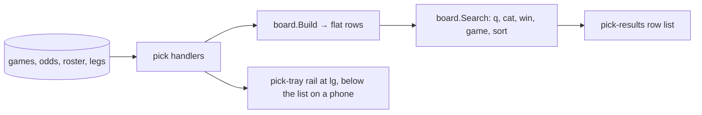
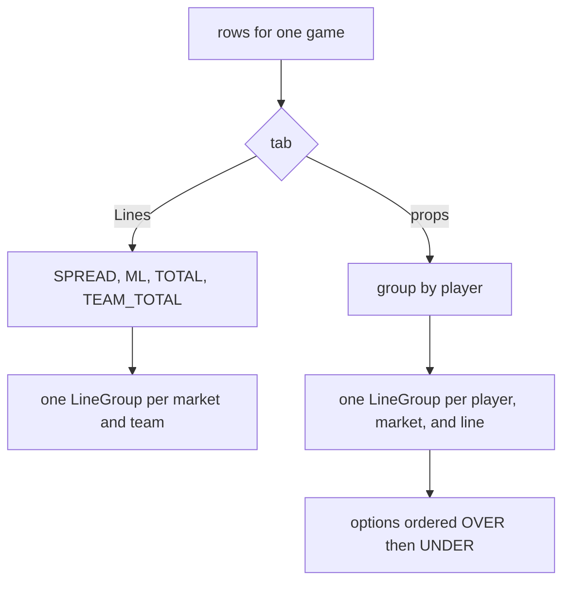
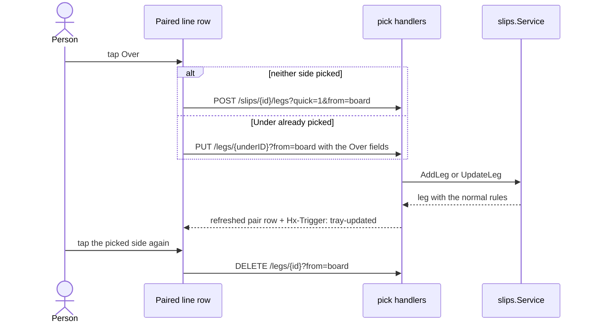
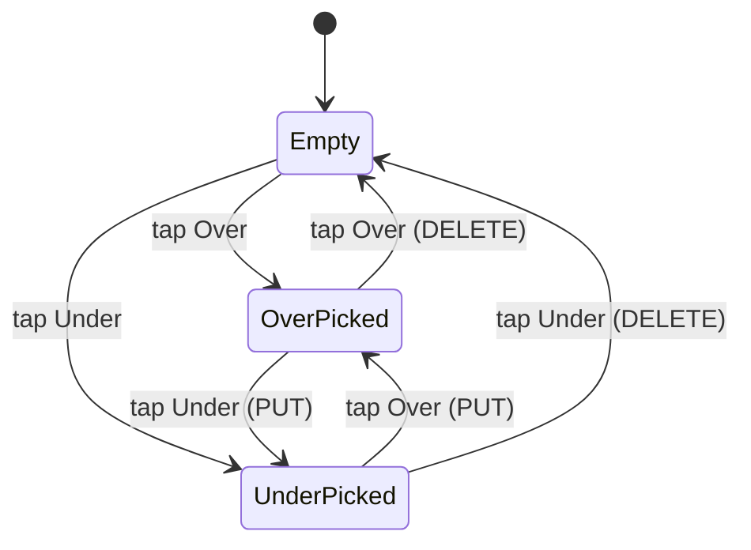

# Design: Game-first pick board

## Context

The pick board already has the data it needs. `internal/board` is pure and turns stored odds into one `Row` per
selection, using the viewer's home book when it prices the selection and the median across books otherwise. `Row`
carries the game, market, team, player, side, line, price, display text, category, kickoff window, and the viewer's leg
id when the selection is picked. `board.Search` filters those rows by query, category, window, one game, and sort.
`internal/web/pick.go` loads the slip's legs, the week's games, odds, and rosters once, then shapes the views. The
templates in `web/templates/pick.html` and the `pick-*` partials in `partials.html` render the flat list and a tray.

Three details shape the new screen:

- Game lines use side `TEAM` with one row per team for `SPREAD` and `ML`, `OVER`/`UNDER` for `TOTAL` and `TEAM_TOTAL`,
  `OVER`/`UNDER` for player markets, and `YES` for `ANYTIME_TD`. A one-sided board is normal.
- `db.Game` already carries the team codes, full names, kickoff, venue, and status. `db.RosterPlayer` carries the
  player's position, which the board can copy onto a row.
- The layout is one column capped at `max-w-3xl`. `Page` has no width switch, so a two-pane screen needs a `Wide` flag
  that widens the header, main, and dock together.

The board never syncs props. Only `GET /games/{id}/props?slip=` calls `SyncGameProps` and then fires `board-updated`.
That invariant stays. Add and update rules live in `internal/slips`; the pick handler never re-implements them.

Read before starting:

- [Slips](../docs/concepts/slips.md#the-pick-board) for the current board, tray, and empty states.
- [Routes](../docs/reference/routes.md#pick-board) for the routes, query parameters, and HTMX headers.
- [Odds math](../docs/reference/odds-math.md) for the home-book and median price rule.
- [Analyzer](../docs/concepts/analyzer.md#the-pick-tray) for what the tray repeats.
- [Product plan](../plan/product.md#screens) and [Architecture plan](../plan/architecture.md#stack) for the stack and
  screen order.
- `AGENTS.md` for phone first, the free-tier rules, and "never blocking".

The current shape:



## Approach

### 1. Board seam: slate, detail, and paired lines

Keep `Build` pure. Add a view-model layer that the handler calls after `Build`:

```go
type GameCard struct {
    ID, Matchup, Venue      string
    Away, Home              string
    Kickoff                 time.Time
    Lines                   GameLines
    Props                   int
    HasProps                bool
}

type GameLines struct {
    Spread, Total, Moneyline *LineSummary
}

type LineSummary struct {
    AwayLine, AwayOdds string
    HomeLine, HomeOdds string
    Line, OverOdds, UnderOdds string
}

type LineGroup struct {
    Market, Team, Player, PlayerID, Position string
    Label                                    string
    Line                                     *float64
    Options                                  []Row // 1 or 2
}

type GameDetail struct {
    Game      GameCard
    Category  Category
    Tabs      []Tab
    Lines     []LineGroup // Lines tab: SPREAD, ML, TOTAL, TEAM_TOTAL
    Players   []PlayerGroup
}
```

`Slates(games, rows, roster, query)` returns one `GameCard` per game that has not kicked off, filtered by the query and
kickoff window. It derives the spread, total, and moneyline from the built rows, and counts prop rows for the
"Explore N props" label. `Detail(game, rows, roster, category, query, sort)` groups the rows for one game.

Pairing is a keyed fold, not a second data source:

- Key on `market + team + player + line`.
- Order the options deterministically: away before home for `SPREAD`/`ML`, `OVER` before `UNDER` for totals and props,
  and the single `YES` row for `ANYTIME_TD`.
- A missing price leaves one option. The template shows one full-width button instead of a dead half.
- If two legs already sit on both sides (for example from the custom leg form), both options show as picked. The row is
  honest about it and lets either be removed.

Category tabs fold `TEAM_TOTAL` into Lines, so the tabs are Lines, Passing, Rushing, Receiving, TDs, and Kicking. A tab
appears only when it has rows or is the active tab. An unknown or empty category falls back to Lines, then to the
first tab with rows. Within a prop tab, rows cluster under the player, so Receiving Yards and Receptions for one player
share a card. The Lines tab shows the game lines first, then team totals grouped by team.

The default detail sort is player. The other sorts are odds (shortest price first) and line (highest line first).
Kickoff sort drops out because one game has one kickoff. Search stays one `q`: on the slate it matches a matchup,
team, venue, or roster player; in the detail it matches the rows of the open game.



### 2. One URL, two layouts

The pick screen keeps a single route family and one query contract:

| Parameter | Screens      | Meaning                                                        |
| --------- | ------------ | -------------------------------------------------------------- |
| `game`    | slate, detail | The open game. Absent means the slate.                          |
| `cat`     | detail       | The open tab. Ignored without `game`.                           |
| `q`       | slate, detail | Search. Game-level on the slate, row-level in the detail.       |
| `win`     | slate        | Kickoff window.                                                 |
| `sort`    | detail       | Player (default), odds, or line.                                |

Routes:

| Method + path                     | Response                                                        |
| --------------------------------- | --------------------------------------------------------------- |
| `GET /slips/{id}/pick`            | Full page with the slate, detail, and dock                      |
| `GET /slips/{id}/pick/results`    | `#pick-body`: slate plus detail for game, search, or window changes |
| `GET /slips/{id}/pick/detail`     | `#pick-detail`: one game's header, tabs, and rows for tab/sort changes |
| `GET /slips/{id}/tray`            | The tray partial, loaded into the dock sheet                    |
| `GET /slips/{id}/pick/swap`       | Unchanged swap sheet                                            |

The existing `/pick/results` name stays, so old links keep working. `/pick/detail` is new. Every response reuses the
same `pickPageData` load, so a partial cannot drift from the full page.

Game selection is a link that works without JavaScript and is upgraded by HTMX: `hx-get` the results URL, target
`#pick-body`, push the full page URL. On a phone the slate hides and the detail shows; at `lg` both sit in a
`22rem + 1fr` grid. The back link and the "All games" link drop `game` and `cat`, keep `q` and `win`, and swap
`#pick-body` the same way. No client router and no client state.

The detail header and tab bar pin below the top bar. The tab bar scrolls horizontally on a phone with hidden scrollbars.
Each desktop pane scrolls independently: the pick section is `lg:h-[calc(100dvh-3.5rem-4.5rem)]` with `min-h-0` and
`overflow-y-auto` on the slate and the detail. The page body does not scroll at `lg`.

`Page` gains a `Wide bool`. The pick handler sets it; the layout uses `max-w-6xl` for the header inner, main, and dock,
and keeps `max-w-3xl` everywhere else. Width classes are static strings, so Tailwind keeps them.

Game selection replaces `#pick-body`, which can reset the slate's scroll. A small handler in `app.js` saves the
`[data-keep-scroll]` element's `scrollTop` before an HTMX swap and restores it after, the same way `formatTimes` runs
after every swap. Category tabs target `#pick-detail` only, so the slate never moves.

Time keeps the existing contract: a `<time datetime>` with a UTC ISO value. The server renders a neutral ET fallback
("Sun 1:00 PM ET"); `app.js` replaces it with the reader's local zone. No server-side zone guessing.

### 3. Pairing shares one line's state



The row carries the picked leg id and side. Tapping the unpicked side sends the existing `PUT /legs/{id}` with the new
fields, so the owner, lock-in, and kickoff checks run in one place and the activity entry reads "changed X to Y."
Tapping the picked side removes it. Tapping an empty row adds it. `UpdateLeg`'s board response changes from the whole
results partial to the refreshed pair row, matching add and delete, so only that row swaps.

Pairing is the normal path, not a new server rule. The app stays "never blocking": a single pick is never refused, and
the custom leg form can still enter anything. A slip that somehow holds both sides paints both as picked and stays
editable. A blocking rule and a new analyzer rule are both out of scope.



### 4. Dock and tray

The tray moves out of the aside and into a fixed dock. `PickDockView` reuses `trayFrom` and adds the combined price:

```go
type PickDockView struct {
    SlipID, Picked, Limit int
    Combined, CombinedAmerican string
    Legs    []TrayLegView
    Warnings []AnalyzerWarningView
    ActionLabel, ActionHref string
}
```

Combined odds come from `parlay.CombinedOdds` over the viewer's legs, converted back with
`parlay.DecimalToAmerican`, the same math the payout card uses. The dock shows `Picked of Limit` and the combined price
next to a "Slip" button. The button loads `/slips/{id}/tray` into a `dialog` sheet, reusing the swap sheet's shell and
the existing legs, warnings, and one action. The dock listens for `tray-updated` and `slip-updated` and refreshes
itself; the tray inside the sheet already listens for the same events. A new `data-close-dock` handler in `app.js`
mirrors `data-close-swap-sheet`.

The dock is fixed above the safe area at `z-20`, spans the wide layout width, and reserves bottom padding so the last
row is never hidden. It appears only on the pick screen; the hub is unchanged. This keeps picks visible while moving
between games without adding a cross-page global state layer.

### 5. Lazy loading and empty states

The slate is the only place a game's props can be requested. A game with lines but no prop rows gets "Load them" on its
card and in its detail; the button calls the existing `/games/{id}/props?slip=` route, which syncs one game and fires
`board-updated`. Opening a game, changing a tab, searching, sorting, and filtering make no sync. The existing empty
states move to the slate: no stored games, no odds, every game kicked off, and no match. A game that kicked off is
counted and left out. An open game that is no longer on the slate falls back to the slate with the started count.

## Verification

The plan has no acceptance checks for this change; it predates the game-first screen. These checks stand in.

- **Phone at 390×844:** the slate lists games with matchup, kickoff, spread, total, and prop count. A game opens a
  drilldown with a back link. Tabs scroll horizontally. Over/Under buttons are at least 48px tall and split 50/50.
  Picking a side updates the dock without leaving the screen.
- **Desktop at 1024 and 1280:** the slate and detail each scroll independently and the page body does not. Switching
  games replaces the detail and highlights the selected card without losing the slate scroll. Switching tabs keeps the
  slate scroll and the detail's search.
- **URL and history:** refresh restores `game`, `cat`, `q`, `win`, and `sort`. Back from a drilldown returns to the
  slate with the window and search intact. A shared URL opens the same game and tab. An unknown game or category falls
  back instead of 404ing. No `game` shows the slate.
- **Pairing:** picking Over then Under on one line leaves one leg, flips the selection, and updates the combined odds.
  Picking the active side removes it. The opposite-side update runs through `PUT /legs/{id}` and still enforces owner,
  lock-in, kickoff, and the leg limit.
- **Dock:** count, combined odds, warnings, and the action refresh after add, remove, swap, and the live
  `tray-updated`/`slip-updated` signals. The sheet opens and closes on a phone and a desktop, and its tray can remove
  legs.
- **Lazy props:** visiting, searching, filtering, and tabbing never call the refresher. Only "Load them" does, once per
  game, and `board-updated` refreshes the board. A second visit inside the cache window spends nothing.
- **Empty and edge states:** no games, no odds, all games started, a search that matches nothing, a game with lines but
  no props, and a one-sided market each render one clear state.
- **Regression:** slip add, update, delete, lock, unlock, vote, export, and the analyzer banner behave as before.

Standard checks: `go test ./...`, `golangci-lint run ./...`, `go generate ./...` (Tailwind), `good-vibes docs lint`,
and `good-vibes check`.

## Risks

- **Wide layout leaks.** `max-w-6xl` has to apply to the header inner, main, and dock together. Missing one leaves the
  screen off-center. Check every `max-w-3xl` use and test at 1024.
- **Scroll resets.** Replacing `#pick-body` can throw the slate back to the top. The save/restore handler is the only
  mitigation; test game switches after scrolling deep in the list.
- **Stale pair rows.** A live update or a second tab can change the picked side. The row is rebuilt from stored legs on
  every board or tray signal; if a stale update lands, `UpdateLeg` still checks the owner and kickoff, so the failure is
  a 422, not a bad write.
- **Both sides from the custom form.** Pairing cannot stop that path. The row shows both as picked; the design accepts
  it rather than adding a blocking rule that would fight "never blocking."
- **Time fallback.** With JavaScript off, times read in ET. That is a deliberate, neutral fallback; the local zone is
  the enhancement.
- **Credit pressure.** A game that auto-loads props on selection would drain the Odds API budget. The design keeps
  loading behind the explicit button and adds a test that browsing never syncs.
- **Test churn.** Many pick tests assert flat rows. Rewriting them can hide a real regression, so board tests stay
  behavior-focused and the web tests assert the URL and partial seams.

## TODO

Effort: hard (replaces the board's view model, templates, and URL contract across two breakpoints, with line pairing and
new tests).

### Phase 1: Add the game slate and drilldown

- [x] Add `board.Slates` and the game-line summaries, with `Position` copied onto prop rows, plus tests for kickoff
      order, the spread/total/moneyline summary, window and query filtering, and dropping kicked-off games.
- [ ] Replace the flat pick page with `#pick-body`: a game slate and a detail pane that shows the open game's existing
      rows. Keep the kickoff-window chips and the matchup search on the slate. Add `Page.Wide`, the `lg` grid, the
      phone drilldown and back link, the ET fallback time, and the scroll-restore handler. Link game cards with
      `hx-get` and a plain href fallback.
- [ ] Docs: rewrite the pick board section in `docs/concepts/slips.md` and the pick board routes and parameters in
      `docs/reference/routes.md`.

### Phase 2: Open a game with tabs and player clusters

- [ ] Add `board.Detail`, `GameDetail`, `LineGroup`, and `PlayerGroup`, with tests for tab order, folding team totals
      into Lines, and player clustering across markets.
- [ ] Add `GET /slips/{id}/pick/detail`, the detail view model, and the pinned header plus horizontal tab bar. Render
      the Lines tab as game lines then team totals, and prop tabs as player cards with their lines. Keep the existing
      add/remove buttons inside each row.
- [ ] Docs: update the pick board section in `docs/concepts/slips.md` and the detail route in
      `docs/reference/routes.md`.

### Phase 3: Pair both sides of one line

- [ ] Add `board.Pair` and its tests: Over/Under, away/home spread and moneyline, the single `ANYTIME_TD` side, a
      missing side, and deterministic option order.
- [ ] Render one row per line with two side buttons. A picked side deletes, the opposite side updates that leg through
      `PUT /legs/{id}`, and an empty side adds. Return the refreshed pair row from the board update path and keep
      `Hx-Trigger: tray-updated`. Add handler tests for all three paths.
- [ ] Docs: document pairing and the update response in `docs/concepts/slips.md` and `docs/reference/routes.md`.

### Phase 4: Add the pick dock

- [ ] Add the combined price to `PickDockView` from the viewer's legs and its tests, then replace the aside tray with
      the fixed dock and a `dialog` sheet. Add the dock's open/close handler, refresh it on `tray-updated` and
      `slip-updated`, and reserve bottom padding so rows are not hidden.
- [ ] Docs: update the tray and dock in `docs/concepts/slips.md` and the pick tray description in
      `docs/concepts/analyzer.md`.

### Phase 5: Finish search, sorts, and lazy prompts

- [ ] Scope `q` to the open game in the detail, add the odds and line sorts and their tests, and keep the slate search
      at matchup, team, venue, and roster player.
- [ ] Move the unloaded-props prompt onto the slate and the open detail, move the week empty states to the slate, and
      add the test that browsing never syncs while "Load them" syncs one game.
- [ ] Docs: update `docs/reference/routes.md` and the pick board section in `docs/concepts/slips.md`, and correct the
      tray-at-`lg` sentence in `plan/product.md`.
