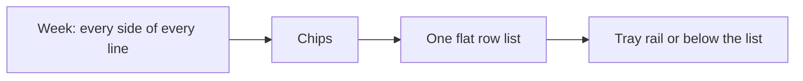
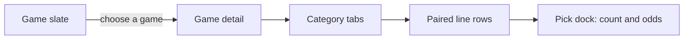

# Game-first pick board

## Context

The pick board is one flat list. Every side of every line is its own full-width row: Over and Under are separate rows,
and so are the home and away sides of a spread. A Sunday slate with a dozen games and a few opened prop boards puts
hundreds of rows in one scroll. The only game context is a small matchup link under each row, and the only pairing is a
two-column grid after someone already filters to one game.

Researching props means scrolling past every other game first. Raw ISO timestamps render in each row until the browser
formats them. The viewer's picks sit in a side rail on wide screens and below the whole list on a phone, so they scroll
away exactly when someone is deep in a prop list. The rail never shows the combined odds while picking.

The board already reads the week's games, odds, rosters, and the viewer's legs in one place, and the slip already
persists picks on the server. The problem is the shape of the screen, not missing data.

## Goals and non-goals

**Goals:**

- Group the week by game first. A person picks a game, then a market, then a side.
- Pair the two sides of one line into one row: Over/Under, home/away spread, and home/away moneyline.
- Cluster one player's markets under that player inside a game.
- Show the selected game, category, kickoff window, and search in the URL, so back, refresh, and a shared link restore
  the same view.
- Replace raw ISO timestamps with a short kickoff label in the reader's zone.
- Keep the viewer's pick count and combined odds visible while browsing, with one tap to review the slip.
- Build phone first: a slate, then a drilldown with a back link, then the dock. Widen to two independent panes at
  `lg`. Touch targets stay at least 48px tall.
- Keep prop loading lazy. Opening a game, changing a tab, or filtering never spends a credit; only "Load them" does,
  through the existing cache and credit floors.

**Non-goals:**

- A client-side index, SPA, JSON API, or build step. Grouping stays server-rendered with HTMX.
- A new route family or a change to slip membership, locking, or odds math.
- A global parlay dock on every page. The dock lives on the pick board; picks already persist across pages on the
  server.
- A new blocking rule or analyzer rule. Pairing stops both sides of one line in the normal path; a single pick is never
  refused, and the analyzer keeps its friendly voice.
- Eager or scheduled prop sync, new data sources, or raising the Odds API budget.
- Sportsbook integrations or money handling.

Success looks like this: at 390px, a person goes slate → game → category → pick without losing the dock, and the back
link keeps the window and search. At 1024px, the game list and the game detail scroll independently. A refresh restores
the game and tab. A game whose props were never fetched still offers "Load them," and browsing the rest of the slate
spends no credits.

## Decision

Rebuild the pick board as a game-first master-detail screen. The slate lists games with their kickoff, matchup, spread,
total, and prop count. Choosing a game opens its detail: a pinned header, category tabs, then rows grouped by player,
with both sides of each line in one row. Desktop shows the slate beside the detail; a phone shows the slate, then pushes
the detail with a back link. The same URL drives both widths, so there is no separate mobile router. A sticky dock shows
the pick count and combined odds and opens the existing tray as a sheet.

This beats a client-side React index because the app is already server-rendered templates and HTMX; a second state
layer would duplicate grouping and sync. It beats adding more filters to the flat list because filters cannot supply
game context or player clusters. It beats a third desktop column because a games list, a prop workspace, and a tray do
not fit at 1024px.

The effort is hard: it replaces the board's view model and templates, adds line pairing and URL state across two
breakpoints, and rewrites the board tests that assume a flat list.
