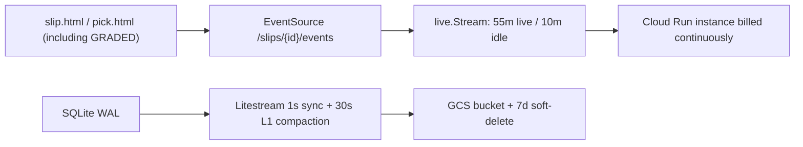
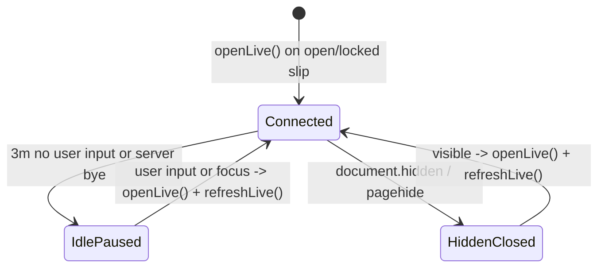

# Design: Reduce Cloud Run and storage costs

## Context

Two cost drivers sit in the current runtime and deploy setup:

1. **Long-lived SSE streams (`internal/live/stream.go`, `web/templates/`, `web/static/app.js`):**
   - Both `web/templates/slip.html` (`{{if .Slip}}`) and `web/templates/pick.html` unconditionally set
     `data-live-url="/slips/{id}/events"`, even when a slip is `GRADED`.
   - `internal/live/stream.go` keeps streams open for `idleDeadline = 10 * time.Minute` or
     `liveDeadline = 55 * time.Minute` (`pingEvery = 25 * time.Second`). Because `refresh.Service.LiveWindow` is true
     from 30 minutes before the earliest kickoff until the last game ends, Sunday streams run the full 55 minutes.
   - `web/static/app.js` only closes `liveSource` on `document.hidden` (`visibilitychange`) or server `bye`. A desktop
     or unlocked phone tab left visible keeps Cloud Run request-based billing active even with zero user interaction.
2. **Litestream GCS write and soft-delete churn (`deploy/litestream.yml`, `deploy/setup.sh`):**
   - `deploy/litestream.yml` leaves Litestream v0.5.18 at its defaults (`sync-interval=1s`, L1 compaction `30s`, L2
     `5m`, L3 `1h`), writing `~20 MiB` compacted LTX files frequently during syncs (`633.70 MiB` across `166` objects
     for a `24 MiB` DB in prod).
   - `deploy/setup.sh` creates the GCS bucket with GCS's default 7-day soft-delete policy
     (`retentionDurationSeconds: 604800`), retaining every compacted and deleted LTX object for a week.

## Approach

### 1. Scope and shorten SSE lifetimes without hurting active UX

- **Skip SSE on settled slips (`internal/web/slips.go`, `internal/web/pick.go`, `web/templates/`):** Add
  `LiveURL string` to `SlipPage` and `PickPage`, populated only when `slip.Status != db.SlipGraded`. Templates render
  `data-live-url="{{.LiveURL}}"` only when non-empty. In `slipHandlers.events`, if the loaded slip is `SlipGraded`,
  write `event: bye\ndata: {}\n\n` and return at once so an open client does not reconnect in a loop.
- **Tighter server stream caps (`internal/live/stream.go`):** Reduce `idleDeadline` from `10m` to `3m` and
  `liveDeadline` from `55m` to `15m`. Active browsers reopen on focus/interaction and catch up with `refreshLive()`, so
  live collaboration stays immediate.
- **Client idle pause (`web/static/app.js`):** Track a `3m` inactivity timer reset by `pointerdown`, `keydown`,
  `scroll`, `touchstart`, and `htmx:beforeRequest`. When idle fires on a visible tab, call `closeLive()` and mark
  `idlePaused = true`. On the next user interaction (`{ passive: true }`), `focus`, or `visibilitychange`, clear
  `idlePaused`, call `openLive()`, and run `refreshLive()` to pull any missed updates. Also close `liveSource` on
  `pagehide`.

### 2. Batch Litestream syncs and clear GCS soft-delete

- **Tune `deploy/litestream.yml` (Litestream v0.5.18 format):**
  - Set global `sync-interval: 10s` (reducing GCS Class A L0 writes up to 10× during bursts while graceful `SIGTERM`
    exit via `litestream replicate -exec /app/server` still flushes final frames before Cloud Run terminates).
  - Configure `levels:` (`5m`, `1h`, `24h`) and `snapshot:` (`interval: 24h`, `retention: 24h`) to stop `30s` L1 full-DB
    compaction rewrites while keeping 24-hour point-in-time recovery.
- **Disable 7-day soft-delete on the replica bucket (`deploy/setup.sh`):**
  - After bucket creation/check in `deploy/setup.sh`, run
    `gcloud storage buckets update "gs://$BUCKET" --clear-soft-delete` so compacted/expired LTX segments are actually
    freed instead of billed for 7 extra days. Re-running `deploy/setup.sh` applies this to the existing prod bucket
    safely.

**Trade-offs:**

- Replacing SSE with fixed-interval polling was rejected because active friends picking together lose instant updates
  and short polling still wakes Cloud Run repeatedly.
- Longer `sync-interval` (e.g. `5m`) was rejected because a hard crash could lose recent picks; `10s` cuts write churn
  sharply while keeping the window tiny and graceful shutdown exact.

## Verification

- Unit tests in `internal/live/stream_test.go` verifying the `3m` idle and `15m` live deadlines emit `event: bye` and
  close.
- Handler and template tests in `internal/web/slips_test.go` and `internal/web/pick_test.go` verifying `OPEN` and
  `LOCKED` slips emit `data-live-url`, `GRADED` slips omit `data-live-url`, and `GET /slips/{id}/events` on a `GRADED`
  slip returns `event: bye` immediately.
- Browser/JS check (and/or Playwright/smoke check if present, plus manual check in `dev`) confirming `app.js` closes
  `EventSource` on idle timeout and reopens + triggers `slip-updated`/`board-updated` on interaction.
- Litestream smoke test using `litestream/litestream:0.5.18` (and existing local replica smoke test if present)
  verifying `deploy/litestream.yml` parses cleanly, replicates, and restores after graceful stop; shellcheck on
  `deploy/setup.sh`.
- Standard check: `go test -race ./...` and `golangci-lint run`.

## Risks

- **Hard `SIGKILL` crash loss window:** Raising `sync-interval` from `1s` to `10s` means up to `10s` of writes could be
  lost on an ungraceful OOM/crash (normal deploys and scale-to-zero send `SIGTERM`, where Litestream flushes before
  exit). Mitigate by keeping `pick-board-performance` memory/CPU well under `512Mi`.
- **Idle pause reconnect race:** Rapidly clicking after an idle pause could open two `EventSource`s if `openLive()`
  isn't guarded; `openLive()` already checks `if (!liveURL || document.hidden || liveSource) return;`.
- **Litestream v0.5 config syntax:** Validate `deploy/litestream.yml` directly against the pinned `litestream:0.5.18`
  binary in CI/local Docker before deploying.

## TODO

Effort: medium (coordinates client idle/visibility lifecycle, server SSE deadlines and graded-slip guards, Litestream
v0.5 config tuning, and GCS bucket soft-delete cleanup)

### Phase 1: Tighten SSE stream scope and lifetimes

- [x] Reduce `idleDeadline` (`3m`) and `liveDeadline` (`15m`) in `internal/live/stream.go`, omit `data-live-url` on
      `SlipGraded` pages in `internal/web/slips.go`, `internal/web/pick.go`, `web/templates/slip.html`, and
      `web/templates/pick.html`, and make `/slips/{id}/events` return `event: bye` for graded slips, with tests in
      `internal/live/stream_test.go`, `internal/web/slips_test.go`, and `internal/web/pick_test.go`.
- [x] Add a `3m` user-inactivity pause + interaction/focus/pagehide lifecycle for `EventSource` in `web/static/app.js`
      that refreshes partials on resume.

### Phase 2: Tune Litestream replication and GCS bucket retention

- [x] Update `deploy/litestream.yml` with `sync-interval: 10s`, reduced compaction `levels` (`5m`, `1h`, `24h`), and
      `snapshot` retention (`24h`), and verify config parsing and restore against `litestream:0.5.18`.
- [ ] Update `deploy/setup.sh` to run `gcloud storage buckets update "gs://$BUCKET" --clear-soft-delete` idempotently.
- [ ] Docs: update `docs/concepts/live-updates.md`, `docs/concepts/persistence.md`, and `docs/guides/gcp-setup.md` with
      the new SSE deadlines, Litestream settings, and bucket soft-delete policy.
