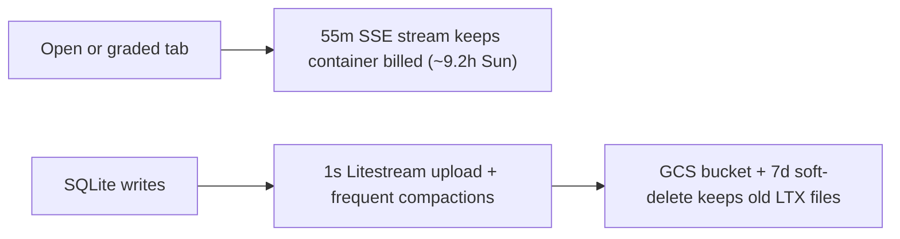
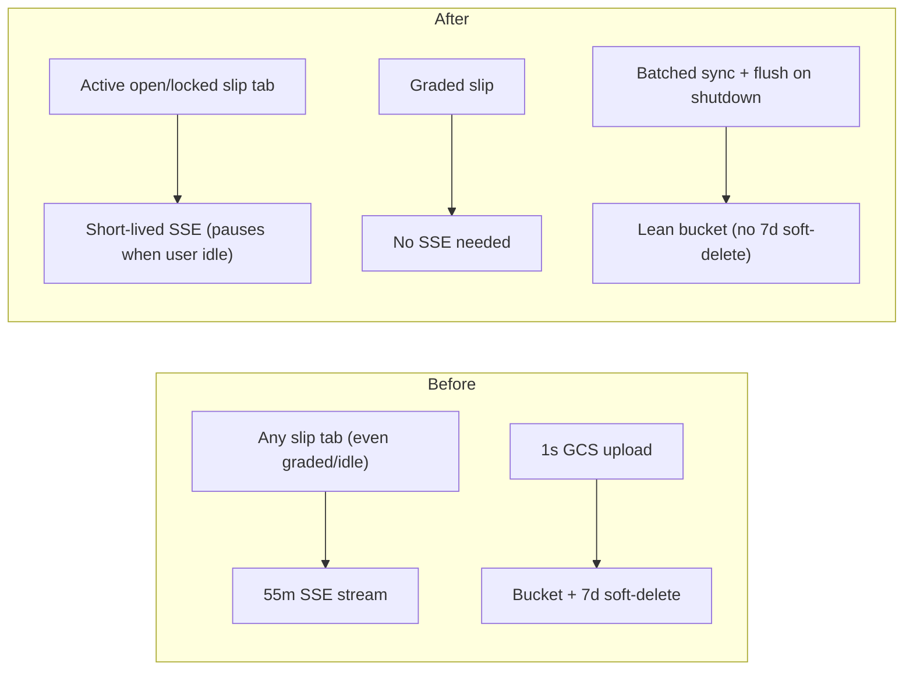

# Reduce Cloud Run and storage costs

## Context

Sunday's launch spent ~$0.85 in Google Cloud credits for a handful of users. Production logs and GCP resource settings
show two drivers behind ongoing Cloud Run and Cloud Storage usage:

1. **Long-lived SSE streams pin the Cloud Run container awake:** Every open slip or pick page keeps a live update stream
   open for up to `55` minutes during game windows (`10` minutes idle otherwise), and even settled/graded slips open a
   stream. On Sunday, open streams kept the Cloud Run container billed for ~9.2 hours across active windows even when no
   one was clicking.
2. **Frequent Litestream uploads and 7-day GCS soft-delete retention:** Litestream syncs SQLite WAL changes to Cloud
   Storage every second and creates compacted snapshots that currently total `633.7 MiB` across `166` objects for a
   `24 MiB` database, while the bucket's default 7-day soft-delete policy retains every compacted and deleted segment
   for a week.

## Goals and non-goals

**Goals:**

- Cut Cloud Run active billing hours and Cloud Storage write/storage volume without slowing down page loads or breaking
  live updates for active users.
- Scale the Cloud Run instance to zero quickly once tabs are idle, graded, or left open unattended.
- Trim redundant Litestream GCS writes and soft-deleted LTX retention while preserving safe database recovery on
  shutdown or crash.

**Non-goals:**

- Replacing SQLite or Litestream, or moving off Cloud Run.
- Disabling live updates while a user is actively picking or watching a live slip.
- Changing sportsbook/odds API credit guardrails.

## Decision

Tighten live SSE stream lifetimes and client idle behavior alongside Litestream replication and GCS bucket retention
settings:

- Skip opening live streams on already-graded slips, shorten server idle/live stream caps (with seamless reconnect on
  activity or focus), and pause the browser's stream after a few minutes of no user interaction (reconnecting and
  refreshing immediately when the user returns).
- Raise Litestream's sync interval from 1 second to a short multi-second batch (still flushing on graceful shutdown),
  tune LTX retention, and disable GCS 7-day soft-delete on the Litestream replica bucket since Litestream manages its
  own point-in-time segments.

Removing SSE altogether and polling on a fixed timer was rejected because active friends building a parlay together
would lose instant updates; pausing idle/graded streams preserves instant push when people are active while letting
Cloud Run sleep between bursts. Moving to instance-based billing (`min-instances`) would increase baseline monthly cost
instead of lowering it.

The `effort` rating is `medium` because it coordinates client activity/visibility lifecycle, server SSE stream rules,
Litestream replication settings, and GCS bucket policy while ensuring zero lost writes on shutdown and seamless client
catch-up.
