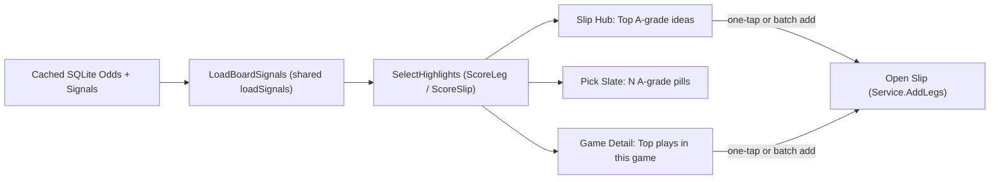

# Close-out

## Overview

## Consequences

- **Easier:** Friends blanking on picks see deterministic A-grade singles and conflict-free 2–3 leg combos on the hub and game detail, with one-tap single or atomic batch add.
- **Easier:** Board and slip signal loading share `loadSignals`, so highlight grades match slip grades with zero extra API calls or credit spend.
- **Harder:** Hub and pick-board renders now run batched board signal queries and combo scoring in memory (~3.25 ms on a 16-game slate) whenever the viewer has open pick slots.
- **Revisit:** The fixed combo pool cap (top 12 A-grade legs plus up to 6 B-grade stack partners) if new markets or prop types widen the candidate pool enough to miss valid stacks or slow renders.

## Alternatives considered

- **Separate recommendation heuristic:** Rejected because a separate heuristic would drift from `ScoreLeg` and `ScoreSlip`, causing a highlighted play to drop in grade once added to a slip.
- **Precomputing highlights in a background job or SQLite table:** Rejected to avoid cache invalidation bugs as odds, weather, injuries, and user picks change; bounded in-memory scoring is fast enough per render.
- **Relaxing the bar to B+ when no A-grades exist:** Rejected because surfacing B+ picks dilutes trust in the A badge; hiding the strip when empty is clearer.

## Implementation notes

- `board.Row` stores American odds in `Odds` rather than `Price`, so highlight ranking and `CombinedOdds` use `Row.Odds`.
- `HighlightOptions` treats `0` as "use default" (`3` legs, `2` parlays, `1` per player), so callers must pass negative values to disable a cap or return zero items.
- Slip routes are registered in `slipHandlers.Routes` (`internal/web/slips.go`) rather than `internal/web/routes.go`, and transactional batch validation (`Service.AddLegs`) lives in `internal/slips/rules.go` to keep handlers thin.
- `POST /slips/{id}/legs` gained a `from=pick` branch because `from=board` returns a single `pick-line-group` partial, whereas `#pick-detail` highlight buttons need `#pick-body` refreshed.
- `"Top plays in this game"` sits below the sticky header in `#pick-detail` rather than inside it so mobile viewports can scroll past it.
- Highlights only score already-cached SQLite rows in the slip's slate scope; before odds or props are cached, or when nothing reaches an A grade, the strip stays hidden.

## Follow-ups

None.
