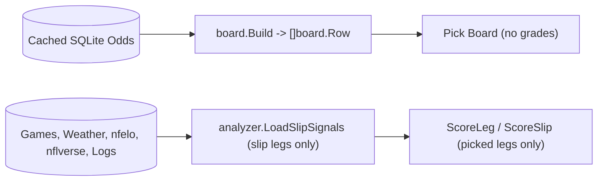
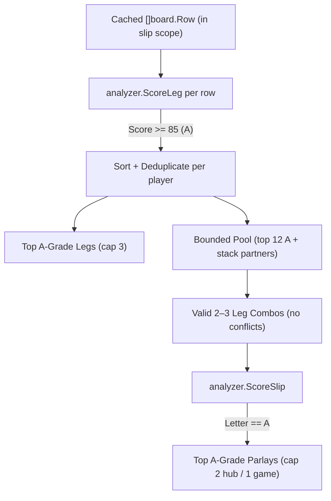

# Design: A-grade leg and parlay highlights

## Context

`internal/board` turns cached SQLite `odds` into `[]board.Row` (`board.Build`) and game cards/details
(`board.BuildSlate`). Each `Row` carries
`GameID, Market, Team, PlayerID, PlayerName, Position, Side, Line, Price, Display, Category, Picked`. Today,
`board.ApplySignals` only attaches heuristic suggestion badges (`Smash matchup`, `Fits slip`, `Role bump`,
`High volume`) and never calls `analyzer.ScoreLeg` or `analyzer.ScoreSlip`.

`internal/analyzer` runs `ScoreLeg` and `ScoreSlip` only on legs already added to a slip (rendered in
`internal/web/slips.go` for the hub and `internal/web/pick.go` for the pick tray). `LoadSlipSignals` loads
`player_gamelogs` and `nflverse_player_weeks` only for `distinctLegPlayerIDs(legs)`. After `sharp-book-grading`,
`LoadSlipSignals` also attaches `Game.Sharp` from cached `odds`.

**Key constraints:**

- Highlights must strictly use cached SQLite data—zero external API calls or credit spend.
- Every highlighted A-grade leg or combo must be scored by the exact same `ScoreLeg` / `ScoreSlip` engine used on the
  slip, so adding a highlighted play never surprises the user with a different grade.
- Phone-first layout: compact, scannable strips that fail soft (hide cleanly) when no A-grade plays exist.



## Approach

### 1. Board-wide signal loader (`internal/analyzer/signals.go`)

Add `LoadBoardSignals(ctx, store, now, weekID, games, playerIDs) (map[string]Game, map[string]PlayerStats)` sharing the
internal implementation of `LoadSlipSignals`. The only difference is taking `playerIDs []string` (collected from cached
`[]board.Row`) instead of deriving them from `[]db.Leg`. Because `store.PlayerGameLogs`,
`store.NFLversePlayerWeeksForPlayersTypes`, `store.RosterForTeams`, and `store.OddsForWeek` all execute batched SQLite
queries, loading signals for all matched players on the board stays in a handful of fast local reads.

### 2. Pure highlight selector (`internal/board/highlights.go`)

Add pure functions in `internal/board` that convert cached `[]board.Row` into `analyzer.Leg` values and select top
A-grade legs and A-grade correlated 2–3 leg parlay combos:

```go
type LegHighlight struct {
    Row    Row
    Grade  analyzer.LegGrade
    Reason string // concise sharp-friend summary from top positive factors
}

type ParlayHighlight struct {
    Legs         []LegHighlight
    Grade        analyzer.SlipGrade
    CombinedOdds int    // American odds via parlay.CombinedOdds
    Label        string // e.g. "Shootout stack", "Clock-drain stack", "2-leg A-grade combo"
    Reason       string
}

type HighlightOptions struct {
    MaxLegs         int // default 3 for hub and game preview
    MaxParlays      int // default 2 for hub, 1 for game preview
    MaxPerPlayer    int // default 1 to keep ideas diverse
    SameGameOnly    bool
    ExcludePicked   bool
}

type HighlightSet struct {
    Legs    []LegHighlight
    Parlays []ParlayHighlight
}

func SelectHighlights(
    rows []Row,
    games map[string]analyzer.Game,
    stats map[string]analyzer.PlayerStats,
    opts HighlightOptions,
) HighlightSet
```

Selection and bounding algorithm:

1. **Leg scoring:** Filter out `row.Picked != 0` (when `ExcludePicked` is true) and `OTHER`. Convert each row via
   `RowToAnalyzerLeg(row)` and run `analyzer.ScoreLeg`. Keep rows with `Grade.Letter == "A"` (`Score >= 85`).
2. **Deterministic ranking & diversity:** Sort A-grade legs by `Grade.Score` desc, `Row.Price` desc (better payout),
   then `(GameID, Market, PlayerName, Side)`. Select up to `MaxLegs` while enforcing at most `MaxPerPlayer` per player
   (and at most 1 side per `(GameID, Market, Subject)`).
3. **Bounded parlay combo generation:**
   - Take a bounded pool of at most `12` top A-grade legs (plus up to `6` B-grade same-game stack partners when building
     `stack_shootout` or `stack_clock_drain` 3-leg stacks, since the `+8` stack bonus can lift a high-B trio into an A
     slip).
   - Generate candidate 2-leg and 3-leg combos where legs are distinct selections, never opposite sides of the same
     market, and (for `SameGameOnly`) share `GameID`.
   - Score each candidate with `analyzer.ScoreSlip`; reject any combo with a `Warn` or `Danger` warning, and keep combos
     with `SlipGrade.Letter == "A"`.
   - Rank combos by `SlipGrade.Score` desc, preferring combos with a positive stack factor, then by `CombinedOdds` desc.
     Deduplicate so no two returned combos share more than 1 leg, and cap at `MaxParlays`.



### 3. One-tap add for legs and combos (`internal/web`)

- **Single-leg highlight:** Posts directly to the existing `POST /slips/{id}/legs` handler with the same form parameters
  as pick-board buttons.
- **Parlay combo highlight:** Add `POST /slips/{id}/legs/batch` in `internal/web/slips.go` (registered in `routes.go`).
  It accepts an indexed array of leg selections, validates the slip is `OPEN` and the viewer is unlocked, checks
  remaining capacity (`len(mine) + newLegs <= slip.LegsPerMember`), skips any selection already on the viewer's slip,
  inserts all new legs in one SQLite transaction, logs activity, publishes `slip-updated`, and returns the updated
  `#slip-panel` or `#pick-body`/`#pick-dock` partial.
- When the viewer has fewer open slots than a combo's leg count, the combo card still renders its legs with individual
  `+ Add` buttons and disables the bulk `"Add all N"` button with `"Needs N open slots"`.

### 4. Phone-first UI surfaces (`internal/web`)

- **Main screen (Hub, `GET /slips/{id}` and `#slip-panel`):**
  - Computed only when `slip.Status == db.SlipOpen` and the viewer is in the `pick` step (has remaining leg slots).
  - Renders a compact `"Top A-grade ideas"` card strip inside `#slip-panel` (below the step banner) showing up to 3
    A-grade legs and up to 2 A-grade parlay combos, each with its green `A` pill, concise reason, price, inline
    `<details>` factor breakdown, and one-tap `+ Add`.
  - Hidden completely when `HighlightSet` is empty (e.g. before odds load or when nothing hits A).
- **Per-game preview (Pick board, `GET /slips/{id}/pick`, `#pick-slate`, `#pick-detail`):**
  - On each game card in `#pick-slate`: show a compact `"N A-grade"` pill when that game has `N > 0` A-grade legs
    (omitted when 0).
  - At the top of `#pick-detail` (above the Lines/Passing/Rushing/Receiving/TDs/Kicking tabs): render a compact
    `"Top plays in this game"` strip with up to 3 A-grade legs and up to 1 same-game A-grade parlay combo, with one-tap
    `+ Add`.

### Trade-offs & rejected options

- **Rejected: Precomputing highlights in a background job or SQLite table:** Adds cache invalidation bugs whenever odds,
  weather, injuries, or a user's picks change. With a bounded combo pool (`<= 12` legs → at most `66` pairs and `220`
  triples), in-memory scoring takes under a few milliseconds per render.
- **Rejected: Relaxing the bar to B+ when no A-grades exist:** Dilutes the meaning of an A-grade highlight; hiding the
  strip cleanly when nothing reaches A keeps the badge trustworthy.

## Verification

- Run `go test ./...` and `good-vibes docs lint`.
- Unit tests and benchmark in `internal/board/highlights_test.go`:
  - Only `Letter == "A"` legs and combos are returned; already-picked rows are excluded; per-player deduplication holds;
    deterministic ordering on ties.
  - Combo generation rejects script conflicts (`trailing_rb`, `blowout_passing`, `total_contradiction`) and
    opposite-side selections, and surfaces positive stacks (`stack_shootout`, `stack_clock_drain`).
  - Benchmark confirms `SelectHighlights` over a full 16-game week (~1,500 cached rows) runs in low single-digit
    milliseconds.
- Web handler tests in `internal/web/slips_test.go` and `internal/web/pick_test.go`:
  - Hub renders `"Top A-grade ideas"` only when open and viewer needs picks; hides when locked, full, or empty; zero
    external refresh calls triggered.
  - `POST /slips/{id}/legs/batch` adds all combo legs atomically, rejects over-capacity requests cleanly, and publishes
    `slip-updated`.
  - Pick slate shows `"N A-grade"` pill on qualifying game cards; `#pick-detail` renders `"Top plays in this game"`
    above the tabs with working one-tap add.
- Check mobile viewport layout (375px width) via existing screenshot/layout tests to ensure strips do not overflow
  horizontally.

## Risks

- **Render latency on full Sunday slates:** Scoring ~1,500 rows + bounded combos on every hub render could add latency
  if `LoadBoardSignals` queries are not batched. Mitigated by single-query batched SQLite reads, bounding the combo pool
  to 12 legs, and verifying with a benchmark + `AddBoardTiming`.
- **Duplicate legs when adding a combo:** If one leg of a 2-leg combo is already on the slip,
  `POST /slips/{id}/legs/batch` skips duplicates before checking capacity and runs inside a single transaction.
- **Hub visual clutter on phones:** Capping at 3 legs + 2 combos and hiding the section once the viewer finishes picking
  keeps the hub focused on the next step.

## TODO

### Phase 1: Board signal loader and pure highlight selector

Complexity: medium (requires batched board-wide signal loading, bounded combinatorial search with conflict filtering,
and deterministic deduplication) Risk: low (pure package additions with unit tests and benchmarks; no UI or route
changes yet)

- [x] Add `LoadBoardSignals` to `internal/analyzer/signals.go` (sharing internal helpers with `LoadSlipSignals`) with
      tests in `internal/analyzer/signals_test.go`.
- [x] Implement `RowToAnalyzerLeg`, `LegHighlight`, `ParlayHighlight`, and `SelectHighlights` in
      `internal/board/highlights.go` with unit tests and a full-slate benchmark in `internal/board/highlights_test.go`.

### Phase 2: Main screen highlights and batch-add endpoint

Complexity: medium (wires board highlights into the hub render path and adds transactional multi-leg insertion with
capacity validation and SSE updates) Risk: low (additive UI strip that fails soft when empty and reuses slip
lock/capacity invariants)

- [x] Add `POST /slips/{id}/legs/batch` in `internal/web/slips.go` and `internal/web/routes.go` for atomic combo
      insertion with capacity/duplicate checks and `slip-updated` broadcast, plus handler tests in
      `internal/web/slips_test.go`.
- [x] Wire `LoadBoardSignals` and `board.SelectHighlights` into the hub render path (`internal/web/slips.go` +
      `web/templates/partials.html`) to render the phone-first `"Top A-grade ideas"` strip during the viewer's `pick`
      step, with handler tests in `internal/web/slips_test.go`.

### Phase 3: Per-game preview highlights and living docs

Complexity: low (follows the same `SelectHighlights` seam on the pick board slate and `#pick-detail` partial) Risk: low
(read-only additions over existing cached pick-board data with fail-soft rendering)

- [ ] Surface per-game A-grade counts on `#pick-slate` cards and the `"Top plays in this game"` strip at the top of
      `#pick-detail` (`internal/web/pick.go` + `web/templates/partials.html`) with handler tests in
      `internal/web/pick_test.go`.
- [ ] Docs: update `docs/concepts/slips.md`, `docs/concepts/analyzer.md`, and `docs/reference/routes.md` to document the
      A-grade highlights and `POST /slips/{id}/legs/batch`, then run `good-vibes docs lint`.
