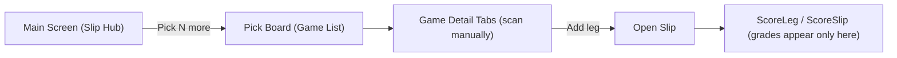
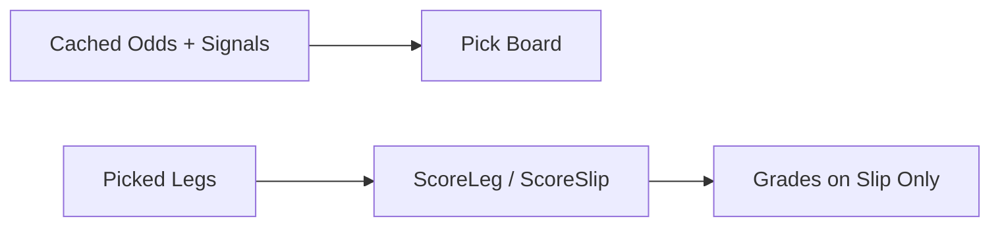
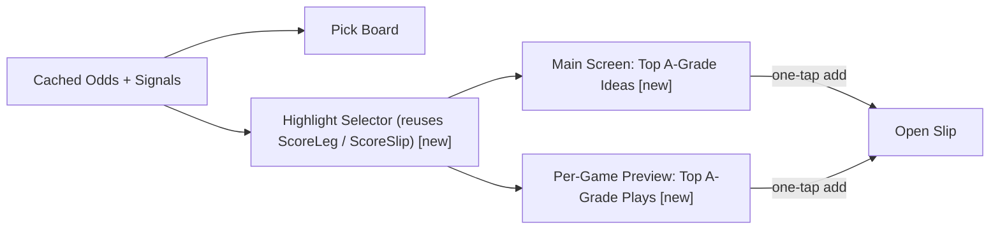

# A-grade leg and parlay highlights

## Context

Today, leg and slip grades only appear after someone adds a pick to a slip. On the pick board, game cards show basic
lines and prop counts, and players carry small suggestion tags (`Smash matchup`, `Role bump`), but there is no way to
see which legs or correlated parlays earn an A grade before picking.

Friends who open the app on Sunday morning blanking on what to bet have to tap through individual games and scan tabs to
find strong plays. The main screen (the slip hub) shows a "Pick N more" banner with no curated ideas to help them get
started.

## Goals and non-goals

**Goals:**

- Surface a small, curated list of A-grade legs and A-grade correlated 2–3 leg parlay ideas on the main screen (when the
  viewer still has picks to make) and inside each game's preview on the pick board.
- Score candidate legs and combos strictly from already-cached odds and signals using the same deterministic `ScoreLeg`
  and `ScoreSlip` engine, with zero extra external API calls.
- Let a user tap any highlighted leg (or combo) to add it directly to their open slip, alongside a short sharp-friend
  reason for the A grade and a link to the full breakdown.
- Keep the phone-first layout scannable by capping the number of highlights and failing soft (hiding the section) when
  no cached plays reach an A grade.

**Non-goals:**

- Auto-filling a user's slip or locking picks on their behalf.
- Triggering paid odds or prop fetches just to populate highlights; highlights only score cached rows within the slip's
  slate scope.
- Adding LLM-generated blurbs or betting advice; every highlight and reason stays deterministic plain Go.

## Decision

### Before

### After

Add a pure highlight selector that runs the existing `ScoreLeg` and `ScoreSlip` engine over already-cached board rows
and valid correlated combos, then renders a compact "Top ideas" strip on the main screen and inside each game preview
with one-tap add.

This beats building a separate recommendation heuristic because a separate heuristic would drift from the analyzer and
confuse friends when a "top pick" drops to a C once added to the slip. Waiting on `sharp-book-grading` ensures
highlighted A-grade legs already clear the sharp-line price check rather than spotlighting stale or overpriced retail
numbers.

`complexity: medium` fits because the selector must bound combo generation so page renders stay fast, deduplicate
overlapping legs and combos, respect slate scopes and already-picked legs, and fit cleanly into phone-first hub and
game-preview layouts. `risk: low` fits because highlights are read-only over cached data and reuse existing add-leg
endpoints, failing soft when data is absent with full coverage from deterministic selection tests.
