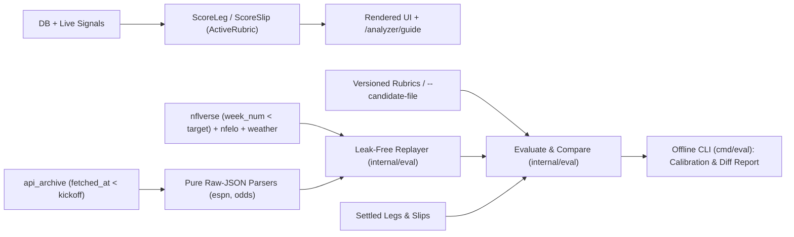

# Close-out

## Overview

## Consequences

- **Easier:** Testing and comparing rubric weight changes (`RubricV1` vs. built-in or JSON-file candidates) offline against historical weeks without touching live request paths or SQLite schemas.
- **Easier:** Identifying predictive vs. noisy analyzer rules via per-factor lift over implied odds and band migration matrices before shipping weight changes.
- **Harder:** Adding new analyzer rules or weights requires threading them through the `Rubric` struct rather than package-level constants so live scoring, `/analyzer/guide`, and offline evals stay aligned.
- **Revisit:** Revisit per-factor sample-size thresholds or confidence bounds once multiple seasons of archived weeks accumulate, since single-season friend-group slip counts can make factor lift noisy.

## Alternatives considered

- **Storing grade snapshots in SQLite at lock time:** Rejected because comparing a new rubric against past weeks still requires replay, pure-Go re-scoring takes milliseconds, and skipping stored grades keeps the Litestream-replicated database smaller and results idempotent.
- **Falling back to overwritten live tables (`player_gamelogs`, `roster_players.injury_status`, `odds`) on archive gaps:** Rejected because silent post-kickoff data leakage would artificially inflate historical calibration; the replayer fails soft and reports gaps in `DataCoverage` instead.
- **Automated grid search or ML weight tuning:** Rejected because small weekly sample sizes would overfit quickly and violate the deterministic, human-reviewed Go grading rule.

## Implementation notes

- **Archive coverage limits:** Pre-archive weeks or missing pre-kickoff payloads produce partial signal coverage; `DataCoverage` surfaces those counts on every run instead of falling back to live tables.
- **Priced-leg `Lift` alignment:** `Evaluate` aligns `Lift` denominators to decided legs with valid odds so unpriced legs do not skew `WinRate - AvgImpliedProb`.
- **Factor attribution labels:** `Evaluate` normalizes factor attribution keys to canonical `GradeRubric()` labels so aggregate reports group rules consistently across legs.

## Follow-ups

- Propose and tune a `RubricV2` candidate in `internal/analyzer/rubric.go` using `cmd/eval` once sufficient archived weeks and settled slips are available.
- Add minimum-sample warnings or confidence intervals to `internal/eval/metrics.go` factor attribution output to flag low-`N` rules during early-season runs.
