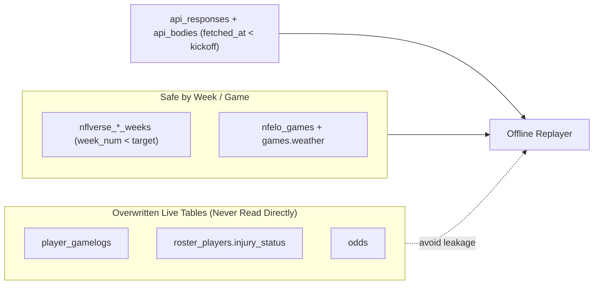
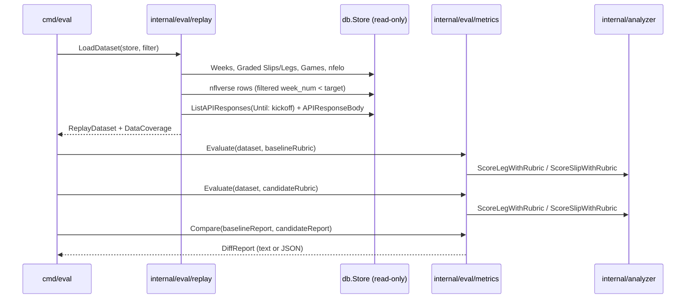

# Design: Grading evals and calibration

## Context

`internal/analyzer` computes deterministic leg and slip grades via `ScoreLeg` and `ScoreSlip` (`internal/analyzer/grade.go`), using hardcoded package constants for the baseline score, category clamps, factor deltas, and A–F cutoffs. Nothing in the app versions those weights or evaluates how well graded legs and parlays actually perform against settled outcomes.

The SQLite database already contains the historical building blocks needed for offline evaluation:
- Settled legs and slips (`slips`, `legs` with `result` in `WON`, `LOST`, `PUSH`, `VOID`) via `internal/db`.
- Weekly team and player efficiency/usage tables (`nflverse_team_weeks`, `nflverse_player_weeks`) keyed by `(season, season_type, week_num)`.
- Game-scoped weather (`games`) and pre-kickoff `nfelo_games` projections.
- Append-only raw HTTP responses in `api_responses` + `api_bodies` (`internal/db/archive_read.go`: `ListAPIResponses` and `APIResponseBody`), which capture ESPN game logs, rosters, injury summaries, weather, nfelo, nflverse, and odds payloads with `fetched_at` timestamps.

**Key constraint (leakage prevention):** Three tables are overwritten in place as the season progresses: `player_gamelogs` (one latest blob per athlete), `roster_players.injury_status` (current week's injury status), and `odds` (latest sync per group). Replaying a past week directly from those live tables would leak post-kickoff data into pre-kickoff grades. The replayer must therefore read weekly tables filtered by `week_num < targetWeek` and reconstruct overwritten inputs strictly from `api_archive` rows with `fetched_at < game.Kickoff` (failing soft when an archive entry is missing).



## Approach

### 1. Versioned rubrics (`internal/analyzer/rubric.go`)

Extract the hardcoded scoring constants in `internal/analyzer/grade.go` into a plain `Rubric` struct with JSON tags so rubrics can be versioned in Go and optionally loaded from a candidate JSON file during offline tuning:

```go
type Rubric struct {
    Name string `json:"name"`

    LegBaseline   int `json:"leg_baseline"`
    FormUsageMin  int `json:"form_usage_min"`
    FormUsageMax  int `json:"form_usage_max"`
    MatchupEnvMin int `json:"matchup_env_min"`
    MatchupEnvMax int `json:"matchup_env_max"`
    LinePriceMin  int `json:"line_price_min"`
    LinePriceMax  int `json:"line_price_max"`

    // Leg factor deltas (hit_rate, rising_usage, median_trap, teammate_out_bump,
    // shrinking_role, favorable_matchup, tough_matchup, wind_warn, wind_danger,
    // qb_drag, fake_weather, nfelo_cushion, hook, hook_softened, total_key_number,
    // chalk_min, chalk_max, plus sharp-book deltas when present)
    // ...

    // Slip adjustments (stack_bonus, warn_conflict, danger_conflict,
    // parlay_drag_per_leg, parlay_drag_free_legs, chalk_drag_per_extra_leg)
    // ...

    BandA int `json:"band_a"` // 85
    BandB int `json:"band_b"` // 73
    BandC int `json:"band_c"` // 60
    BandD int `json:"band_d"` // 48
}
```

- `RubricV1` holds the exact current production weights.
- `ActiveRubric` points to the live rubric (`RubricV1` initially).
- Add `ScoreLegWithRubric(leg, games, stats, rubric)` and `ScoreSlipWithRubric(legs, games, stats, rubric)`.
- `ScoreLeg` and `ScoreSlip` delegate to `ActiveRubric`; `GradeRubric()` reads from `ActiveRubric` so `/analyzer/guide` never drifts.
- `RubricByName(name string) (Rubric, bool)` and `RubricNames() []string` expose the built-in registry.

### 2. Pure raw-body parsers for archive replay (`internal/ingest/espn`, `internal/ingest/odds`)

`espn.ParseInjuries` already parses raw JSON without HTTP. Expose matching pure parsers for the remaining overwritten sources so `internal/eval` can replay decompressed `api_bodies` bytes directly:
- `espn.ParseGameLogJSON(raw []byte) (map[string][]float64, error)` (reusing the existing game-log decoder in `internal/ingest/espn`).
- `espn.ParseRosterJSON(raw []byte) ([]RosterPlayer, error)`.
- `odds.ParseLinesJSON(raw []byte) ([]Line, error)` and `odds.ParsePropsJSON(raw []byte) ([]Prop, error)`.

### 3. Leak-free historical replayer (`internal/eval/replay.go`)

Add a new package `internal/eval` that reads a SQLite database via `*db.Store` (never writing, never calling external APIs):

```go
type ReplayFilter struct {
    Season   int // 0 = all seasons
    FromWeek int // 0 = unbounded
    ToWeek   int // 0 = unbounded
    GroupID  int64
}

type ReplayDataset struct {
    Weeks    []ReplayedWeek
    Coverage DataCoverage // counts of legs with archived gamelogs, injuries, nflverse, nfelo, odds
}
```

For each historical week in scope:
1. Load settled slips and legs (`db.SlipGraded`, legs with `WON`/`LOST`/`PUSH`/`VOID`) and the week's `db.Game` rows.
2. **nflverse (leak-free):** Query `nflverse_team_weeks` and `nflverse_player_weeks` for the season, then filter strictly to `row.WeekNum < week.WeekNum` (for regular season; for postseason, include all regular-season rows plus prior postseason weeks) before calling `analyzer.BuildTeamDefenseProfiles` and `analyzer.BuildPlayerUsage`.
3. **nfelo & weather:** Read `nfelo_games` and `games` weather columns for the week's games.
4. **Archived game logs, injuries, and odds (`fetched_at < game.Kickoff`):**
   - Query `store.ListAPIResponses` with `Until: game.Kickoff` and the relevant key prefix (`espn:gamelog:{athlete}`, `espn:summary:{game}`, `espn:roster:{team}`, `odds:lines`, `odds:props:{game}`).
   - Pick the latest response before `game.Kickoff`, decompress via `store.APIResponseBody`, and parse via the pure ingest parsers.
   - If an archive entry is missing (e.g. a pre-archive week), leave that signal nil and record the gap in `DataCoverage`—never fall back to live overwritten tables.



### 4. Calibration metrics & rubric diff (`internal/eval/metrics.go`)

`Evaluate(dataset ReplayDataset, rubric analyzer.Rubric) Report` computes:
- **Leg calibration by band (`A`, `B`, `C`, `D`, `F`, `ungraded`):**
  - `Total`, `Wins`, `Losses`, `Pushes` (pushes/voids excluded from win-rate denominator).
  - `WinRate` (`Wins / (Wins + Losses)`).
  - `AvgImpliedProb` (mean of `parlay.ImpliedProb(leg.Odds)` across decided legs).
  - `Lift` (`WinRate - AvgImpliedProb`).
  - `FlatROI` (sum of `parlay.Units(result, decimal)` / decided count).
  - `BrierScore` (mean squared error of implied/band probability vs. outcome, or grade-ordered calibration check).
- **Per-factor attribution (`FactorStats`):** for each `GradeFactor.Rule`, count of decided legs where it fired, `WinRate`, `AvgImpliedProb`, `Lift`, and average `Delta`.
- **Slip calibration by band (`A`..`F`):** count, wins, losses, pushes, actual parlay hit rate, average combined implied probability (`1 / CombinedOdds`), and unit ROI.
- **Monotonicity summary:** flags whether win rate and lift decrease monotonically across populated bands `A -> F`.

`Compare(baseline, candidate Report) DiffReport` computes:
- Per-band win-rate, lift, and flat-ROI deltas.
- **Migration matrix:** counts and actual win rates of legs that moved between bands (e.g., promoted into `A` vs. demoted out of `A`), making it immediately obvious whether a rubric change promoted winners or losers.
- Per-slip-band calibration deltas.

### 5. Offline CLI (`cmd/eval/main.go`)

Add a lightweight standalone CLI:
- Flags: `--db <path>` (required, opened read-only), `--rubric <name>` (default `v1`), `--baseline <name>`, `--candidate <name>`, `--candidate-file <json>` (overrides candidate with a local JSON `Rubric`), `--season <int>`, `--from-week <int>`, `--to-week <int>`, `--format text|json`.
- Prints `DataCoverage` header, leg calibration table, factor attribution table, slip calibration table, and (when comparing two rubrics) the side-by-side diff and migration summary.

### Trade-offs & rejected options

- **Rejected: Storing grade snapshots in SQLite at lock time:** Comparing a new rubric against past weeks requires replay anyway, pure-Go re-scoring over a season takes milliseconds, and skipping stored grades avoids schema growth and Litestream replication overhead.
- **Rejected: Falling back to live `player_gamelogs` / `roster_players.injury_status` when `api_archive` is empty:** Silent future-data leakage would make historical evals look artificially good and mislead weight tuning. Failing soft and reporting `DataCoverage` keeps metrics honest.
- **Rejected: Automated grid search / ML optimizer in v1:** With a small sample of weekly friend-group slips, automated optimization would overfit immediately. Human-reviewed `v1` vs. `v2` comparison with factor lift and migration win rates is safer and aligns with the deterministic plain-Go product rule.

## Verification

- Run `go test ./...` and `good-vibes docs lint`.
- Unit tests in `internal/analyzer/rubric_test.go`:
  - `ScoreLegWithRubric(..., RubricV1)` and `ScoreSlipWithRubric(..., RubricV1)` match `ScoreLeg` / `ScoreSlip` bit-for-bit across existing test cases.
  - Modifying a `Rubric` field (e.g., factor delta or `BandA` cutoff) deterministically changes the output without mutating `ActiveRubric`.
- Unit tests in `internal/eval/replay_test.go` and `internal/eval/metrics_test.go`:
  - **Leakage guard test:** seed a SQLite DB with Week 4 legs plus Week 5–8 `nflverse` rows, post-kickoff `api_archive` entries, and mutated `player_gamelogs`; assert replay for Week 4 ignores all Week >= 4 nflverse rows, ignores post-kickoff archive entries, and does not read live `player_gamelogs`.
  - **Metrics & diff test:** verify `WinRate`, `AvgImpliedProb`, `Lift`, `FlatROI`, per-factor attribution, push/void exclusion, and migration matrix counts/win rates on synthetic decided legs and slips.
- CLI smoke test in `cmd/eval/main_test.go`: run against a seeded temporary SQLite DB for single-rubric (`--format text` and `--format json`) and `--baseline v1 --candidate-file <tmp.json>` diff modes, verifying exit code 0 and expected output sections.

## Risks

- **Small sample size early in a season:** With only a few dozen friend-group legs per month, per-factor lift can be noisy. Mitigated by always printing sample counts (`N`) alongside win rate and lift, and supporting replay over every archived week/season.
- **Archive gaps on older weeks:** Weeks recorded before an ingest source was archived will have partial signal coverage. Mitigated by explicit `DataCoverage` reporting in every eval output so partial weeks are never mistaken for full-signal weeks.
- **Drift between `Rubric` struct and `score*` functions:** If a new factor is added later without wiring it through `Rubric`, evals won't be able to tune it. Mitigated by removing hardcoded delta constants in `grade.go` so `score*` reads all weights exclusively from `Rubric`.

## TODO

### Phase 1: Versioned rubrics in `internal/analyzer`

Complexity: medium (refactors `ScoreLeg`, `ScoreSlip`, and `GradeRubric` to read all weights and cutoffs from a `Rubric` struct without altering any live v1 behavior)
Risk: low (existing analyzer test suite proves bit-for-bit equivalence for `RubricV1`)

- [x] Introduce `Rubric`, `RubricV1`, `ActiveRubric`, `RubricByName`, `ScoreLegWithRubric`, and `ScoreSlipWithRubric` in `internal/analyzer/rubric.go`, refactor `grade.go` and `docs.go` to read from `Rubric`, and add equivalence and override tests in `internal/analyzer/rubric_test.go`.

### Phase 2: Pure archive parsers and leak-free historical replayer

Complexity: medium (coordinates pre-kickoff archive lookup across ESPN game logs, summaries, rosters, and odds alongside week-filtered nflverse rows with strict anti-leakage guarantees)
Risk: low (read-only offline replay package with no production request-path changes; verified by explicit leakage tests)

- [ ] Expose pure raw-JSON parsers (`ParseGameLogJSON`, `ParseRosterJSON` in `internal/ingest/espn`, and `ParseLinesJSON`, `ParsePropsJSON` in `internal/ingest/odds`) reusing existing decoders, with unit tests against fixture payloads.
- [ ] Implement `ReplayFilter`, `ReplayDataset`, `DataCoverage`, and `LoadDataset` in `internal/eval/replay.go`, plus leakage-guard and partial-archive fail-soft tests in `internal/eval/replay_test.go`.

### Phase 3: Calibration metrics, rubric diff, offline CLI, and docs

Complexity: medium (computes leg, factor, and parlay calibration metrics plus side-by-side migration matrices and wires a clean offline CLI)
Risk: low (standalone offline CLI and pure metrics functions with full unit and smoke test coverage)

- [ ] Implement `Evaluate` and `Compare` (leg/slip calibration by band, lift over implied odds, flat ROI, per-factor attribution, and migration matrix) in `internal/eval/metrics.go` with table-driven tests in `internal/eval/metrics_test.go`.
- [ ] Add the offline CLI in `cmd/eval/main.go` supporting single-rubric, `--baseline`/`--candidate`, `--candidate-file`, week/season filters, and `text`/`json` output, with smoke tests in `cmd/eval/main_test.go`.
- [ ] Docs: update `docs/concepts/analyzer.md` and `docs/guides/local-dev.md` to document versioned rubrics and how to run offline grading evals against a local or Litestream-restored SQLite database, then run `good-vibes docs lint`.
