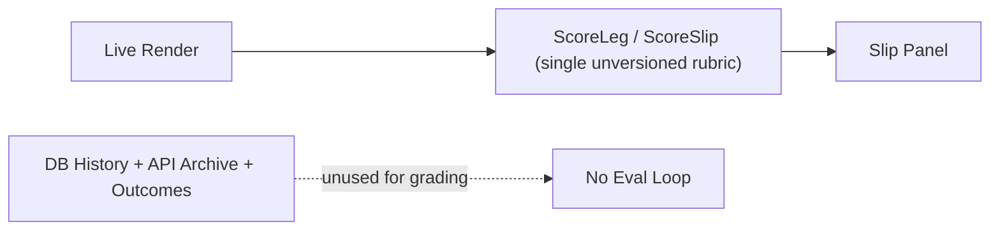
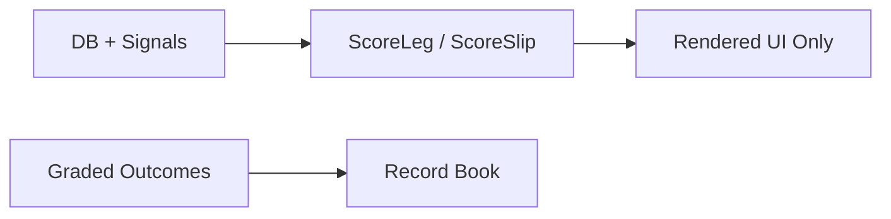
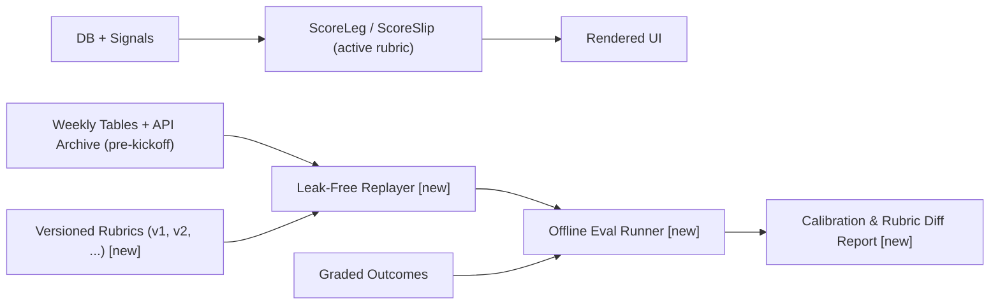

# Grading evals and calibration

## Context

Today, `ScoreLeg` and `ScoreSlip` run on the fly when rendering a slip or tray, and every weight and threshold in the rubric was chosen by hand.

We have no way to check whether our grades actually work: whether A-grade legs win more often than C- or F-grade legs, which factors add real predictive signal versus noise, or whether a rubric change improves calibration before we ship it.

At the same time, the app already stores graded legs, slips, game outcomes, weekly nflverse rows, nfelo projections, and an append-only archive of raw API responses. We just lack a versioned replay and eval flow that turns that history into a repeatable benchmark.

## Goals and non-goals

**Goals:**

- Version the grading rubric in code (e.g., `v1`, `v2`) so multiple candidate rubrics can be run deterministically over the same historical data without storing derived grades in SQLite.
- Reconstruct leak-free pre-kickoff inputs for past weeks from stored weekly tables (`week_num < targetWeek`) and pre-kickoff payloads in the raw API archive (`fetched_at < kickoff`) for overwritten sources (odds, game logs, injuries).
- Build a deterministic offline eval runner that replays historical legs and parlays through one or more rubric versions, joins them with actual outcomes, and reports calibration metrics: hit rate by letter grade (A–F), lift over implied odds, per-factor hit rate and lift, and parlay hit rate by slip grade.
- Support side-by-side comparison between a baseline rubric and a candidate rubric so we can tune weights and rules against real historical data.

**Non-goals:**

- Persisting rendered grades or grade snapshots in SQLite; grades stay derived and idempotent from versioned rubrics.
- Automated machine-learning training or self-tuning weights in production; grading stays plain, human-reviewed Go rules.
- Adding an eval dashboard to the end-user web UI; evals run offline against a local or Litestream-restored SQLite database.
- Calling external APIs or spending odds credits during eval runs.

## Decision

### Before

### After

Version the grading rubric in Go and build an offline, leak-free historical replayer and eval runner that scores past weeks across rubric versions and compares calibration against actual leg and parlay outcomes.

This beats storing grade snapshots in SQLite because comparing a new rubric against past weeks requires replay anyway, pure-Go re-scoring over a full season takes milliseconds, and skipping grade storage keeps the Litestream-replicated database smaller and results idempotent. Reconstructing overwritten inputs (odds, game logs, injuries) from pre-kickoff `api_archive` payloads prevents future-week data from leaking into historical grades.

`complexity: medium` fits because the change coordinates leak-free historical input reconstruction across weekly tables and raw archived HTTP payloads, versioned rubric dispatch, and calibration reporting for both legs and multi-leg parlays. `risk: low` fits because the eval runner is strictly offline with no schema changes and no impact on live request paths, backed by deterministic replay tests.
