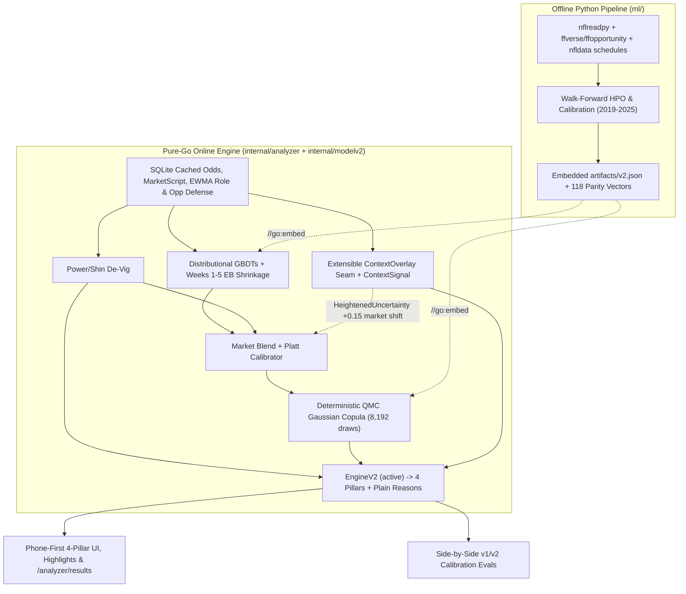

# Close-out

## Overview

## Consequences

- **Easier:** New breaking-context checks (inactives, sharp steam, structured news) plug into `ContextOverlay` and `ContextSignal` without retraining or re-exporting model artifacts.
- **Easier:** Grading changes can be compared side-by-side against `EngineV1` across `internal/eval`, `/analyzer/results`, and web handler tests via `GradingEngine` and `Dependencies.GradingEngine`.
- **Easier:** Good scripts with bad prices stay visibly distinct because `EngineV2` splits `Price & Vig`, `Script Fit`, `Stability & Tail Risk`, and `Context & Traps` instead of folding them into one additive score.
- **Harder:** Modifying EWMA decay, Empirical Bayes shrinkage, feature definitions, or QMC Sobol sequences requires re-running `mise run train-v2` and keeping Go and Python aligned within `1e-6` across all 118 parity vectors.
- **Harder:** Tracing why a single leg landed on a given score takes more effort than reading v1's flat `+8/-5` rubric deltas, because probabilities pass through GBDT parameters, market blending, Platt calibration, and copula simulation.
- **Revisit:** Re-evaluate `lightgbm` or `xgboost` versus the custom second-order `DistributionalGBDT` over `scikit-learn` if training environments standardize `libomp` or tree complexity grows.
- **Revisit:** Run `mise run eval-prod` against live production Litestream snapshots as soon as Google ADC is available in an authenticated shell to confirm calibration on live group slips.

## Alternatives considered

- **Python sidecar or ONNX/CGO serving vs. embedded flat JSON trees:** Rejected a Python Cloud Run service (breaks the single-instance SQLite invariant and adds cold-start cost) and ONNX Runtime (breaks `CGO_ENABLED=0` static Alpine builds). Embedded flat JSON trees evaluate with zero heap allocations.
- **`lightgbm`/`xgboostlss` vs. custom Newton-Raphson GBDTs over `scikit-learn`:** Native `xgboost` and `lightgbm` wheels failed to load on macOS without Homebrew `libomp.dylib`. Implemented second-order `DistributionalGBDT` over `scikit-learn` `DecisionTreeRegressor` (preserving native `NaN` routing) and exported `+/-inf` missingness split thresholds as finite `+/-1e300` sentinels.
- **Patching v1's additive rubric vs. replacing it with four calibrated pillars:** Appending Power de-vig or copula deltas to a 75-point checklist would leave probabilities uncalibrated and let compounding vig or tail risk pass as A grades. Built `EngineV2` behind `GradingEngine` and kept `EngineV1` solely as an eval baseline.
- **Random Monte Carlo or bivariate approximations vs. deterministic QMC Cholesky draws:** Bivariate closed-form rules break past two legs, and pseudo-random sampling causes grades to jitter on reload. Precomputed Joe & Kuo Sobol draws (`N = 8,192`) stay deterministic and sub-millisecond for multi-leg SGPs.
- **Standalone model probabilities vs. market-anchored blending (`[0.70, 0.85]`):** Weekly nflverse box scores lag Sunday morning news and sharp action. Blending toward Power-devigged consensus suppresses false `+EV` claims while still catching one-way/alt-line mispricings and wide model-market divergence.
- **Per-leg opponent SQL queries vs. single season-wide query:** Querying opponent matchups per leg would create N+1 database round-trips because classifying opposing `WR1`/`WR2`/`RB1`/`RB2` requires each opponent's full team depth chart. Switched to one `NFLversePlayerWeeksForSeasonTypes` fetch when player legs exist.

## Implementation notes

- **Upstream nflverse dataset gaps:** `nflverse/nflverse-data` returned HTTP 404 for `ff_opportunity/ep_weekly_{season}.csv`, and `nflreadpy.load_schedules` returned HTTP 404 on `schedules/games.parquet`. Opportunity ingestion points to `ffverse/ffopportunity` (`latest-data`), infers `season_type` from week number, reads optional `passing_cpoe` from `stats_player_week`, and falls back to `nflverse/nfldata` `games.csv` during training.
- **Shin de-vig negative-overround edge case:** `DevigTwoWayShin` falls back to multiplicative normalization when overround is in `[0.95, 1.0)` because Shin's insider-trading parameter `z` requires positive overround; `DevigTwoWayPower` solves across the full `[0.95, 1.25]` range.
- **Promotion eval gaps:** `mise run eval-prod` was skipped because Google ADC was unavailable to restore the Litestream backup (`gs://parlay-club-parlay-litestream`), and `ep_weekly_2026.csv` was omitted from `internal/sandbox/registry.go` to avoid breaking its fixed 104-fixture snapshot check. Promotion used the 2023–2025 walk-forward validation (`Log Loss 0.603852` vs. market `0.624527`, `Copula SGP LL 0.590423` vs. naive `0.618393`) and a real 2025 Weeks 7–10 replay dataset (`benchmark_dataset.json`).
- **Copula node coverage limits:** `artifacts/v2.json` omits standalone `ANYTIME_TD` and `TEAM_TOTAL` columns from its base regime matrices; cross-player pairs proxy to attenuated yardage/TD nodes while `WithinPlayer` applies exact same-player overrides. Single games with over 32 legs fall back from Sobol draws to Halton draws.
- **Test and coverage caveats:** `TestEngineV2FullSlateLatencyBudget` skips its `<100ms` assertion under `-race` via build tags so full-suite race runs do not flake, and `DataCoverage.WithNFLVerse` in `internal/eval/replay.go` still tracks v1 coverage fields rather than `EWMA` to keep baseline CLI assertions comparable.

## Follow-ups

- **Validate `EngineV2` on live production slips:** Run `LITESTREAM_BUCKET=parlay-club-parlay-litestream mise run eval-prod` from an authenticated `gcloud` shell to confirm calibration and SGP lift on archived group slips.
- **Feed live breaking signals into `ContextSignal`:** Wire late inactive feeds, injury status changes, or sharp line-movement alerts into `Game.ContextSignals` and `PlayerStats.ContextSignals` via the `external_context_signals` overlay seam.
- **Add native `ANYTIME_TD` and `TEAM_TOTAL` copula columns:** Estimate cross-player empirical correlations for `ANYTIME_TD` and `TEAM_TOTAL` in `ml/copula.py` so `internal/modelv2/copula.go` can drop cross-player node proxying.
- **Track v2 feature coverage in `eval.DataCoverage`:** Add `EWMA` and `MarketScript` counters to `internal/eval/replay.go` alongside the existing v1 `WithNFLVerse` coverage check.
